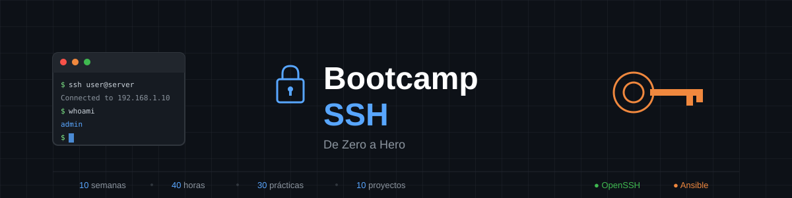

<div align="center">



[](https://www.openssh.com/)
[](/)
[](/)
[](/)
[](LICENSE)

**El bootcamp definitivo para dominar SSH desde cero hasta nivel profesional**

[🚀 Comenzar](#-inicio-rápido) •
[📚 Contenido](#-contenido-del-bootcamp) •
[💻 Requisitos](#-requisitos) •
[📖 Recursos](#-recursos)

</div>

---

## 🎯 ¿Qué es este Bootcamp?

Este es un **bootcamp profesional de SSH** diseñado para administradores de sistemas y desarrolladores que quieren dominar la conexión remota segura. En **10 semanas** y **40 horas** de contenido práctico, pasarás de no saber qué es SSH a implementar infraestructuras empresariales completas.

### ¿Por qué SSH es fundamental?

SSH (Secure Shell) es **el estándar de facto** para:

- 🖥️ **Acceso remoto seguro** a servidores Linux/Unix
- 📁 **Transferencia segura** de archivos (SCP, SFTP, rsync)
- 🔒 **Túneles cifrados** para proteger comunicaciones
- 🤖 **Automatización** con Ansible y scripts
- ☁️ **Gestión de infraestructura cloud** (AWS, GCP, Azure)

> _"Si trabajas con servidores, SSH no es opcional. Es tu herramienta de supervivencia."_

---

## 📊 Estructura del Bootcamp

| Parámetro              | Valor               |
| ---------------------- | ------------------- |
| 📅 **Duración**        | 10 semanas          |
| ⏱️ **Horas semanales** | 4 horas             |
| 📚 **Total horas**     | 40 horas            |
| 📖 **Teoría**          | 25% (1h/semana)     |
| 💻 **Prácticas**       | 37.5% (1.5h/semana) |
| 🔨 **Proyectos**       | 37.5% (1.5h/semana) |

### Metodología

```
┌─────────────────────────────────────────────────────────┐
│  📖 TELL (1h)    →    💻 DO (1.5h)    →    🔨 APPLY (1.5h)  │
│  3 módulos           3 prácticas           1 proyecto       │
│  teóricos            progresivas           integrador       │
└─────────────────────────────────────────────────────────┘
```

---

## 📚 Contenido del Bootcamp

### Fase 1: Fundamentos (Semanas 1-2)

| Semana | Tema                                                         | Objetivo                                      |
| ------ | ------------------------------------------------------------ | --------------------------------------------- |
| **01** | [Fundamentos de SSH y Primera Conexión](bootcamp/week-01-fundamentos_ssh_y_primera_conexion/) | Comprender SSH y realizar tu primera conexión |
| **02** | [Autenticación con Llaves SSH](bootcamp/week-02-autenticacion_con_llaves_ssh/)          | Dominar criptografía de llave pública/privada |

### Fase 2: Configuración Cliente (Semanas 3-4)

| Semana | Tema                                                      | Objetivo                                 |
| ------ | --------------------------------------------------------- | ---------------------------------------- |
| **03** | [Configuración Avanzada del Cliente](bootcamp/week-03-configuracion_avanzada_cliente_ssh/) | Optimizar `~/.ssh/config` y multiplexing |
| **04** | [Transferencia de Archivos](bootcamp/week-04-transferencia_archivos_scp_sftp_rsync/)          | Dominar SCP, SFTP y rsync                |

### Fase 3: Servidor y Seguridad (Semana 5)

| Semana | Tema                                                  | Objetivo                             |
| ------ | ----------------------------------------------------- | ------------------------------------ |
| **05** | [Configuración del Servidor SSH](bootcamp/week-05-configuracion_servidor_ssh/) | Endurecer seguridad de `sshd_config` |

### Fase 4: Funcionalidades Avanzadas (Semanas 6-7)

| Semana | Tema                                                 | Objetivo                                  |
| ------ | ---------------------------------------------------- | ----------------------------------------- |
| **06** | [Port Forwarding y Túneles](bootcamp/week-06-port_forwarding_y_tuneles/)     | Crear túneles seguros entre redes         |
| **07** | [SSH Agent y Gestión de Llaves](bootcamp/week-07-ssh_agent_y_gestion_llaves/) | Gestionar múltiples llaves eficientemente |

### Fase 5: Arquitecturas y Automatización (Semanas 8-9)

| Semana | Tema                                                    | Objetivo                                |
| ------ | ------------------------------------------------------- | --------------------------------------- |
| **08** | [Bastion Hosts y Arquitecturas](bootcamp/week-08-bastion_hosts_y_arquitecturas/)    | Implementar servidores de salto seguros |
| **09** | [Automatización con SSH y Ansible](bootcamp/week-09-automatizacion_ssh_y_ansible/) | Automatizar tareas administrativas      |

### Fase 6: Seguridad Empresarial (Semana 10)

| Semana | Tema                                                  | Objetivo                                  |
| ------ | ----------------------------------------------------- | ----------------------------------------- |
| **10** | [Seguridad Avanzada y Auditoría](bootcamp/week-10-seguridad_avanzada_y_auditoria/) | 2FA, fail2ban y proyecto final integrador |

---

## 🚀 Inicio Rápido

### 1. Clona el repositorio

```bash
git clone https://github.com/ergrato-dev/bc-ssh.git
cd bc-ssh
```

### 2. Verifica que tienes SSH instalado

```bash
# Linux/macOS
ssh -V

# Windows (PowerShell)
ssh -V
```

### 3. Comienza con la Semana 1

```bash
cd bootcamp/week-01-fundamentos_ssh_y_primera_conexion
cat README.md
```

---

## 💻 Requisitos

### Software Necesario

| Herramienta         | Descripción          | Instalación                         |
| ------------------- | -------------------- | ----------------------------------- |
| **OpenSSH Client**  | Cliente SSH          | Incluido en Linux/macOS/Windows 10+ |
| **Terminal**        | Emulador de terminal | iTerm2, Windows Terminal, Alacritty |
| **Editor de texto** | Para configuraciones | VS Code, Vim, Nano                  |

### Servidor de Práctica

Necesitarás acceso a un servidor SSH. Opciones:

| Opción                  | Costo  | Recomendación                     |
| ----------------------- | ------ | --------------------------------- |
| **DigitalOcean**        | $6/mes | ⭐ Recomendado para principiantes |
| **Linode**              | $5/mes | Buena alternativa                 |
| **VirtualBox + Ubuntu** | Gratis | Para práctica local               |
| **Docker**              | Gratis | Contenedores con SSH              |

### Conocimientos Previos

- ✅ Nociones básicas de línea de comandos
- ✅ Comprensión general de redes (IP, puertos)
- ❌ **NO** se requiere experiencia previa con SSH

---

## 📁 Estructura del Repositorio

```
bc-ssh/
├── 📄 README.md                 # Este archivo
├── 📄 LICENSE                   # Licencia MIT
├── 📁 _assets/                  # Recursos gráficos
├── 📁 _docs/                    # Documentación del proyecto
├── 📁 _scripts/                 # Scripts de automatización
│
└── 📁 bootcamp/                 # 📚 Contenido del bootcamp
    ├── 📁 week-01-fundamentos_ssh_y_primera_conexion/            # Fundamentos y primera conexión
    ├── 📁 week-02-autenticacion_con_llaves_ssh/            # Autenticación con llaves
    ├── 📁 week-03-configuracion_avanzada_cliente_ssh/            # Configuración avanzada cliente
    ├── 📁 week-04-transferencia_archivos_scp_sftp_rsync/            # Transferencia de archivos
    ├── 📁 week-05-configuracion_servidor_ssh/            # Configuración servidor
    ├── 📁 week-06-port_forwarding_y_tuneles/            # Port forwarding y túneles
    ├── 📁 week-07-ssh_agent_y_gestion_llaves/            # SSH Agent
    ├── 📁 week-08-bastion_hosts_y_arquitecturas/            # Bastion hosts
    ├── 📁 week-09-automatizacion_ssh_y_ansible/            # Automatización y Ansible
    └── 📁 week-10-seguridad_avanzada_y_auditoria/            # Seguridad avanzada + Proyecto Final
```

### Estructura de cada Semana

```
week-XX-tema_principal/
├── README.md                    # Índice de la semana
├── RUBRICA-EVALUACION.md        # Criterios (100 pts)
├── 0-assets/                    # Diagramas SVG
├── 1-teoria/                    # 3 módulos teóricos
├── 2-practicas/                 # 3 prácticas progresivas
├── 3-proyecto/                  # Proyecto integrador
├── 4-recursos/                  # Material complementario
└── 5-glosario/                  # Terminología SSH
```

---

## 📊 Sistema de Evaluación

### Distribución Semanal (100 pts)

| Componente   | Peso | Puntos          |
| ------------ | ---- | --------------- |
| 📖 Teoría    | 20%  | 20 pts          |
| 💻 Prácticas | 30%  | 30 pts (10 c/u) |
| 🔨 Proyecto  | 50%  | 50 pts          |

### Escala de Calificación

| Rango  | Nivel           | Descripción          |
| ------ | --------------- | -------------------- |
| 90-100 | 🏆 Excelente    | Dominio completo     |
| 80-89  | 🌟 Muy Bueno    | Todos los requisitos |
| 70-79  | ✅ Bueno        | Requisitos básicos   |
| 60-69  | ⚠️ Suficiente   | Mínimos con errores  |
| 0-59   | ❌ Insuficiente | No cumple mínimos    |

---

## 📖 Recursos

### Documentación Oficial

- 📚 [OpenSSH Manual](https://www.openssh.com/manual.html)
- 📚 [SSH Protocol RFC 4251](https://www.rfc-editor.org/rfc/rfc4251.html)
- 📚 [SSH Academy](https://www.ssh.com/academy/ssh)

### Comunidades

- 💬 [r/sysadmin](https://reddit.com/r/sysadmin) - Reddit
- 💬 [ServerFault](https://serverfault.com/) - Stack Exchange

### Canales YouTube Recomendados

- 🎬 [NetworkChuck](https://www.youtube.com/@NetworkChuck) - Tutoriales SSH
- 🎬 [Learn Linux TV](https://www.youtube.com/@LearnLinuxTV) - Administración Linux
- 🎬 [TechWorld with Nana](https://www.youtube.com/@TechWorldwithNana) - DevOps
- 🎬 [Jeff Geerling](https://www.youtube.com/@JeffGeerling) - Ansible

---

## 🤝 Contribuir

¿Encontraste un error? ¿Tienes una sugerencia? ¡Las contribuciones son bienvenidas!

1. Fork el repositorio
2. Crea una rama (`git checkout -b feature/mejora`)
3. Commit tus cambios (`git commit -m 'feat: nueva funcionalidad'`)
4. Push a la rama (`git push origin feature/mejora`)
5. Abre un Pull Request

---

## 📄 Licencia

Este proyecto está bajo la Licencia MIT. Ver [LICENSE](LICENSE) para más detalles.

---

<div align="center">

**🔐 Bootcamp SSH: De Zero a Hero**

Diseñado con ❤️ para la comunidad de administradores de sistemas

[](https://github.com/ergrato-dev/bc-ssh)
[](https://github.com/ergrato-dev/bc-ssh)

_10 semanas • 40 horas • De principiante a experto_

</div>
