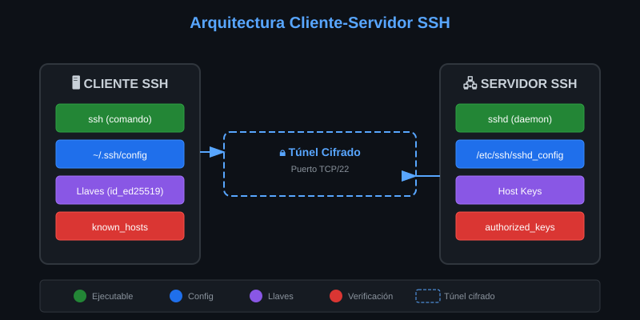
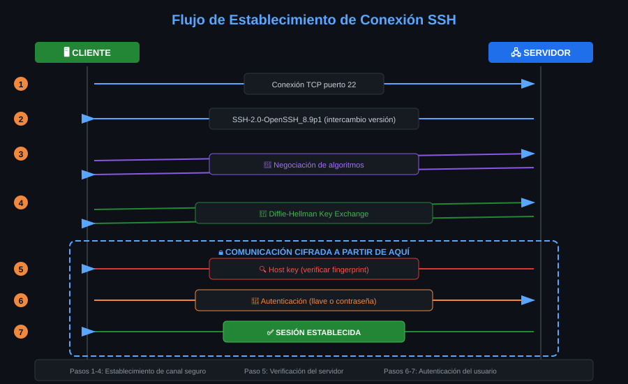
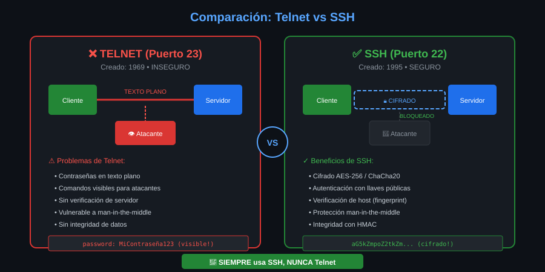
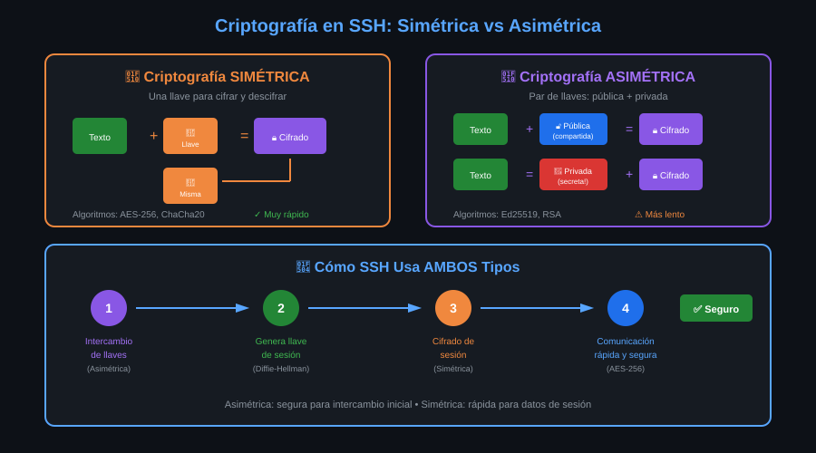

# 🎨 Assets - Semana 01


---

## 📁 Diagramas Disponibles

| #   | Archivo                                                        | Descripción                          | Usado en                                                     |
| --- | -------------------------------------------------------------- | ------------------------------------ | ------------------------------------------------------------ |
| 01  | [01-arquitectura-ssh.svg](01-arquitectura-ssh.svg)             | Arquitectura cliente-servidor SSH    | [Módulo 02](../1-teoria/02-arquitectura-cliente-servidor.md) |
| 02  | [02-flujo-conexion.svg](02-flujo-conexion.svg)                 | Flujo de establecimiento de conexión | [Módulo 02](../1-teoria/02-arquitectura-cliente-servidor.md) |
| 03  | [03-comparacion-telnet-ssh.svg](03-comparacion-telnet-ssh.svg) | Comparación visual Telnet vs SSH     | [Módulo 01](../1-teoria/01-historia-evolucion-ssh.md)        |
| 04  | [04-criptografia-ssh.svg](04-criptografia-ssh.svg)             | Criptografía simétrica vs asimétrica | [Módulo 03](../1-teoria/03-criptografia-basica.md)           |

---

## 📊 Previsualizaciones

### 01 - Arquitectura SSH

Muestra los componentes del cliente y servidor SSH y cómo se conectan.



---

### 02 - Flujo de Conexión

Diagrama de secuencia con los 7 pasos del handshake SSH.



---

### 03 - Telnet vs SSH

Comparación visual de por qué SSH reemplazó a Telnet.



---

### 04 - Criptografía en SSH

Explica la diferencia entre cifrado simétrico y asimétrico y cómo SSH usa ambos.



---

## 🎨 Especificaciones de Diseño

| Propiedad           | Valor                                                 |
| ------------------- | ----------------------------------------------------- |
| Tema                | Dark (GitHub)                                         |
| Fondo               | `#0d1117`                                             |
| Fuente              | Arial, sans-serif                                     |
| Colores principales | `#58a6ff` (azul), `#238636` (verde), `#da3633` (rojo) |
| Formato             | SVG vectorial                                         |
| Sin gradientes      | ✅                                                    |

---

## 📝 Cómo Usar los Diagramas

### En Markdown

```markdown

```

### En HTML (para más control)

```html
<div align="center">
  
</div>
```

---

<div align="center">

[⬅️ Volver a Semana 01](../README.md)

</div>
