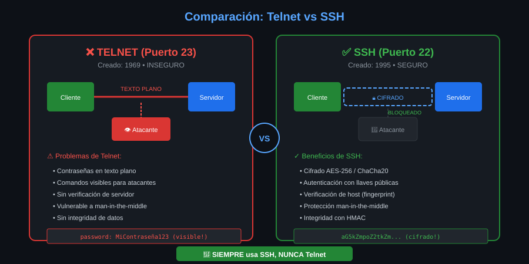

# 📚 Módulo 01: Historia y Evolución de SSH


> _"La necesidad de seguridad creó SSH. Un ataque de sniffing en una universidad finlandesa cambió para siempre la forma en que nos conectamos a servidores remotos."_

---

## 🎯 Objetivos del Módulo

Al finalizar este módulo, serás capaz de:

- [ ] Explicar por qué SSH fue creado y qué problema resuelve
- [ ] Identificar las diferencias críticas entre Telnet y SSH
- [ ] Comprender el contexto histórico y la evolución del protocolo
- [ ] Reconocer por qué OpenSSH es el estándar actual

---

## 📊 Diagrama: Telnet vs SSH



---

## 📋 Contenido

### 1.1 La Era del Acceso Remoto Inseguro

#### Los Primeros Días de las Redes

En los años 60 y 70, las redes de computadoras eran pequeñas y **confiables por defecto**. Los usuarios dentro de una universidad o empresa se conocían entre sí, y la idea de que alguien interceptara comunicaciones era casi impensable.

#### Telnet: El Primer Acceso Remoto (1969)

**Telnet** (Teletype Network) fue creado en 1969 como parte de ARPANET. Permitía a los usuarios conectarse a computadoras remotas como si estuvieran sentados frente a ellas.

```bash
# Así se conectaba con Telnet (NO USAR - inseguro)
telnet servidor.ejemplo.com 23
```

**El problema fatal de Telnet:**

| Aspecto | Telnet | Consecuencia |
|---------|--------|--------------|
| Contraseñas | Texto plano | Cualquiera en la red puede verlas |
| Comandos | Sin cifrar | Todo lo que escribes es visible |
| Autenticación | Solo contraseña | Sin verificación del servidor |
| Integridad | Ninguna | Los datos pueden ser modificados |

#### Otros Protocolos Inseguros de la Época

- **rsh** (Remote Shell): Ejecutar comandos remotos sin cifrado
- **rlogin** (Remote Login): Login remoto basado en confianza
- **rcp** (Remote Copy): Copiar archivos sin protección
- **FTP** (File Transfer Protocol): Transferencia con credenciales en texto plano

> ⚠️ **Importante**: Todos estos protocolos siguen existiendo, pero **NUNCA** deben usarse en redes no confiables. SSH los reemplaza completamente.

---

### 1.2 El Nacimiento de SSH

#### El Incidente que Cambió Todo (1995)

En **1995**, Tatu Ylönen era investigador en la Universidad Tecnológica de Helsinki, Finlandia. Un día, la red de la universidad sufrió un **ataque de sniffing** (captura de paquetes de red).

Los atacantes capturaron:
- Miles de nombres de usuario
- Miles de contraseñas
- Credenciales de acceso a sistemas críticos

#### La Solución de Tatu Ylönen

En solo **tres meses**, Tatu desarrolló la primera versión de SSH (Secure Shell). Lo publicó como **software libre** en julio de 1995.

```
Julio 1995: SSH 1.0 publicado
            ↓
        Adopción explosiva
            ↓
Diciembre 1995: 20,000+ usuarios en 50 países
```

#### Principios Fundamentales de SSH

Tatu diseñó SSH con tres pilares:

1. **Confidencialidad**: Nadie puede leer el tráfico
2. **Integridad**: Nadie puede modificar los datos
3. **Autenticación**: Verificar identidad de usuario Y servidor

---

### 1.3 ¿Qué Hizo Diferente a SSH?

#### Cifrado de Extremo a Extremo

Desde el primer paquete, **todo está cifrado**:

```
TELNET:
Usuario ──── "password123" ────→ Servidor
         (texto plano visible)

SSH:
Usuario ──── "aX7#kL9$mN2..." ────→ Servidor
         (cifrado, ilegible)
```

#### Verificación del Servidor (Host Key)

SSH resuelve el problema de "¿cómo sé que me conecto al servidor correcto?":

```bash
# Primera conexión a un servidor
$ ssh usuario@servidor.com
The authenticity of host 'servidor.com (192.168.1.100)' can't be established.
ED25519 key fingerprint is SHA256:uNiVztksCsDhcc0u9e8BujQXVUpKZIDTMczCvj3tD2s.
Are you sure you want to continue connecting (yes/no/[fingerprint])?
```

Esta huella digital (fingerprint) es **única** para cada servidor. Si alguien intenta hacerse pasar por el servidor, el fingerprint no coincidirá.

#### Autenticación Flexible

SSH ofrece múltiples métodos de autenticación:

| Método | Seguridad | Uso Recomendado |
|--------|-----------|-----------------|
| Contraseña | ⭐⭐ | Solo para pruebas |
| Llave pública | ⭐⭐⭐⭐ | Uso diario |
| Certificados | ⭐⭐⭐⭐⭐ | Entornos empresariales |
| 2FA (TOTP) | ⭐⭐⭐⭐⭐ | Máxima seguridad |

---

### 1.4 La Evolución: SSH-1 → SSH-2 → OpenSSH

#### SSH-1 (1995-1996)

La primera versión tenía algunas vulnerabilidades:

- Problemas de integridad en el cifrado
- Posibles ataques de inserción de datos
- Algoritmos criptográficos limitados

#### SSH-2 (1996-2006)

Una reescritura completa que solucionó los problemas:

```
SSH-2 Mejoras:
├── Nuevo protocolo de intercambio de llaves (Diffie-Hellman)
├── Mejor integridad (HMAC)
├── Separación de autenticación, conexión y transporte
└── Soporte para múltiples canales en una conexión
```

> 📌 **SSH-2 es el protocolo actual**. SSH-1 está obsoleto y no debe usarse.

#### OpenSSH (1999-Presente)

En 1999, el equipo de **OpenBSD** creó OpenSSH, una implementación completamente libre de SSH-2.

**¿Por qué OpenSSH ganó?**

| Característica | OpenSSH |
|----------------|---------|
| Licencia | BSD (muy permisiva) |
| Código | Abierto y auditado |
| Seguridad | Prioridad #1 del proyecto |
| Portabilidad | Funciona en casi cualquier sistema |
| Adopción | 90%+ de servidores en Internet |

```bash
# Verificar tu versión de OpenSSH
ssh -V
# Ejemplo de salida: OpenSSH_8.9p1 Ubuntu-3ubuntu0.1, OpenSSL 3.0.2
```

#### Línea de Tiempo Completa

```
1969 ─── Telnet creado (ARPANET)
  │
1983 ─── rsh, rlogin (BSD Unix)
  │
1995 ─── SSH 1.0 (Tatu Ylönen, Finlandia)
  │         └── Respuesta a ataque de sniffing
  │
1996 ─── SSH 2.0 (Protocolo mejorado)
  │         └── Reescritura completa, más seguro
  │
1999 ─── OpenSSH 1.0 (Proyecto OpenBSD)
  │         └── Implementación libre y abierta
  │
2006 ─── SSH-2 se convierte en estándar IETF (RFC 4251-4256)
  │
2014 ─── OpenSSH añade soporte Ed25519
  │         └── Criptografía de curva elíptica moderna
  │
2019 ─── OpenSSH depreca SHA-1
  │
2023 ─── OpenSSH 9.x con mejoras de seguridad
  │
Hoy ──── OpenSSH es el estándar universal
```

---

## 💡 Puntos Clave para Recordar

1. **Telnet transmite todo en texto plano** - nunca lo uses
2. **SSH fue creado en respuesta a un ataque real** en 1995
3. **SSH-2 es el protocolo actual** - SSH-1 está obsoleto
4. **OpenSSH es la implementación estándar** usada en el 90%+ de servidores
5. **Los tres pilares de SSH**: Confidencialidad, Integridad, Autenticación

---

## 🧪 Comprueba tu Conocimiento

1. ¿Por qué Telnet es inseguro?
2. ¿Qué evento motivó la creación de SSH?
3. ¿Cuál es la diferencia principal entre SSH-1 y SSH-2?
4. ¿Por qué OpenSSH se convirtió en el estándar?

<details>
<summary>Ver respuestas</summary>

1. Telnet transmite contraseñas y datos en texto plano, visible para cualquiera en la red.
2. Un ataque de sniffing en la Universidad de Helsinki en 1995, donde se capturaron miles de credenciales.
3. SSH-2 es una reescritura completa con mejor criptografía, integridad (HMAC) y arquitectura modular.
4. Licencia BSD permisiva, código abierto auditado, y prioridad absoluta en seguridad.

</details>

---

## 🧭 Navegación

| ⬅️ Anterior | 📚 Índice           | Siguiente ➡️                                        |
| ----------- | ------------------- | --------------------------------------------------- |
| -           | [Teoría](README.md) | [Arquitectura](02-arquitectura-cliente-servidor.md) |
