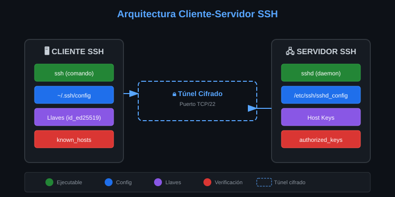
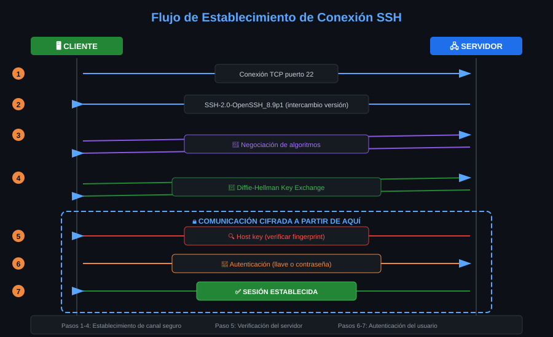

# 📚 Módulo 02: Arquitectura Cliente-Servidor

> TODO: Contenido pendiente de desarrollo

---

## 🎯 Objetivos del Módulo

- Identificar componentes cliente y servidor
- Comprender el flujo de conexión SSH
- Conocer puertos y protocolos

---

## 📊 Diagrama: Arquitectura Cliente-Servidor

---

## 📋 Contenido

### 2.1 Componentes del Sistema SSH

<!-- TODO -->

### 2.2 El Cliente SSH

<!-- TODO -->

### 2.3 El Servidor SSH (sshd)

<!-- TODO -->

### 2.4 Flujo de Conexión

<!-- TODO -->

---

## 🧭 Navegación

| ⬅️ Anterior                              | 📚 Índice           | Siguiente ➡️                              |
| ---------------------------------------- | ------------------- | ----------------------------------------- |
| [Historia](01-historia-evolucion-ssh.md) | [Teoría](README.md) | [Criptografía](03-criptografia-basica.md) |
