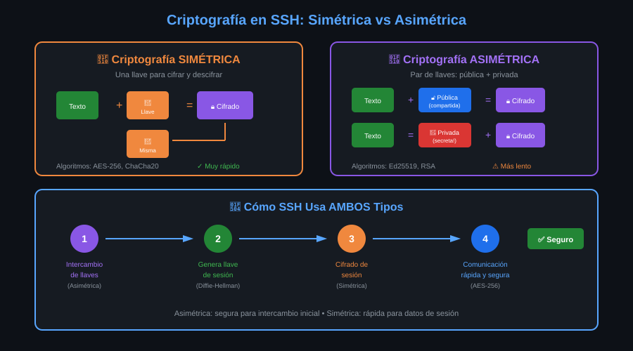

# 📚 Módulo 03: Criptografía Básica


> _"No necesitas ser criptógrafo para usar SSH, pero entender los conceptos básicos te ayudará a tomar mejores decisiones de seguridad y diagnosticar problemas."_

---

## 🎯 Objetivos del Módulo

Al finalizar este módulo, serás capaz de:

- [ ] Diferenciar entre criptografía simétrica y asimétrica
- [ ] Explicar por qué SSH usa ambos tipos de cifrado
- [ ] Comprender el concepto de par de llaves (pública/privada)
- [ ] Identificar los algoritmos más importantes (Ed25519, RSA, AES)

---

## 📊 Diagrama: Criptografía en SSH



---

## 📋 Contenido

### 3.1 ¿Qué es la Criptografía?

#### Definición Simple

La **criptografía** es el arte de transformar información legible en algo ilegible, y viceversa, usando matemáticas.

```
Texto Original          Cifrado           Texto Cifrado
     │                    │                    │
"Hola Mundo"  ────→  [Algoritmo]  ────→  "aX7#kL9$mN2"
     │               + Llave              │
     │                                    │
     └────────── Solo quien tiene ────────┘
                 la llave puede
                 revertir el proceso
```

#### Los Tres Pilares de la Seguridad

SSH usa criptografía para garantizar:

| Pilar                | Significado                     | Cómo SSH lo logra              |
| -------------------- | ------------------------------- | ------------------------------ |
| **Confidencialidad** | Nadie puede leer tus datos      | Cifrado AES-256                |
| **Integridad**       | Nadie puede modificar tus datos | HMAC (códigos de verificación) |
| **Autenticación**    | Verificar identidad             | Llaves públicas/privadas       |

---

### 3.2 Criptografía Simétrica

#### El Concepto

En la criptografía **simétrica**, se usa la **misma llave** para cifrar y descifrar.

```
        ┌─────────────┐
        │  🔑 Llave   │
        │   Secreta   │
        └──────┬──────┘
               │
    ┌──────────┼──────────┐
    │          │          │
    ▼          │          ▼
 Cifrar        │       Descifrar
    │          │          │
    │          │          │
"Hola"  →  "xK7$m"  →  "Hola"
```

#### Analogía del Candado

Imagina un candado con llave:

- Tú y tu amigo tienen **copias de la misma llave**
- Ambos pueden abrir y cerrar el candado
- El problema: ¿Cómo le das la copia a tu amigo de forma segura?

#### Algoritmos Simétricos en SSH

| Algoritmo             | Bits | Estado         | Uso en SSH        |
| --------------------- | ---- | -------------- | ----------------- |
| **AES-256-GCM**       | 256  | ✅ Recomendado | Cifrado de sesión |
| **ChaCha20-Poly1305** | 256  | ✅ Recomendado | Alternativa a AES |
| AES-128-CTR           | 128  | ⚠️ Aceptable   | Legacy            |
| 3DES                  | 168  | ❌ Obsoleto    | No usar           |

#### Ventajas y Desventajas

| ✅ Ventajas                                | ❌ Desventajas                               |
| ------------------------------------------ | -------------------------------------------- |
| Muy rápido                                 | Problema de distribución de llaves           |
| Eficiente para grandes cantidades de datos | Necesitas compartir la llave de forma segura |
| Hardware optimizado (AES-NI)               | Una llave por cada par de comunicación       |

---

### 3.3 Criptografía Asimétrica

#### El Concepto

En la criptografía **asimétrica**, hay **dos llaves diferentes** que trabajan juntas:

```
┌─────────────────┐     ┌─────────────────┐
│   🔓 Llave      │     │   🔐 Llave      │
│    PÚBLICA      │     │    PRIVADA      │
├─────────────────┤     ├─────────────────┤
│ • Puedes        │     │ • NUNCA         │
│   compartirla   │     │   compartirla   │
│ • Está en       │     │ • Solo en tu    │
│   authorized_   │     │   máquina       │
│   keys          │     │ • Protegida     │
│ • Cifra datos   │     │   con permisos  │
│                 │     │ • Descifra      │
│                 │     │   datos         │
└─────────────────┘     └─────────────────┘
        │                       │
        └───────────────────────┘
              Matemáticamente
               relacionadas
```

#### Analogía del Buzón

Imagina un buzón de correo:

- **Llave pública = Ranura del buzón**: Cualquiera puede meter cartas
- **Llave privada = Llave del buzón**: Solo tú puedes abrirlo y leer las cartas

```
Cualquier persona                    Solo tú
      │                                │
      ▼                                ▼
┌──────────┐                    ┌──────────┐
│  Meter   │                    │  Abrir   │
│  carta   │                    │  buzón   │
│ (público)│                    │(privado) │
└──────────┘                    └──────────┘
```

#### ¿Cómo Funcionan Matemáticamente?

Sin entrar en detalles complejos:

1. Las llaves se generan usando **números primos muy grandes** (RSA) o **curvas elípticas** (Ed25519)
2. Lo cifrado con la pública **solo** se puede descifrar con la privada
3. Lo firmado con la privada **solo** se puede verificar con la pública

```
Cifrado:
Mensaje + Llave Pública → Mensaje Cifrado
Mensaje Cifrado + Llave Privada → Mensaje Original

Firma Digital:
Mensaje + Llave Privada → Firma
Mensaje + Firma + Llave Pública → ✅ Verificado o ❌ Inválido
```

#### Algoritmos Asimétricos en SSH

| Algoritmo   | Tipo           | Tamaño Llave | Estado      | Recomendación            |
| ----------- | -------------- | ------------ | ----------- | ------------------------ |
| **Ed25519** | Curva elíptica | 256 bits     | ✅ Mejor    | **Usar siempre**         |
| **RSA**     | Factorización  | 4096 bits    | ✅ Seguro   | Si Ed25519 no disponible |
| ECDSA       | Curva elíptica | 256/384/521  | ⚠️ OK       | Ed25519 es mejor         |
| DSA         | -              | 1024 bits    | ❌ Obsoleto | No usar                  |

#### Ed25519 vs RSA

```bash
# Generar llave Ed25519 (RECOMENDADO)
ssh-keygen -t ed25519 -C "tu@email.com"
# Resultado: archivo de 419 bytes

# Generar llave RSA 4096 bits
ssh-keygen -t rsa -b 4096 -C "tu@email.com"
# Resultado: archivo de 3.2 KB
```

| Característica       | Ed25519    | RSA-4096  |
| -------------------- | ---------- | --------- |
| Seguridad            | ⭐⭐⭐⭐⭐ | ⭐⭐⭐⭐  |
| Velocidad            | ⭐⭐⭐⭐⭐ | ⭐⭐⭐    |
| Tamaño llave         | 256 bits   | 4096 bits |
| Año creación         | 2011       | 1977      |
| Resistente a quantum | Parcial    | No        |

#### Ventajas y Desventajas

| ✅ Ventajas                                     | ❌ Desventajas                  |
| ----------------------------------------------- | ------------------------------- |
| Resuelve el problema de distribución            | Más lento que simétrico         |
| Llave pública puede ser compartida abiertamente | No eficiente para grandes datos |
| Permite firmas digitales                        | Llaves más grandes              |

---

### 3.4 Cómo SSH Usa Ambas

#### La Estrategia Híbrida

SSH combina lo mejor de ambos mundos:

```
┌──────────────────────────────────────────────────────────────┐
│                    CONEXIÓN SSH                              │
├──────────────────────────────────────────────────────────────┤
│                                                              │
│  FASE 1: Intercambio de llaves (ASIMÉTRICA)                 │
│  ────────────────────────────────────────                    │
│  • Diffie-Hellman genera llave de sesión                    │
│  • Host key verifica identidad del servidor                 │
│  • Solo ocurre UNA VEZ al inicio                            │
│                                                              │
│                         ↓                                    │
│                                                              │
│  FASE 2: Cifrado de sesión (SIMÉTRICA)                      │
│  ─────────────────────────────────────                       │
│  • AES-256 cifra TODO el tráfico                            │
│  • Usa la llave generada en Fase 1                          │
│  • Rápido y eficiente para toda la sesión                   │
│                                                              │
└──────────────────────────────────────────────────────────────┘
```

#### ¿Por Qué Esta Combinación?

| Problema                                           | Solución SSH                        |
| -------------------------------------------------- | ----------------------------------- |
| Simétrica es rápida pero ¿cómo compartir la llave? | Asimétrica para intercambio inicial |
| Asimétrica es segura pero lenta                    | Solo se usa al inicio               |
| Necesito cifrar mucho tráfico                      | Simétrica para el resto             |

#### Ejemplo Práctico del Flujo

```
1. Cliente se conecta al servidor

2. Diffie-Hellman (Asimétrico):
   Cliente                    Servidor
      │                          │
      │── Valor público A ──────→│
      │←── Valor público B ──────│
      │                          │
   Ambos calculan la MISMA llave de sesión
   sin transmitirla por la red

3. Verificación del Host (Asimétrico):
   Servidor firma un mensaje con su llave privada
   Cliente verifica con la llave pública del servidor

4. Autenticación del Usuario (Asimétrico):
   Cliente demuestra que tiene la llave privada
   correspondiente a una pública en authorized_keys

5. Sesión Cifrada (Simétrico):
   Todo el tráfico se cifra con AES-256
   usando la llave de sesión generada en paso 2

   $ ls -la
   [████████████████] ← Cifrado con AES-256
   $ cat archivo.txt
   [████████████████] ← Cifrado con AES-256
```

#### Ver los Algoritmos en Acción

```bash
# Ver qué algoritmos negocia tu conexión
ssh -vv usuario@servidor 2>&1 | grep -E "kex:|cipher:|MAC:"

# Salida típica:
# debug2: kex: algorithm: curve25519-sha256
# debug2: kex: host key algorithm: ssh-ed25519
# debug2: cipher: aes256-gcm@openssh.com
# debug2: MAC: <implicit>
```

---

## 💡 Puntos Clave para Recordar

1. **Simétrica**: Una llave, rápida, para cifrar datos de sesión (AES-256)
2. **Asimétrica**: Par de llaves, segura, para intercambio inicial (Ed25519)
3. **SSH usa ambas**: Asimétrica al inicio, simétrica para el resto
4. **Ed25519 es el mejor algoritmo actual** para llaves SSH
5. **La llave privada NUNCA se comparte** - solo la pública
6. **Diffie-Hellman** permite acordar una llave sin transmitirla

---

## 🔢 Resumen de Algoritmos

### Para tus Llaves (Asimétricos)

```bash
# ✅ MEJOR OPCIÓN
ssh-keygen -t ed25519

# ✅ ALTERNATIVA SEGURA
ssh-keygen -t rsa -b 4096

# ❌ NO USAR
ssh-keygen -t dsa        # Obsoleto
ssh-keygen -t rsa -b 1024  # Muy débil
```

### Para Cifrado de Sesión (Simétricos)

| Prioridad | Algoritmo                     |
| --------- | ----------------------------- |
| 1️⃣        | chacha20-poly1305@openssh.com |
| 2️⃣        | aes256-gcm@openssh.com        |
| 3️⃣        | aes128-gcm@openssh.com        |

---

## 🧪 Comprueba tu Conocimiento

1. ¿Cuál es la diferencia entre criptografía simétrica y asimétrica?
2. ¿Por qué SSH usa ambos tipos?
3. ¿Qué algoritmo deberías usar para generar tus llaves SSH?
4. ¿Puedes compartir tu llave pública? ¿Y la privada?
5. ¿Qué algoritmo se usa para cifrar el tráfico de la sesión?

<details>
<summary>Ver respuestas</summary>

1. **Simétrica** usa una llave para cifrar y descifrar. **Asimétrica** usa un par de llaves (pública/privada).
2. Asimétrica para intercambiar llaves de forma segura al inicio; simétrica para cifrar el tráfico de forma eficiente.
3. **Ed25519** - es el más moderno, seguro y eficiente.
4. La pública SÍ puedes compartirla (va en `authorized_keys`). La privada NUNCA se comparte.
5. **AES-256** o **ChaCha20** - algoritmos simétricos rápidos.

</details>

---

## 🧭 Navegación

| ⬅️ Anterior                                         | 📚 Índice           | Siguiente ➡️                 |
| --------------------------------------------------- | ------------------- | ---------------------------- |
| [Arquitectura](02-arquitectura-cliente-servidor.md) | [Teoría](README.md) | [Prácticas](../2-practicas/) |
