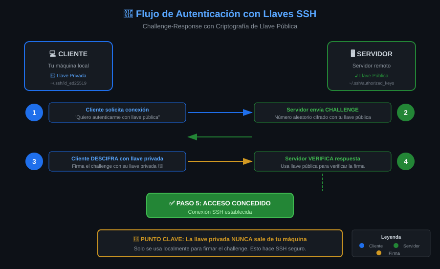

# 📚 Módulo 01: Contraseña vs Llaves SSH


> _"Las contraseñas son como cerraduras que cualquiera puede intentar abrir. Las llaves SSH son como huellas digitales únicas que solo tú posees."_

---

## 🎯 Objetivos del Módulo

Al finalizar este módulo, serás capaz de:

- [ ] Explicar las debilidades de la autenticación por contraseña
- [ ] Describir las ventajas de la autenticación por llaves
- [ ] Entender el flujo de autenticación con llaves públicas
- [ ] Justificar por qué las llaves son el estándar de la industria

---

## 📊 Diagrama: Flujo de Autenticación



---

## 📋 Contenido

### 1.1 Autenticación por Contraseña: El Problema

#### ¿Cómo Funciona?

```
Cliente                          Servidor
   │                                │
   │── "Quiero conectar" ──────────→│
   │                                │
   │←── "Dame tu contraseña" ───────│
   │                                │
   │── "MiPassword123" ────────────→│  ← ¡Viaja por la red!
   │                                │
   │   Servidor compara con        │
   │   /etc/shadow                 │
   │                                │
   │←── "OK, bienvenido" ───────────│
```

#### Problemas de las Contraseñas

| Problema             | Descripción                            | Riesgo   |
| -------------------- | -------------------------------------- | -------- |
| **Brute Force**      | Atacantes prueban miles de contraseñas | 🔴 Alto  |
| **Diccionario**      | Usan listas de contraseñas comunes     | 🔴 Alto  |
| **Reutilización**    | Usuarios usan la misma contraseña      | 🔴 Alto  |
| **Phishing**         | Engaño para revelar credenciales       | 🟠 Medio |
| **Keyloggers**       | Malware captura lo que escribes        | 🟠 Medio |
| **Shoulder Surfing** | Alguien mira mientras escribes         | 🟡 Bajo  |

#### Estadísticas Alarmantes

```
🔓 Ataques SSH por hora en un servidor público típico:

   ████████████████████████████ 10,000+ intentos/hora

   Contraseñas más probadas:
   1. root / root
   2. admin / admin
   3. root / 123456
   4. root / password
   5. user / user
```

#### El Ataque de Fuerza Bruta en Acción

```bash
# Así se ve un ataque en /var/log/auth.log:
Nov 28 10:15:01 server sshd: Failed password for root from 185.234.xx.xx
Nov 28 10:15:02 server sshd: Failed password for root from 185.234.xx.xx
Nov 28 10:15:03 server sshd: Failed password for root from 185.234.xx.xx
Nov 28 10:15:04 server sshd: Failed password for admin from 185.234.xx.xx
Nov 28 10:15:05 server sshd: Failed password for admin from 185.234.xx.xx
# ... miles de intentos más
```

---

### 1.2 Autenticación por Llaves: La Solución

#### ¿Cómo Funciona?

```
Cliente                          Servidor
   │                                │
   │ Tiene: llave PRIVADA          │ Tiene: llave PÚBLICA
   │ (id_ed25519)                  │ (authorized_keys)
   │                                │
   │── "Quiero conectar" ──────────→│
   │                                │
   │←── Challenge (número random) ──│
   │                                │
   │   Cliente FIRMA el challenge  │
   │   con su llave privada        │
   │                                │
   │── Firma ─────────────────────→│
   │                                │
   │   Servidor VERIFICA la firma  │
   │   con la llave pública        │
   │                                │
   │←── "OK, firma válida" ─────────│

✅ La llave privada NUNCA viaja por la red
```

#### ¿Por Qué Es Más Seguro?

1. **La llave privada nunca se transmite**

   - Solo se usa localmente para firmar
   - No hay nada que interceptar

2. **Criptografía asimétrica**

   - Imposible derivar la privada desde la pública
   - Matemáticamente seguro

3. **Sin brute force posible**

   - No hay contraseña que adivinar
   - El espacio de llaves es astronómico

4. **Resistente a ataques de red**
   - MITM no puede obtener la llave
   - Replay attacks no funcionan

#### Comparación de Seguridad

```
Contraseña "P@ssw0rd123":
┌────────────────────────────────────────┐
│ Espacio de búsqueda: ~10^15 (1 cuadrillón)
│ Tiempo para crackear: Horas a días
│ Método: GPU + diccionarios
└────────────────────────────────────────┘

Llave Ed25519 (256 bits):
┌────────────────────────────────────────┐
│ Espacio de búsqueda: 2^256
│ = 115,792,089,237,316,195,423,570,985,
│   008,687,907,853,269,984,665,640,564,
│   039,457,584,007,913,129,639,936
│ Tiempo para crackear: Más que la edad del universo
│ Método: No existe método viable
└────────────────────────────────────────┘
```

---

### 1.3 Ventajas Prácticas de las Llaves

#### Para el Usuario

| Ventaja                      | Descripción                                 |
| ---------------------------- | ------------------------------------------- |
| **Sin escribir contraseñas** | Conexión con un solo comando                |
| **Múltiples servidores**     | Una llave para todos (o llaves específicas) |
| **Automatización**           | Scripts pueden conectar sin intervención    |
| **Passphrase opcional**      | Capa extra de seguridad local               |

#### Para el Administrador

| Ventaja                            | Descripción                       |
| ---------------------------------- | --------------------------------- |
| **Sin gestión de contraseñas**     | No hay que rotar contraseñas      |
| **Auditoría clara**                | Saber qué llave accedió           |
| **Revocación fácil**               | Eliminar línea de authorized_keys |
| **Puede deshabilitar contraseñas** | `PasswordAuthentication no`       |

#### Ejemplo de Uso Diario

```bash
# CON CONTRASEÑA (tedioso):
$ ssh admin@servidor1.com
Password: ********
$ exit
$ ssh admin@servidor2.com
Password: ********
$ exit
$ ssh admin@servidor3.com
Password: ********

# CON LLAVES (eficiente):
$ ssh servidor1
Welcome to servidor1!
$ exit
$ ssh servidor2
Welcome to servidor2!
$ exit
$ ssh servidor3
Welcome to servidor3!
```

---

### 1.4 El Flujo Completo de Autenticación

#### Paso a Paso Detallado

```
1. PREPARACIÓN (una sola vez)
   ─────────────────────────
   Cliente genera par de llaves:
   $ ssh-keygen -t ed25519

   Resultado:
   ~/.ssh/id_ed25519      (privada - SECRETA)
   ~/.ssh/id_ed25519.pub  (pública - compartir)

2. DESPLIEGUE (una sola vez por servidor)
   ──────────────────────────────────────
   Cliente copia llave pública al servidor:
   $ ssh-copy-id usuario@servidor

   Resultado en servidor:
   ~/.ssh/authorized_keys contiene la llave pública

3. CONEXIÓN (cada vez que conectas)
   ─────────────────────────────────
   a) Cliente inicia conexión
   b) Servidor envía challenge aleatorio
   c) Cliente firma challenge con llave privada
   d) Servidor verifica firma con llave pública
   e) Si coincide → acceso concedido
```

#### El Challenge-Response en Detalle

```
                    CHALLENGE-RESPONSE

Servidor genera número aleatorio: 7a3f9c2e8b...
                         │
                         ▼
            ┌────────────────────────┐
            │   Envía al cliente     │
            └────────────────────────┘
                         │
                         ▼
Cliente recibe: 7a3f9c2e8b...
                         │
    Firma con llave privada
                         │
                         ▼
Firma: x9k2m4p7q1... (única para este challenge)
                         │
                         ▼
            ┌────────────────────────┐
            │   Envía al servidor    │
            └────────────────────────┘
                         │
                         ▼
Servidor verifica con llave pública:
┌─────────────────────────────────────────┐
│ ¿Firma válida para challenge 7a3f9c2e8b?│
│                                         │
│ ✅ SÍ → Acceso concedido               │
│ ❌ NO → Acceso denegado                │
└─────────────────────────────────────────┘
```

---

### 1.5 Cuándo Usar Cada Método

#### Usar Contraseñas Cuando:

- ⚠️ Primera conexión a un servidor nuevo (antes de copiar llave)
- ⚠️ Acceso de emergencia desde máquina desconocida
- ⚠️ Entornos de prueba temporales

#### Usar Llaves Cuando:

- ✅ **Siempre** para servidores de producción
- ✅ Acceso a servicios como GitHub, GitLab, AWS
- ✅ Automatización y scripts
- ✅ Acceso regular a cualquier servidor

#### La Recomendación Profesional

```bash
# En /etc/ssh/sshd_config del servidor:

# Deshabilitar autenticación por contraseña
PasswordAuthentication no

# Permitir solo llaves públicas
PubkeyAuthentication yes

# Deshabilitar acceso root directo
PermitRootLogin prohibit-password

# Resultado: Solo llaves, máxima seguridad
```

---

## 💡 Puntos Clave para Recordar

1. **Contraseñas viajan por la red** → Pueden ser interceptadas
2. **Llaves privadas nunca viajan** → Imposible interceptar
3. **Brute force no funciona con llaves** → Espacio de búsqueda infinito
4. **Una llave para muchos servidores** → Gestión simplificada
5. **El estándar es deshabilitar contraseñas** → Mejor práctica de seguridad

---

## 🧪 Comprueba tu Conocimiento

1. ¿Por qué las contraseñas son vulnerables a ataques de fuerza bruta?
2. ¿Qué se transmite por la red durante la autenticación por llaves?
3. ¿Dónde se almacena la llave pública en el servidor?
4. ¿Por qué es imposible derivar la llave privada desde la pública?
5. ¿Cuál es la configuración recomendada para servidores de producción?

<details>
<summary>Ver respuestas</summary>

1. Porque el espacio de búsqueda es limitado (10^15) y puede probarse con GPUs modernas.
2. Solo la firma del challenge, nunca la llave privada.
3. En `~/.ssh/authorized_keys` del usuario en el servidor.
4. Por las propiedades matemáticas de la criptografía asimétrica (números primos grandes o curvas elípticas).
5. `PasswordAuthentication no` + `PubkeyAuthentication yes` + `PermitRootLogin prohibit-password`

</details>

---

## 🧭 Navegación

| ⬅️ Anterior | 📚 Índice           | Siguiente ➡️                                    |
| ----------- | ------------------- | ----------------------------------------------- |
| -           | [Teoría](README.md) | [Algoritmos de Llaves](02-algoritmos-llaves.md) |
