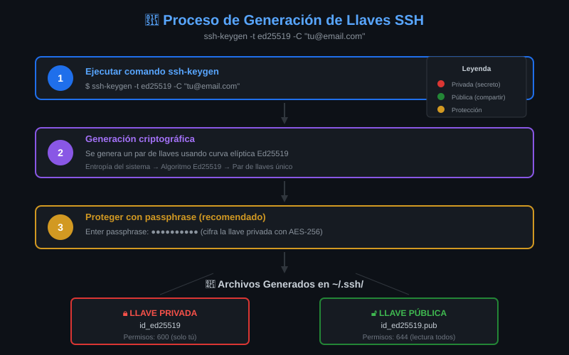

# 📚 Módulo 02: Algoritmos de Llaves SSH


> _"Elegir el algoritmo correcto es como elegir el candado correcto: no todos ofrecen la misma seguridad ni eficiencia."_

---

## 🎯 Objetivos del Módulo

Al finalizar este módulo, serás capaz de:

- [ ] Identificar los principales algoritmos de llaves SSH
- [ ] Explicar las diferencias entre RSA, Ed25519 y ECDSA
- [ ] Elegir el algoritmo adecuado para cada situación
- [ ] Entender por qué Ed25519 es la recomendación actual

---

## 📊 Diagrama: Comparación de Algoritmos



---

## 📋 Contenido

### 2.1 Resumen de Algoritmos

#### Comparativa Rápida

| Algoritmo   | Año  | Tipo               | Tamaño Llave | Seguridad  | Velocidad  | Recomendación               |
| ----------- | ---- | ------------------ | ------------ | ---------- | ---------- | --------------------------- |
| **Ed25519** | 2011 | Curva elíptica     | 256 bits     | ⭐⭐⭐⭐⭐ | ⭐⭐⭐⭐⭐ | 🏆 **Usar siempre**         |
| **RSA**     | 1977 | Factorización      | 4096 bits    | ⭐⭐⭐⭐   | ⭐⭐⭐     | ✅ Si Ed25519 no disponible |
| **ECDSA**   | 2005 | Curva elíptica     | 256-521 bits | ⭐⭐⭐⭐   | ⭐⭐⭐⭐   | ⚠️ Ed25519 es mejor         |
| **DSA**     | 1991 | Logaritmo discreto | 1024 bits    | ⭐⭐       | ⭐⭐⭐     | ❌ **Obsoleto**             |

#### Comando de Generación por Algoritmo

```bash
# Ed25519 (RECOMENDADO)
ssh-keygen -t ed25519 -C "tu@email.com"

# RSA 4096 bits (alternativa segura)
ssh-keygen -t rsa -b 4096 -C "tu@email.com"

# ECDSA 521 bits (aceptable)
ssh-keygen -t ecdsa -b 521 -C "tu@email.com"

# DSA (NO USAR - obsoleto)
# ssh-keygen -t dsa  ← No hagas esto
```

---

### 2.2 Ed25519: El Estándar Moderno

#### ¿Qué es Ed25519?

Ed25519 es un algoritmo de firma digital basado en la **curva elíptica Curve25519**, diseñado por Daniel J. Bernstein en 2011.

```
Ed25519 = Edwards-curve Digital Signature Algorithm
          usando Curve25519

Nombre completo: Ed25519-SHA-512
```

#### Características Técnicas

| Propiedad             | Valor               |
| --------------------- | ------------------- |
| Tamaño llave privada  | 32 bytes (256 bits) |
| Tamaño llave pública  | 32 bytes (256 bits) |
| Tamaño firma          | 64 bytes            |
| Seguridad equivalente | RSA ~3000 bits      |
| Operación matemática  | Curva elíptica      |

#### Ventajas de Ed25519

```
✅ SEGURIDAD
   ├── Diseño moderno resistente a ataques conocidos
   ├── Sin problemas de implementación de ECDSA
   └── Firma determinística (no necesita random seguro)

✅ RENDIMIENTO
   ├── Generación de llaves: ~20x más rápido que RSA
   ├── Firma: ~30x más rápido que RSA-4096
   └── Verificación: ~15x más rápido que RSA-4096

✅ TAMAÑO
   ├── Llave pública: 68 caracteres
   └── Llave RSA-4096 pública: 750+ caracteres

✅ COMPATIBILIDAD
   ├── OpenSSH 6.5+ (2014)
   ├── GitHub, GitLab, Bitbucket
   └── Todos los proveedores cloud modernos
```

#### Ejemplo de Llave Ed25519

```bash
# Generar llave Ed25519
$ ssh-keygen -t ed25519 -C "admin@empresa.com"
Generating public/private ed25519 key pair.
Enter file in which to save the key: ~/.ssh/id_ed25519
Enter passphrase: ********
Enter same passphrase again: ********

# Ver llave pública (muy corta!)
$ cat ~/.ssh/id_ed25519.pub
ssh-ed25519 AAAAC3NzaC1lZDI1NTE5AAAAIGPsF5pJwT3... admin@empresa.com

# Solo 68 caracteres de llave!
```

---

### 2.3 RSA: El Veterano Confiable

#### ¿Qué es RSA?

RSA (Rivest-Shamir-Adleman) fue creado en 1977 y es uno de los primeros sistemas de criptografía asimétrica.

```
RSA = Rivest, Shamir, Adleman (sus creadores)

Base matemática: Dificultad de factorizar números primos grandes
```

#### Características Técnicas

| Propiedad            | RSA-2048            | RSA-4096                   |
| -------------------- | ------------------- | -------------------------- |
| Tamaño llave privada | ~1.7 KB             | ~3.2 KB                    |
| Tamaño llave pública | ~400 bytes          | ~800 bytes                 |
| Seguridad            | 112 bits            | 140+ bits                  |
| Estado               | ⚠️ Mínimo aceptable | ✅ Recomendado si usas RSA |

#### Cuándo Usar RSA

```
✅ USAR RSA CUANDO:
   ├── Sistemas legacy que no soportan Ed25519
   ├── OpenSSH < 6.5 (anterior a 2014)
   └── Hardware especializado sin soporte Ed25519

❌ NO USAR RSA CUANDO:
   ├── Ed25519 está disponible (casi siempre)
   └── Tamaño de llave es una preocupación
```

#### Ejemplo de Llave RSA-4096

```bash
# Generar llave RSA (usa 4096 bits MÍNIMO)
$ ssh-keygen -t rsa -b 4096 -C "admin@empresa.com"

# Ver llave pública (¡muy larga!)
$ cat ~/.ssh/id_rsa.pub
ssh-rsa AAAAB3NzaC1yc2EAAAADAQABAAACAQC7... [muchos caracteres más]
... admin@empresa.com

# ~750 caracteres de llave
```

#### Tamaños RSA y Seguridad

```
RSA-1024  ❌ INSEGURO - No usar
RSA-2048  ⚠️ Mínimo - Solo si es obligatorio
RSA-3072  ✅ Aceptable
RSA-4096  ✅ Recomendado si usas RSA
RSA-8192  ✅ Máxima seguridad pero muy lento
```

---

### 2.4 ECDSA: El Intermedio

#### ¿Qué es ECDSA?

ECDSA (Elliptic Curve Digital Signature Algorithm) usa curvas elípticas como Ed25519, pero con una implementación diferente.

```
ECDSA = Elliptic Curve DSA
Curvas soportadas: nistp256, nistp384, nistp521
```

#### Problemas de ECDSA

```
⚠️ PROBLEMAS CONOCIDOS:

1. Requiere números aleatorios de alta calidad
   └── Si el random es malo, la llave privada se expone
   └── Sony PlayStation 3 fue hackeado por esto

2. Curvas NIST tienen origen cuestionable
   └── Posible influencia de NSA en parámetros
   └── Ed25519 usa curva diseñada públicamente

3. Más complejo de implementar correctamente
   └── Más superficie de ataque
```

#### Cuándo Usar ECDSA

```
✅ USAR ECDSA CUANDO:
   └── Es el único algoritmo de curva elíptica disponible

❌ NO USAR ECDSA CUANDO:
   └── Ed25519 está disponible (preferir siempre Ed25519)
```

#### Si Debes Usar ECDSA

```bash
# Usar el tamaño más grande disponible
ssh-keygen -t ecdsa -b 521 -C "tu@email.com"

# Tamaños disponibles:
# -b 256 (nistp256) - Mínimo
# -b 384 (nistp384) - Mejor
# -b 521 (nistp521) - Recomendado si usas ECDSA
```

---

### 2.5 DSA: El Obsoleto

#### ⚠️ NO USAR DSA

```
┌─────────────────────────────────────────────────────┐
│                    ⛔ DSA OBSOLETO                   │
├─────────────────────────────────────────────────────┤
│                                                     │
│  • Máximo 1024 bits (muy débil)                    │
│  • Deprecado en OpenSSH 7.0 (2015)                 │
│  • Deshabilitado por defecto desde OpenSSH 9.0     │
│  • NO genera nuevas llaves DSA                     │
│                                                     │
│  Si tienes llaves DSA existentes:                  │
│  → Genera nuevas llaves Ed25519 AHORA              │
│                                                     │
└─────────────────────────────────────────────────────┘
```

---

### 2.6 Comparación de Rendimiento

#### Benchmark de Operaciones

```
Generación de Llaves (10,000 operaciones):
─────────────────────────────────────────
Ed25519   │████░░░░░░░░░░░░░░░░│  0.8 seg
ECDSA-256 │██████░░░░░░░░░░░░░░│  1.2 seg
RSA-2048  │████████████████░░░░│  8.5 seg
RSA-4096  │████████████████████│ 45.0 seg

Firma (100,000 operaciones):
─────────────────────────────────────────
Ed25519   │██░░░░░░░░░░░░░░░░░░│  0.3 seg
ECDSA-256 │████░░░░░░░░░░░░░░░░│  0.8 seg
RSA-2048  │████████░░░░░░░░░░░░│  3.2 seg
RSA-4096  │████████████████████│ 12.0 seg

Verificación (100,000 operaciones):
─────────────────────────────────────────
Ed25519   │██░░░░░░░░░░░░░░░░░░│  0.4 seg
ECDSA-256 │████░░░░░░░░░░░░░░░░│  0.9 seg
RSA-2048  │███░░░░░░░░░░░░░░░░░│  0.6 seg
RSA-4096  │██████░░░░░░░░░░░░░░│  1.8 seg
```

#### Tamaño de Llave Pública

```
Tamaño en caracteres (Base64):
──────────────────────────────
Ed25519   │████░░░░░░░░░░░░░░░░│   68 chars
ECDSA-256 │██████░░░░░░░░░░░░░░│  172 chars
ECDSA-521 │████████░░░░░░░░░░░░│  268 chars
RSA-2048  │██████████████░░░░░░│  372 chars
RSA-4096  │████████████████████│  736 chars
```

---

### 2.7 Guía de Decisión

#### Árbol de Decisión

```
¿Qué algoritmo usar?
        │
        ▼
┌───────────────────────┐
│ ¿OpenSSH 6.5+ (2014)?│
└───────────┬───────────┘
            │
    ┌───────┴───────┐
    │               │
   SÍ              NO
    │               │
    ▼               ▼
┌─────────┐   ┌─────────────┐
│Ed25519  │   │ RSA-4096    │
│🏆 MEJOR │   │ ✅ Seguro   │
└─────────┘   └─────────────┘
```

#### Resumen Final

| Situación                          | Algoritmo | Comando                      |
| ---------------------------------- | --------- | ---------------------------- |
| **Uso general**                    | Ed25519   | `ssh-keygen -t ed25519`      |
| **Sistema legacy**                 | RSA-4096  | `ssh-keygen -t rsa -b 4096`  |
| **Hardware limitado**              | Ed25519   | `ssh-keygen -t ed25519`      |
| **Máxima compatibilidad**          | RSA-4096  | `ssh-keygen -t rsa -b 4096`  |
| **Solo curva elíptica disponible** | ECDSA-521 | `ssh-keygen -t ecdsa -b 521` |

---

## 💡 Puntos Clave para Recordar

1. **Ed25519 es la mejor opción** para casi todos los casos
2. **RSA-4096 es la alternativa** para sistemas que no soportan Ed25519
3. **Nunca uses menos de RSA-2048** (4096 es mejor)
4. **DSA está obsoleto** - no generes nuevas llaves DSA
5. **ECDSA funciona**, pero Ed25519 es preferible
6. **Tamaño no es todo** - Ed25519 con 256 bits es más seguro que RSA-2048

---

## 🧪 Comprueba tu Conocimiento

1. ¿Cuál es el algoritmo recomendado para nuevas llaves SSH?
2. ¿Qué tamaño mínimo debe tener una llave RSA para ser segura?
3. ¿Por qué Ed25519 es más rápido que RSA?
4. ¿Qué problema tiene ECDSA con los números aleatorios?
5. ¿Por qué DSA no debe usarse?

<details>
<summary>Ver respuestas</summary>

1. **Ed25519** - moderno, rápido y seguro.
2. **4096 bits** (2048 es el mínimo absoluto).
3. Usa curvas elípticas que requieren operaciones matemáticas más simples que la factorización de RSA.
4. Si el generador de números aleatorios es débil, puede exponer la llave privada.
5. Limitado a 1024 bits (inseguro), deprecado y deshabilitado en OpenSSH modernos.

</details>

---

## 🧭 Navegación

| ⬅️ Anterior                                        | 📚 Índice           | Siguiente ➡️                                    |
| -------------------------------------------------- | ------------------- | ----------------------------------------------- |
| [Contraseña vs Llaves](01-contrasena-vs-llaves.md) | [Teoría](README.md) | [Anatomía de las Llaves](03-anatomia-llaves.md) |
