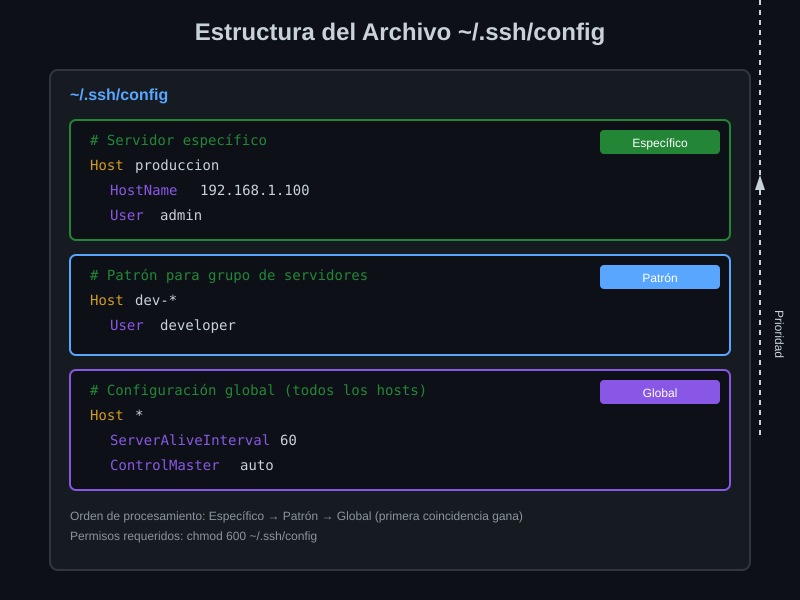

# 📄 El Archivo ~/.ssh/config

## Módulo 01 - Configuración del Cliente SSH


---

## 🎯 Objetivos del Módulo

Al finalizar este módulo, serás capaz de:

- Entender la estructura y sintaxis del archivo `~/.ssh/config`
- Crear bloques Host para diferentes servidores
- Usar directivas comunes para simplificar conexiones
- Aplicar wildcards y patrones para configuraciones grupales

---

## 📖 ¿Qué es ~/.ssh/config?

El archivo `~/.ssh/config` es el **centro de control personal** para todas tus conexiones SSH. En lugar de escribir comandos largos como:

```bash
# ❌ Sin configuración (cada vez que conectas)
ssh -i ~/.ssh/id_ed25519_trabajo -p 2222 -o ServerAliveInterval=60 admin@192.168.1.100
```

Defines la configuración una vez y conectas con:

```bash
# ✅ Con configuración
ssh servidor-web
```

---

## 🏗️ Estructura del Archivo

### Ubicación y Permisos

```bash
# Ubicación
~/.ssh/config

# Permisos requeridos (IMPORTANTE)
chmod 600 ~/.ssh/config  # Solo lectura/escritura para el propietario
```

> ⚠️ **Seguridad**: Si los permisos son incorrectos, SSH puede ignorar el archivo o rechazar conexiones.

### Sintaxis Básica

```ssh-config
# Comentario (líneas que empiezan con #)

# Bloque Host - aplica a un servidor específico
Host nombre-alias
    Opcion1 valor1
    Opcion2 valor2

# Bloque global - aplica a TODOS los hosts
Host *
    OpcionGlobal valor
```

**Reglas de sintaxis:**

- Cada bloque comienza con `Host nombre`
- Las opciones van indentadas (espacios o tabs)
- Las opciones son **case-insensitive** (HostName = hostname)
- Los valores pueden o no usar comillas

---

## 📊 Diagrama: Estructura del Archivo



---

## 🔧 Directivas Esenciales

### Identificación del Servidor

| Directiva  | Descripción                     | Ejemplo                  |
| ---------- | ------------------------------- | ------------------------ |
| `Host`     | Alias o patrón para el servidor | `Host produccion`        |
| `HostName` | IP o dominio real del servidor  | `HostName 192.168.1.100` |
| `User`     | Usuario para la conexión        | `User admin`             |
| `Port`     | Puerto SSH (default: 22)        | `Port 2222`              |

### Ejemplo Básico

```ssh-config
# Servidor de producción
Host prod
    HostName servidor.empresa.com
    User deploy
    Port 22

# Ahora puedes conectar con: ssh prod
```

### Autenticación

| Directiva                  | Descripción                    | Ejemplo                              |
| -------------------------- | ------------------------------ | ------------------------------------ |
| `IdentityFile`             | Ruta a la llave privada        | `IdentityFile ~/.ssh/id_trabajo`     |
| `IdentitiesOnly`           | Solo usar llaves especificadas | `IdentitiesOnly yes`                 |
| `PreferredAuthentications` | Orden de métodos de auth       | `PreferredAuthentications publickey` |

### Ejemplo con Llaves

```ssh-config
Host github.com
    HostName github.com
    User git
    IdentityFile ~/.ssh/id_ed25519_github
    IdentitiesOnly yes  # No probar otras llaves
```

---

## 🎭 Wildcards y Patrones

Los patrones te permiten aplicar configuración a **grupos de servidores**:

### Patrones Disponibles

| Patrón | Descripción                   | Ejemplo                     |
| ------ | ----------------------------- | --------------------------- |
| `*`    | Coincide con cualquier cadena | `Host *` (todos)            |
| `?`    | Coincide con un carácter      | `Host web?` (web1, web2...) |
| `!`    | Negación                      | `Host * !github.com`        |

### Ejemplo: Configuración por Entorno

```ssh-config
# Todos los servidores de desarrollo
Host dev-*
    User developer
    IdentityFile ~/.ssh/id_dev
    StrictHostKeyChecking no  # Desarrollo = menos estricto

# Todos los servidores de producción
Host prod-*
    User deploy
    IdentityFile ~/.ssh/id_prod
    StrictHostKeyChecking yes  # Producción = máxima seguridad

# Servidores específicos
Host dev-web
    HostName 10.0.1.10

Host dev-db
    HostName 10.0.1.20

Host prod-web
    HostName 192.168.100.10

Host prod-db
    HostName 192.168.100.20
```

---

## 🌐 Configuración Global con Host \*

El bloque `Host *` aplica a **TODAS** las conexiones. Úsalo para opciones comunes:

```ssh-config
# Configuración global (va al FINAL del archivo)
Host *
    # Mantener conexiones vivas
    ServerAliveInterval 60
    ServerAliveCountMax 3

    # Compresión para conexiones lentas
    Compression yes

    # Agregar llaves al agente automáticamente
    AddKeysToAgent yes

    # Tiempo de espera para conexión
    ConnectTimeout 10
```

> 💡 **Orden importa**: SSH procesa los bloques en orden. El **primer match gana** para cada opción. Por eso `Host *` va al final.

---

## 📋 Orden de Precedencia

SSH aplica opciones en este orden (primera coincidencia gana):

1. **Línea de comandos**: `ssh -p 2222 servidor`
2. **Archivo del usuario**: `~/.ssh/config`
3. **Archivo del sistema**: `/etc/ssh/ssh_config`
4. **Valores por defecto** de SSH

### Ejemplo de Precedencia

```ssh-config
# ~/.ssh/config
Host servidor
    Port 2222
    User admin
```

```bash
# El puerto de línea de comandos tiene prioridad
ssh -p 3333 servidor  # Usa puerto 3333, usuario admin
```

---

## 🔐 Directivas de Seguridad

```ssh-config
Host servidor-seguro
    HostName secure.empresa.com

    # Verificar siempre la huella del servidor
    StrictHostKeyChecking yes

    # Archivo de known_hosts específico
    UserKnownHostsFile ~/.ssh/known_hosts_empresa

    # Actualizar known_hosts automáticamente
    UpdateHostKeys yes

    # Solo autenticación por llave
    PreferredAuthentications publickey
    PasswordAuthentication no
```

---

## 📁 Modularidad con Include

Desde OpenSSH 7.3+, puedes dividir tu configuración en múltiples archivos:

```ssh-config
# ~/.ssh/config principal

# Incluir configuraciones específicas
Include ~/.ssh/config.d/*.conf

# Configuración global
Host *
    ServerAliveInterval 60
```

```bash
# Crear directorio para configs modulares
mkdir -p ~/.ssh/config.d

# Archivo para trabajo
echo "Host trabajo-*
    IdentityFile ~/.ssh/id_trabajo" > ~/.ssh/config.d/trabajo.conf

# Archivo para proyectos personales
echo "Host personal-*
    IdentityFile ~/.ssh/id_personal" > ~/.ssh/config.d/personal.conf
```

---

## 🧪 Verificar Configuración

### Comando de Debug

```bash
# Ver qué configuración aplica para un host
ssh -G nombre-host

# Ejemplo
ssh -G prod | grep -E "^(hostname|user|port|identityfile)"
```

### Salida Esperada

```
hostname servidor.empresa.com
user deploy
port 22
identityfile ~/.ssh/id_prod
```

---

## ✅ Ejemplo Completo

```ssh-config
# ~/.ssh/config
# Configuración SSH Personal - Actualizado 2024

# ============================================
# GITHUB
# ============================================
Host github.com
    HostName github.com
    User git
    IdentityFile ~/.ssh/id_ed25519_github
    IdentitiesOnly yes

# ============================================
# TRABAJO - Desarrollo
# ============================================
Host trabajo-dev
    HostName 10.0.1.50
    User developer
    IdentityFile ~/.ssh/id_ed25519_trabajo
    ForwardAgent yes

# ============================================
# TRABAJO - Producción
# ============================================
Host trabajo-prod
    HostName 192.168.100.10
    User deploy
    IdentityFile ~/.ssh/id_ed25519_trabajo
    StrictHostKeyChecking yes

# ============================================
# CONFIGURACIÓN GLOBAL
# ============================================
Host *
    AddKeysToAgent yes
    ServerAliveInterval 60
    ServerAliveCountMax 3
    Compression yes
    ConnectTimeout 10
```

---

## 🎯 Resumen

| Concepto        | Descripción                              |
| --------------- | ---------------------------------------- |
| `~/.ssh/config` | Archivo de configuración del cliente SSH |
| `Host nombre`   | Define alias y agrupa opciones           |
| `Host *`        | Configuración global (va al final)       |
| `IdentityFile`  | Especifica qué llave usar                |
| `Include`       | Modulariza la configuración              |
| `ssh -G host`   | Verifica configuración aplicada          |

---

## 🧭 Navegación

| ⬅️ Anterior         |      🏠 Índice      |                                   Siguiente ➡️ |
| :------------------ | :-----------------: | ---------------------------------------------: |
| [README](README.md) | [Teoría](README.md) | [02 - ProxyJump](02-proxyjump-proxycommand.md) |

---

<div align="center">

**📄 El Archivo ~/.ssh/config**

_Tu centro de control SSH_

</div>
