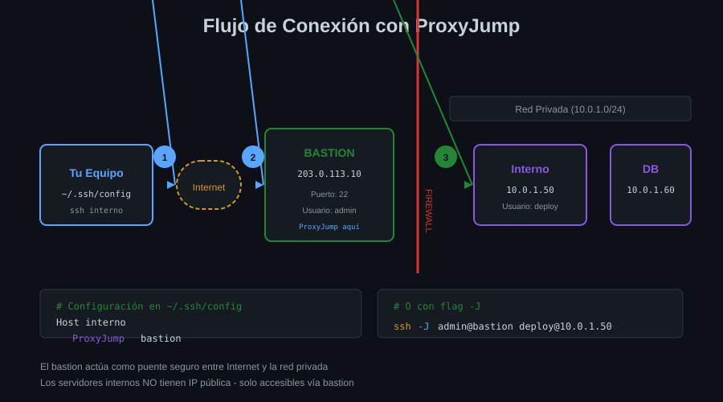

# 🚀 ProxyJump y ProxyCommand

## Módulo 02 - Conexiones a través de Bastiones


---

## 🎯 Objetivos del Módulo

Al finalizar este módulo, serás capaz de:

- Entender qué es un bastion/jump host y por qué se usa
- Configurar conexiones con ProxyJump
- Usar ProxyCommand para casos avanzados
- Encadenar múltiples saltos SSH

---

## 🏰 ¿Qué es un Bastion Host?

Un **bastion host** (también llamado **jump host** o **jump server**) es un servidor que actúa como **punto de entrada único** a una red privada.

### ¿Por Qué Usar Bastiones?

```
┌─────────────────────────────────────────────────────────────────┐
│                         INTERNET                                 │
│                            │                                     │
│                            ▼                                     │
│                    ┌──────────────┐                             │
│                    │   BASTION    │  ← Único punto de entrada   │
│                    │   (público)  │                             │
│                    └──────┬───────┘                             │
│                           │                                      │
│            ┌──────────────┼──────────────┐                      │
│            │      RED PRIVADA            │                      │
│            │              │              │                      │
│            ▼              ▼              ▼                      │
│      ┌─────────┐   ┌─────────┐   ┌─────────┐                   │
│      │  Web    │   │   DB    │   │  App    │                   │
│      │ Server  │   │ Server  │   │ Server  │                   │
│      └─────────┘   └─────────┘   └─────────┘                   │
│        (privado)    (privado)    (privado)                      │
└─────────────────────────────────────────────────────────────────┘
```

**Beneficios de seguridad:**

- 🔒 Un solo punto para auditar y monitorear
- 🛡️ Los servidores internos no tienen IP pública
- 📋 Centraliza logs de acceso
- 🔑 Facilita rotación de credenciales

---

## 📊 Diagrama: Flujo de ProxyJump



---

## 🚀 ProxyJump (Método Moderno)

**ProxyJump** (`-J`) fue introducido en **OpenSSH 7.3** (2016) y es la forma recomendada para saltar a través de bastiones.

### Sintaxis de Línea de Comandos

```bash
# Formato básico
ssh -J usuario@bastion usuario@servidor-destino

# Ejemplo real
ssh -J admin@bastion.empresa.com deploy@web-interno.local

# Con puerto no estándar en el bastion
ssh -J admin@bastion.empresa.com:2222 deploy@web-interno.local
```

### Configuración en ~/.ssh/config

```ssh-config
# Definir el bastion
Host bastion
    HostName bastion.empresa.com
    User admin
    IdentityFile ~/.ssh/id_ed25519_bastion

# Servidor interno que requiere salto
Host web-interno
    HostName 10.0.1.50
    User deploy
    ProxyJump bastion  # ← Salta a través del bastion
    IdentityFile ~/.ssh/id_ed25519_interno

# Ahora conectas directamente:
# ssh web-interno
```

### Múltiples Saltos (Encadenamiento)

```ssh-config
# Bastion nivel 1 (DMZ)
Host bastion-dmz
    HostName 203.0.113.10
    User security

# Bastion nivel 2 (Red interna)
Host bastion-interno
    HostName 10.0.0.1
    User admin
    ProxyJump bastion-dmz  # Primer salto

# Servidor final (Red segura)
Host servidor-secreto
    HostName 192.168.100.50
    User root
    ProxyJump bastion-interno  # Segundo salto (implica también el primero)
```

```bash
# Conexión atraviesa: tu-pc → bastion-dmz → bastion-interno → servidor-secreto
ssh servidor-secreto
```

---

## 🔧 ProxyCommand (Método Clásico)

**ProxyCommand** es más antiguo y flexible. SSH ejecuta el comando especificado para establecer la conexión.

### Sintaxis Básica

```ssh-config
Host servidor-interno
    HostName 10.0.1.50
    User deploy
    ProxyCommand ssh -W %h:%p bastion
```

**Variables especiales:**

- `%h` = hostname del destino final
- `%p` = puerto del destino final
- `%r` = usuario remoto
- `%n` = hostname original (antes de resolver alias)

### ¿Cuándo Usar ProxyCommand?

| Situación                        | Recomendación   |
| -------------------------------- | --------------- |
| Salto simple a través de bastion | ✅ ProxyJump    |
| OpenSSH < 7.3                    | ⚠️ ProxyCommand |
| Necesitas netcat/nc              | ⚠️ ProxyCommand |
| Túnel a través de proxy HTTP     | ⚠️ ProxyCommand |
| Lógica condicional compleja      | ⚠️ ProxyCommand |

### Ejemplo: ProxyCommand con netcat

```ssh-config
# Usando netcat (útil en sistemas antiguos)
Host servidor-interno
    HostName 10.0.1.50
    User deploy
    ProxyCommand ssh bastion nc %h %p
```

### Ejemplo: Proxy HTTP/HTTPS

```ssh-config
# Conexión a través de proxy corporativo
Host servidor-externo
    HostName servidor.externo.com
    User admin
    ProxyCommand nc -X connect -x proxy.empresa.com:8080 %h %p
```

---

## ⚖️ ProxyJump vs ProxyCommand

| Característica  | ProxyJump           | ProxyCommand                |
| --------------- | ------------------- | --------------------------- |
| Sintaxis        | Simple              | Flexible pero compleja      |
| OpenSSH mínimo  | 7.3+                | Cualquier versión           |
| Encadenamiento  | Fácil (`-J a,b,c`)  | Manual                      |
| Port forwarding | Funciona automático | Puede requerir config extra |
| Rendimiento     | Optimizado          | Depende del comando         |
| Casos de uso    | 95% de situaciones  | Casos especiales            |

---

## 🔐 Autenticación en Saltos

### Opción 1: Llaves Diferentes por Servidor

```ssh-config
Host bastion
    HostName bastion.empresa.com
    User admin
    IdentityFile ~/.ssh/id_bastion  # Llave para bastion

Host interno
    HostName 10.0.1.50
    User deploy
    ProxyJump bastion
    IdentityFile ~/.ssh/id_interno  # Llave diferente para interno
```

### Opción 2: Agent Forwarding (con precaución)

```ssh-config
Host bastion
    HostName bastion.empresa.com
    User admin
    ForwardAgent yes  # ⚠️ El bastion puede usar tu agente
```

> ⚠️ **Advertencia de Seguridad**: `ForwardAgent yes` permite que el bastion use tus llaves. Solo actívalo en bastiones **de confianza**.

### Opción 3: Llave Única con IdentitiesOnly

```ssh-config
Host *
    IdentitiesOnly yes  # Solo usar llaves explícitas

Host bastion interno
    IdentityFile ~/.ssh/id_empresa  # Misma llave para ambos
```

---

## 🧪 Debugging de Conexiones

### Ver el Proceso de Salto

```bash
# Verbose mode para ver cada paso
ssh -v -J bastion servidor-interno

# Más detalle
ssh -vv -J bastion servidor-interno

# Máximo detalle
ssh -vvv -J bastion servidor-interno
```

### Salida Típica

```
debug1: Setting up ProxyJump connection to bastion
debug1: Connecting to bastion [203.0.113.10] port 22.
debug1: Connection established.
debug1: Authenticating to bastion as 'admin'
...
debug1: channel 0: new [stdio forward to 10.0.1.50:22]
debug1: Connected to 10.0.1.50 [10.0.1.50] port 22.
debug1: Authenticating to servidor-interno as 'deploy'
```

---

## 📋 Patrones Comunes

### Patrón 1: Todos los Internos vía Bastion

```ssh-config
# Bastion
Host bastion
    HostName bastion.empresa.com
    User admin

# Cualquier servidor interno (patrón)
Host 10.0.*
    User deploy
    ProxyJump bastion

Host 192.168.100.*
    User admin
    ProxyJump bastion
```

### Patrón 2: Match para Condiciones

```ssh-config
# Solo usar proxy cuando NO estás en la red interna
Match host *.interno.empresa.com !exec "ip route | grep -q 10.0.0.0/8"
    ProxyJump bastion
```

### Patrón 3: Diferentes Bastiones por Entorno

```ssh-config
# Bastion desarrollo
Host bastion-dev
    HostName bastion-dev.empresa.com
    User admin

# Bastion producción
Host bastion-prod
    HostName bastion-prod.empresa.com
    User security

# Servidores dev van por bastion-dev
Host dev-*
    ProxyJump bastion-dev

# Servidores prod van por bastion-prod
Host prod-*
    ProxyJump bastion-prod
```

---

## ✅ Ejemplo Completo

```ssh-config
# ~/.ssh/config - Configuración con Bastiones

# ============================================
# BASTIONES
# ============================================
Host bastion
    HostName 203.0.113.10
    User admin
    IdentityFile ~/.ssh/id_bastion
    # No forward agent por seguridad

# ============================================
# SERVIDORES INTERNOS
# ============================================
Host web-prod
    HostName 10.0.1.10
    User deploy
    ProxyJump bastion
    IdentityFile ~/.ssh/id_deploy

Host db-prod
    HostName 10.0.1.20
    User dba
    ProxyJump bastion
    IdentityFile ~/.ssh/id_dba
    # Puerto MySQL local cuando conectes
    LocalForward 3306 localhost:3306

Host app-prod
    HostName 10.0.1.30
    User app
    ProxyJump bastion
    IdentityFile ~/.ssh/id_app

# ============================================
# ATAJO: Todos los *.interno
# ============================================
Host *.interno
    ProxyJump bastion
    User admin
```

---

## 🎯 Resumen

| Concepto       | Descripción                              |
| -------------- | ---------------------------------------- |
| Bastion Host   | Servidor puente a red privada            |
| `ProxyJump`    | Método moderno (OpenSSH 7.3+)            |
| `ProxyCommand` | Método clásico, más flexible             |
| `-J`           | Flag de línea de comandos para ProxyJump |
| `%h:%p`        | Variables para host:puerto destino       |
| Encadenamiento | Múltiples saltos en secuencia            |

---

## 🧭 Navegación

| ⬅️ Anterior                                    |      🏠 Índice      |                                         Siguiente ➡️ |
| :--------------------------------------------- | :-----------------: | ---------------------------------------------------: |
| [01 - ~/.ssh/config](01-archivo-ssh-config.md) | [Teoría](README.md) | [03 - Multiplexing](03-multiplexing-optimizacion.md) |

---

<div align="center">

**🚀 ProxyJump y ProxyCommand**

_Salta a través de bastiones como un profesional_

</div>
