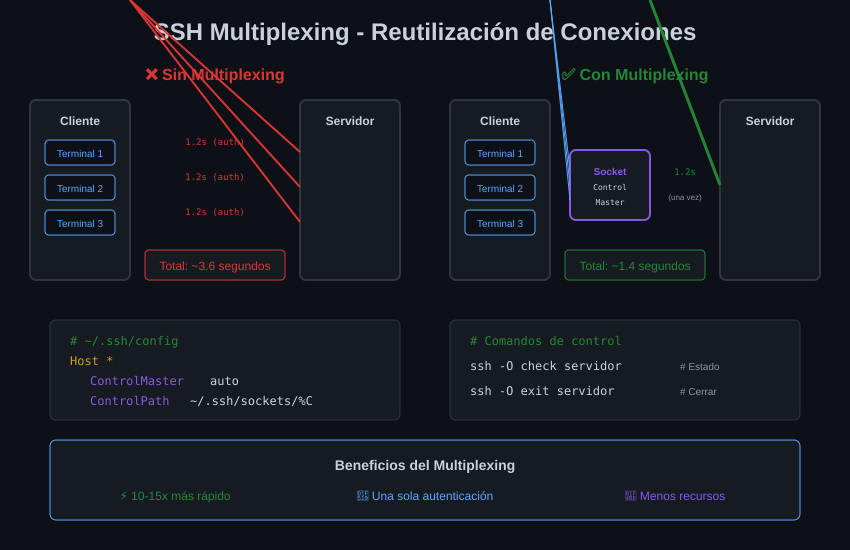

# ⚡ Multiplexing y Optimización

## Módulo 03 - Reutilización de Conexiones SSH


---

## 🎯 Objetivos del Módulo

Al finalizar este módulo, serás capaz de:

- Entender qué es multiplexing y sus beneficios
- Configurar ControlMaster para reutilizar conexiones
- Optimizar conexiones con keep-alives y compresión
- Gestionar sockets de control SSH

---

## 🔄 ¿Qué es SSH Multiplexing?

**Multiplexing** permite reutilizar una **conexión SSH existente** para nuevas sesiones, evitando el overhead de establecer conexión y autenticarse cada vez.

### Sin Multiplexing (Comportamiento Normal)

```
Terminal 1: ssh servidor  →  [Handshake TCP] → [Negociación SSH] → [Autenticación] → Conectado
Terminal 2: ssh servidor  →  [Handshake TCP] → [Negociación SSH] → [Autenticación] → Conectado
Terminal 3: ssh servidor  →  [Handshake TCP] → [Negociación SSH] → [Autenticación] → Conectado

⏱️ Cada conexión: ~1-3 segundos
```

### Con Multiplexing

```
Terminal 1: ssh servidor  →  [Handshake TCP] → [Negociación SSH] → [Autenticación] → Conectado (Master)
Terminal 2: ssh servidor  →  [Usa socket existente] → Conectado instantáneamente
Terminal 3: ssh servidor  →  [Usa socket existente] → Conectado instantáneamente

⏱️ Primera conexión: ~1-3 segundos
⏱️ Conexiones siguientes: ~0.1 segundos
```

---

## 📊 Diagrama: Multiplexing SSH



---

## 🔧 Configuración de Multiplexing

### Las Tres Directivas Clave

| Directiva        | Propósito                  | Valores Comunes                |
| ---------------- | -------------------------- | ------------------------------ |
| `ControlMaster`  | Activa/desactiva el master | `auto`, `yes`, `no`, `autoask` |
| `ControlPath`    | Ubicación del socket       | `~/.ssh/sockets/%r@%h-%p`      |
| `ControlPersist` | Mantener conexión abierta  | `yes`, `no`, `10m`, `1h`       |

### Configuración Básica

```ssh-config
Host *
    # Activar multiplexing automático
    ControlMaster auto

    # Socket de control (uno por usuario@host:puerto)
    ControlPath ~/.ssh/sockets/%r@%h-%p

    # Mantener conexión 10 minutos después de cerrar última sesión
    ControlPersist 10m
```

### Crear el Directorio de Sockets

```bash
# Crear directorio con permisos seguros
mkdir -p ~/.ssh/sockets
chmod 700 ~/.ssh/sockets
```

---

## ⚙️ Opciones de ControlMaster

| Valor     | Comportamiento                                      |
| --------- | --------------------------------------------------- |
| `auto`    | Usa conexión existente o crea una nueva como master |
| `yes`     | Esta conexión SERÁ el master (falla si ya existe)   |
| `no`      | No usar multiplexing                                |
| `autoask` | Como `auto` pero pregunta antes de crear master     |
| `ask`     | Pregunta antes de ser master                        |

### Recomendación

```ssh-config
# Para la mayoría de casos
ControlMaster auto
```

---

## 📍 Opciones de ControlPath

### Variables Disponibles

| Variable | Significado                 | Ejemplo        |
| -------- | --------------------------- | -------------- |
| `%r`     | Usuario remoto              | `admin`        |
| `%h`     | Hostname                    | `servidor.com` |
| `%p`     | Puerto                      | `22`           |
| `%n`     | Hostname original           | `mi-alias`     |
| `%C`     | Hash único (host+port+user) | `a1b2c3d4`     |
| `%L`     | Hostname local              | `mi-laptop`    |

### Patrones Recomendados

```ssh-config
# Patrón claro y legible
ControlPath ~/.ssh/sockets/%r@%h-%p

# Patrón con hash (evita nombres muy largos)
ControlPath ~/.ssh/sockets/%C

# En /tmp (se limpia al reiniciar)
ControlPath /tmp/ssh-%r@%h:%p
```

> ⚠️ **Seguridad**: El directorio de sockets debe tener permisos `700` y estar en una ubicación que solo tú puedas acceder.

---

## ⏱️ Opciones de ControlPersist

| Valor | Comportamiento                                |
| ----- | --------------------------------------------- |
| `no`  | Cerrar master cuando la última sesión termina |
| `yes` | Mantener master indefinidamente               |
| `10m` | Mantener 10 minutos después de última sesión  |
| `1h`  | Mantener 1 hora                               |
| `600` | Mantener 600 segundos (10 min)                |

### Recomendación

```ssh-config
# Balance entre conveniencia y seguridad
ControlPersist 10m

# Para servidores que accedes constantemente
ControlPersist 1h

# Para máxima seguridad (cierra al salir)
ControlPersist no
```

---

## 🛠️ Gestión de Conexiones Master

### Ver Estado de una Conexión

```bash
# Verificar si existe conexión master
ssh -O check servidor

# Salida si existe:
Master running (pid=12345)

# Salida si no existe:
Control socket "~/.ssh/sockets/user@servidor-22" does not exist
```

### Comandos de Control

```bash
# Verificar estado
ssh -O check servidor

# Cerrar conexión master gracefully
ssh -O exit servidor

# Terminar conexión master inmediatamente
ssh -O stop servidor

# Solicitar port forwarding en conexión existente
ssh -O forward -L 8080:localhost:80 servidor

# Cancelar port forwarding
ssh -O cancel -L 8080:localhost:80 servidor
```

### Listar Sockets Activos

```bash
# Ver todos los sockets
ls -la ~/.ssh/sockets/

# Ejemplo de salida
srw------- 1 usuario usuario 0 dic 10 10:00 admin@servidor.com-22
srw------- 1 usuario usuario 0 dic 10 09:30 deploy@web-prod-22
```

---

## ⚡ Otras Optimizaciones

### Keep-Alives (Mantener Conexión Viva)

```ssh-config
Host *
    # Enviar señal cada 60 segundos
    ServerAliveInterval 60

    # Desconectar después de 3 fallos
    ServerAliveCountMax 3
```

**Beneficios:**

- Evita que firewalls cierren conexiones inactivas
- Detecta conexiones muertas rápidamente
- Mantiene NAT/routers activos

### Compresión

```ssh-config
Host conexion-lenta
    # Activar compresión
    Compression yes

    # Nivel de compresión (1-9, default: 6)
    CompressionLevel 6
```

**Cuándo usar:**

- ✅ Conexiones lentas (3G, satélite)
- ✅ Transferencia de texto/logs grandes
- ❌ Conexiones rápidas (LAN, fibra)
- ❌ Datos ya comprimidos (zip, imágenes)

### Timeout de Conexión

```ssh-config
Host *
    # Tiempo máximo para establecer conexión
    ConnectTimeout 10

    # Tiempo máximo para banner SSH
    ConnectionAttempts 3
```

### Algoritmos Rápidos

```ssh-config
Host lan-server
    # Cifrado más rápido para red local segura
    Ciphers aes128-gcm@openssh.com,chacha20-poly1305@openssh.com

    # MAC más rápido
    MACs hmac-sha2-256-etm@openssh.com
```

---

## 📋 Configuración Optimizada Completa

```ssh-config
# ~/.ssh/config - Configuración Optimizada

# ============================================
# MULTIPLEXING GLOBAL
# ============================================
Host *
    ControlMaster auto
    ControlPath ~/.ssh/sockets/%C
    ControlPersist 10m

# ============================================
# KEEP-ALIVES GLOBAL
# ============================================
Host *
    ServerAliveInterval 60
    ServerAliveCountMax 3
    TCPKeepAlive yes

# ============================================
# TIMEOUTS
# ============================================
Host *
    ConnectTimeout 10
    ConnectionAttempts 2

# ============================================
# SERVIDORES CON CONEXIÓN LENTA
# ============================================
Host servidor-remoto
    HostName servidor.pais-lejano.com
    User admin
    Compression yes
    # ControlPersist más largo
    ControlPersist 30m

# ============================================
# SERVIDORES LAN (Máxima Velocidad)
# ============================================
Host lan-*
    Compression no
    Ciphers aes128-gcm@openssh.com
    # Sin persistencia en LAN
    ControlPersist 5m
```

---

## 🧪 Medir el Impacto

### Benchmark Simple

```bash
# Sin multiplexing (primera conexión)
time ssh servidor exit

# Con multiplexing (conexiones siguientes)
time ssh servidor exit
```

### Resultados Típicos

| Escenario        | Tiempo                |
| ---------------- | --------------------- |
| Primera conexión | 1.5-3s                |
| Con multiplexing | 0.05-0.2s             |
| **Mejora**       | **10-30x más rápido** |

---

## ⚠️ Consideraciones de Seguridad

### El Socket es Crítico

```bash
# Solo tú debes poder acceder al socket
chmod 700 ~/.ssh/sockets
ls -la ~/.ssh/sockets/
# Debe mostrar: drwx------ (700)
```

### Cerrar Conexiones al Terminar

```bash
# Script para cerrar todas las conexiones master
for socket in ~/.ssh/sockets/*; do
    ssh -O exit -o ControlPath="$socket" dummy 2>/dev/null
done
```

### No Usar en Servidores Compartidos

Si múltiples usuarios acceden a tu cuenta, el multiplexing puede ser un riesgo:

```ssh-config
# Deshabilitar para hosts sensibles
Host servidor-ultra-seguro
    ControlMaster no
```

---

## 🎯 Resumen

| Concepto             | Descripción                      |
| -------------------- | -------------------------------- |
| Multiplexing         | Reutiliza conexión SSH existente |
| `ControlMaster auto` | Activa multiplexing automático   |
| `ControlPath`        | Ubicación del socket de control  |
| `ControlPersist`     | Tiempo que persiste la conexión  |
| `ssh -O check`       | Verifica estado del master       |
| `ssh -O exit`        | Cierra conexión master           |
| Keep-alives          | Mantiene conexiones vivas        |
| Compresión           | Útil para conexiones lentas      |

---

## 🧭 Navegación

| ⬅️ Anterior                                    |      🏠 Índice      |                          Siguiente ➡️ |
| :--------------------------------------------- | :-----------------: | ------------------------------------: |
| [02 - ProxyJump](02-proxyjump-proxycommand.md) | [Teoría](README.md) | [Prácticas](../2-practicas/README.md) |

---

<div align="center">

**⚡ Multiplexing y Optimización**

_Conexiones SSH ultrarrápidas_

</div>
