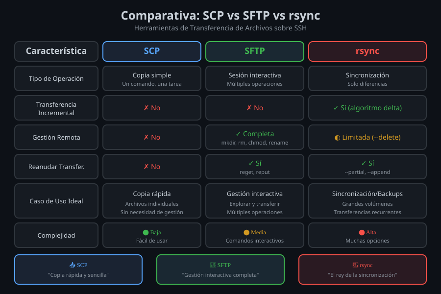

# 📂 SFTP: Sesiones Interactivas

## Módulo 02 - Transferencia Interactiva de Archivos


---

## 🎯 Objetivos del Módulo

Al finalizar este módulo, serás capaz de:

- Entender qué es SFTP y sus ventajas sobre SCP
- Navegar y gestionar archivos en sesiones interactivas
- Transferir archivos con comandos get/put
- Usar SFTP en modo batch para automatización

---

## 📖 ¿Qué es SFTP?

**SFTP (SSH File Transfer Protocol)** es un protocolo de transferencia de archivos que funciona sobre SSH, proporcionando una sesión interactiva similar a FTP pero completamente cifrada.

### Diferencias con FTP

| Característica | FTP                | SFTP           |
| -------------- | ------------------ | -------------- |
| Cifrado        | ❌ (o FTPS)        | ✅ Siempre     |
| Puerto         | 21                 | 22 (SSH)       |
| Firewall       | Problemático       | Un solo puerto |
| Autenticación  | Usuario/contraseña | Llaves SSH     |

### Ventajas sobre SCP

- ✅ **Interactivo**: Navega antes de transferir
- ✅ **Resume**: Continúa transferencias interrumpidas
- ✅ **Gestión**: Crear, eliminar, renombrar archivos remotos
- ✅ **Exploración**: Lista y navega directorios

---

## 🔧 Iniciar Sesión SFTP

### Conexión Básica

```bash
# Sintaxis
sftp usuario@servidor

# Ejemplos
sftp admin@192.168.1.100
sftp deploy@produccion.empresa.com
```

### Con Opciones

```bash
# Puerto no estándar
sftp -P 2222 admin@servidor

# Usando llave específica
sftp -i ~/.ssh/id_deploy admin@servidor

# Usando alias de ~/.ssh/config
sftp produccion
```

### Prompt SFTP

```
sftp> _
```

Una vez conectado, verás el prompt `sftp>` donde puedes ejecutar comandos.

---

## 📋 Comandos de Navegación

### Sistema Remoto

| Comando | Descripción               | Ejemplo             |
| ------- | ------------------------- | ------------------- |
| `pwd`   | Directorio actual remoto  | `sftp> pwd`         |
| `ls`    | Listar archivos remotos   | `sftp> ls -la`      |
| `cd`    | Cambiar directorio remoto | `sftp> cd /var/www` |

### Sistema Local

| Comando | Descripción              | Ejemplo                 |
| ------- | ------------------------ | ----------------------- |
| `lpwd`  | Directorio actual local  | `sftp> lpwd`            |
| `lls`   | Listar archivos locales  | `sftp> lls`             |
| `lcd`   | Cambiar directorio local | `sftp> lcd ~/Downloads` |

### Ejemplo de Navegación

```
sftp> pwd
Remote working directory: /home/admin

sftp> cd /var/www/app
sftp> ls
config/  logs/  public/  src/

sftp> lpwd
Local working directory: /home/usuario

sftp> lcd ~/proyectos
sftp> lls
proyecto1/  proyecto2/  backup/
```

---

## 📥 Transferencias: get y put

### Descargar Archivos (get)

```bash
# Un archivo
sftp> get archivo.txt

# Descargar con nombre diferente
sftp> get config.yml config-backup.yml

# Múltiples archivos
sftp> mget *.log

# Directorio recursivo
sftp> get -r directorio/
```

### Subir Archivos (put)

```bash
# Un archivo
sftp> put documento.pdf

# Subir con nombre diferente
sftp> put local.conf remote.conf

# Múltiples archivos
sftp> mput *.txt

# Directorio recursivo
sftp> put -r proyecto/
```

### Opciones de Transferencia

| Opción | Descripción                         |
| ------ | ----------------------------------- |
| `-r`   | Recursivo (directorios)             |
| `-a`   | Append (añadir a archivo existente) |
| `-p`   | Preservar permisos y timestamps     |

---

## 🗂️ Gestión de Archivos Remotos

### Crear y Eliminar

```bash
# Crear directorio
sftp> mkdir nuevo_directorio

# Eliminar archivo
sftp> rm archivo.txt

# Eliminar directorio vacío
sftp> rmdir directorio_vacio

# Eliminar directorio con contenido (requiere vaciar primero)
sftp> rm directorio/*
sftp> rmdir directorio
```

### Renombrar y Permisos

```bash
# Renombrar archivo
sftp> rename viejo.txt nuevo.txt

# Cambiar permisos
sftp> chmod 755 script.sh

# Cambiar propietario (si tienes permisos)
sftp> chown usuario archivo
sftp> chgrp grupo archivo
```

### Información de Archivos

```bash
# Listar con detalles
sftp> ls -la

# Ver espacio disponible
sftp> df

# Información de archivo específico
sftp> ls -la archivo.txt
```

---

## 📊 Diagrama: Flujo de Sesión SFTP



---

## 🤖 Modo Batch (No Interactivo)

SFTP puede ejecutar comandos desde un archivo o directamente, útil para scripts.

### Desde Archivo de Comandos

```bash
# Crear archivo de comandos
cat > sftp-commands.txt << 'EOF'
cd /var/www/app
lcd ~/backup
get -r config/
get database.sql
bye
EOF

# Ejecutar
sftp -b sftp-commands.txt admin@servidor
```

### Comando Único

```bash
# Ejecutar un comando
echo "get /var/log/app.log" | sftp admin@servidor

# Con here-document
sftp admin@servidor << 'EOF'
cd /var/www
get config.yml
bye
EOF
```

---

## 🔧 Opciones de Línea de Comandos

| Opción          | Descripción                       |
| --------------- | --------------------------------- |
| `-P port`       | Puerto SSH                        |
| `-i identity`   | Archivo de llave                  |
| `-b batchfile`  | Archivo de comandos               |
| `-B buffersize` | Tamaño de buffer                  |
| `-l limit`      | Límite de ancho de banda (Kbit/s) |
| `-o option`     | Opciones SSH                      |
| `-r`            | Recursivo en operaciones          |
| `-v`            | Modo verbose                      |

### Ejemplos

```bash
# Limitar ancho de banda a 1 Mbps
sftp -l 8000 admin@servidor

# Con buffer grande para transferencias rápidas
sftp -B 262144 admin@servidor

# Verbose para debugging
sftp -v admin@servidor
```

---

## 💡 Tips y Trucos

### Ejecutar Comandos Locales

```bash
# Prefijo ! para comandos locales
sftp> !ls -la
sftp> !pwd
sftp> !cat archivo.txt
```

### Ayuda Integrada

```bash
sftp> help
# o
sftp> ?
```

### Wildcard en Transferencias

```bash
# Descargar todos los logs
sftp> mget *.log

# Subir todos los configs
sftp> mput config-*
```

### Salir de SFTP

```bash
sftp> bye
# o
sftp> exit
# o
sftp> quit
```

---

## 🛡️ Seguridad SFTP

### Configuración Segura

```bash
# Usar siempre llaves SSH
sftp -i ~/.ssh/id_ed25519 admin@servidor

# Verificar host keys
# SFTP usa la misma verificación que SSH
```

### SFTP Chroot (Configuración del Servidor)

El servidor puede configurar usuarios para que solo vean un directorio específico:

```
# En /etc/ssh/sshd_config (servidor)
Match User sftp-user
    ChrootDirectory /var/sftp
    ForceCommand internal-sftp
    AllowTcpForwarding no
```

---

## 🧪 Ejemplos Prácticos

### Ejemplo 1: Backup de Configuraciones

```bash
# Sesión interactiva
sftp admin@webserver
sftp> cd /etc/nginx
sftp> lcd ~/backups
sftp> get -r sites-available/
sftp> get nginx.conf
sftp> bye
```

### Ejemplo 2: Deploy con Batch

```bash
# deploy.sftp
cd /var/www/app
put -r dist/
chmod 644 dist/*
bye

# Ejecutar
sftp -b deploy.sftp deploy@produccion
```

### Ejemplo 3: Sincronización Selectiva

```bash
sftp admin@servidor << 'EOF'
cd /var/log/app
lcd ~/logs
mget *.log
bye
EOF
```

---

## 📝 Resumen de Comandos

### Navegación

```bash
pwd / lpwd          # Directorio actual (remoto/local)
ls / lls            # Listar (remoto/local)
cd / lcd            # Cambiar directorio (remoto/local)
```

### Transferencia

```bash
get archivo         # Descargar
put archivo         # Subir
mget *.ext          # Descargar múltiples
mput *.ext          # Subir múltiples
get -r directorio/  # Descargar recursivo
```

### Gestión

```bash
mkdir dir           # Crear directorio
rm archivo          # Eliminar archivo
rmdir dir           # Eliminar directorio
rename viejo nuevo  # Renombrar
chmod 755 archivo   # Cambiar permisos
```

---

## 🎯 Resumen

| Concepto | Descripción                     |
| -------- | ------------------------------- |
| SFTP     | FTP seguro sobre SSH            |
| `get`    | Descargar archivos              |
| `put`    | Subir archivos                  |
| `m*`     | Múltiples archivos (mget, mput) |
| `-r`     | Recursivo                       |
| `-b`     | Modo batch                      |
| `l*`     | Comandos locales (lcd, lls)     |

---

## 🧭 Navegación

| ⬅️ Anterior                       |      🏠 Índice      |                             Siguiente ➡️ |
| :-------------------------------- | :-----------------: | ---------------------------------------: |
| [01 - SCP](01-scp-fundamentos.md) | [Teoría](README.md) | [03 - rsync](03-rsync-sincronizacion.md) |

---

<div align="center">

**📂 SFTP: Sesiones Interactivas**

_Transferencia interactiva y segura_

</div>
