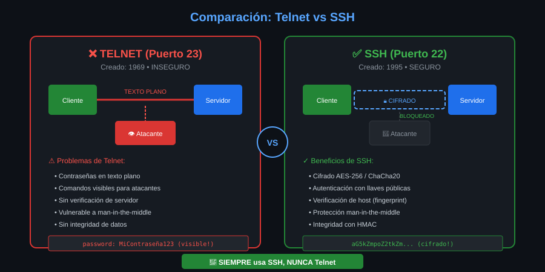

# Qué es SSH y qué problema resuelve

⏱ Lectura: ~25 min

## El problema: administrar una máquina que no tienes delante

Casi todos los servidores del mundo están en un centro de datos o en la nube, sin pantalla ni teclado. Para trabajar en ellos necesitas una **shell remota**: escribir comandos en tu terminal y que se ejecuten allí.

Antes de 1995 eso se hacía con **Telnet** (1969), `rlogin` y `rsh`. Funcionaban, pero enviaban todo **en claro**: cualquiera en la misma red (una Wi-Fi pública, un router de la universidad, un proveedor) podía leer las contraseñas y los comandos con un programa de captura de paquetes.



En 1995, tras un ataque que capturó miles de contraseñas en la red de la Universidad de Tecnología de Helsinki, Tatu Ylönen escribió la primera versión de **SSH** (*Secure Shell*). La idea: el mismo servicio que Telnet, pero con todo cifrado y con forma de comprobar a quién te conectas.

## Qué te garantiza SSH

| Garantía | Qué significa | Sin ella |
|---|---|---|
| **Confidencialidad** | Lo que viaja está cifrado: quien capture el tráfico ve bytes sin sentido | Te roban la contraseña con solo escuchar |
| **Integridad** | Cada paquete lleva una comprobación; si alguien lo altera, la conexión se corta | Alguien cambia `ls` por `rm -rf` en el camino |
| **Autenticación del servidor** | El servidor demuestra quién es con su **host key** | Te conectas a un impostor y le das tu contraseña |
| **Autenticación del usuario** | Tú demuestras quién eres con contraseña, llave o certificado | Cualquiera entra como tú |

La tercera es la que más se olvida y la que verás en el lab-02: la primera vez que te conectas a un host, `ssh` te pide que confirmes su huella. Si respondes `yes` sin comparar, renuncias a esa garantía.

## SSH es más que una shell

El mismo protocolo, y la misma conexión cifrada, sirve para:

| Uso | Herramienta | Semana |
|---|---|---|
| Shell interactiva y comandos remotos | `ssh` | 01 |
| Copiar archivos | `scp`, `sftp`, `rsync` | 06 |
| Llevar otros protocolos por dentro (túneles) | `ssh -L`, `-R`, `-D` | 08 |
| Saltar a redes internas | `ssh -J` | 09 |
| Automatizar servidores | Ansible, CI/CD | 12 |
| Clonar y subir a git | `git@github.com:...` | Cada vez que usas GitHub |

## Versiones del protocolo y del software

**El protocolo** tuvo dos versiones. **SSH-1** (1995) tenía fallos de diseño graves y está abandonado. **SSH-2** se publicó como estándar en 2006, en los RFC 4251 a 4254, y es el único que se usa hoy. Por eso todos los banners empiezan por `SSH-2.0-`.

**El software** más usado es **OpenSSH**, del proyecto OpenBSD, desde 1999. Viene instalado en Linux, macOS y Windows 10+. Este bootcamp usa **OpenSSH 9.6**, la versión de Ubuntu 24.04 LTS:

```bash
ssh -V
```

```
OpenSSH_9.6p1 Ubuntu-3ubuntu13.20, OpenSSL 3.0.13 30 Jan 2024
```

- `9.6`: versión de OpenSSH. `p1`: primera versión *portable* (adaptada a sistemas distintos de OpenBSD).
- `Ubuntu-3ubuntu13.20`: parches de seguridad de Ubuntu. Una versión "vieja" con parches al día no es una versión vulnerable.
- `OpenSSL 3.0.13`: la biblioteca criptográfica que usa.

Las versiones más nuevas (OpenSSH 10.x) cambian algunos valores por defecto. Cuando el bootcamp use algo que no existe en 9.6, lo marca como **OpenSSH 9.9+** y da la alternativa.

## Las piezas: cliente y servidor

SSH sigue el modelo **cliente-servidor**:

- **Cliente** (`ssh`): el programa que ejecutas tú. Inicia la conexión.
- **Servidor** (`sshd`, *SSH daemon*): un proceso que corre en la máquina remota, escucha en el **puerto 22** y atiende cada conexión.

Si `sshd` no está corriendo, no hay nada a lo que conectar, por muy bien que esté tu cliente. El [siguiente documento](02-cliente-servidor-y-laboratorio.md) entra en detalle y presenta el laboratorio donde practicarás.

## Puntos clave

- SSH sustituye a Telnet: misma idea, todo cifrado y con verificación de ambos extremos.
- Cuatro garantías: confidencialidad, integridad, autenticación del servidor y del usuario.
- Solo existe SSH-2. OpenSSH es la implementación de referencia; aquí usas la 9.6.
- Sin un `sshd` escuchando, no hay conexión posible.

<!-- nav -->
---

## 🔗 Navegación

| Anterior | Siguiente |
|---|---|
| ← [Semana 01 — Fundamentos de SSH y primera conexión](../README.md) | [Teoría — Cliente, servidor y el laboratorio](02-cliente-servidor-y-laboratorio.md) → |

[↑ Semana 01](../README.md)
