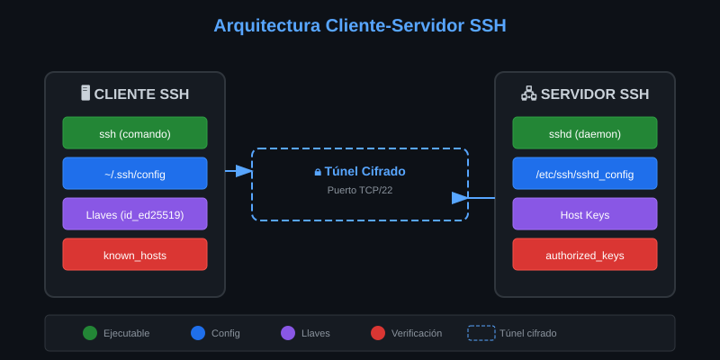
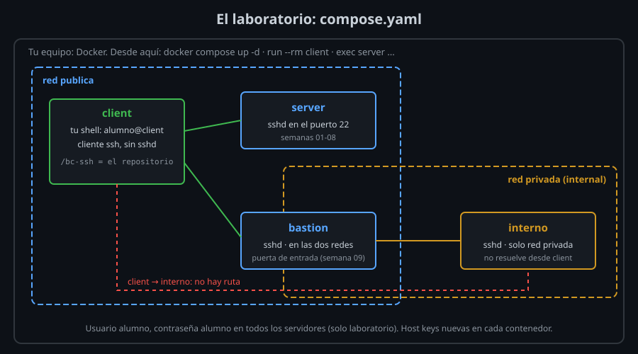
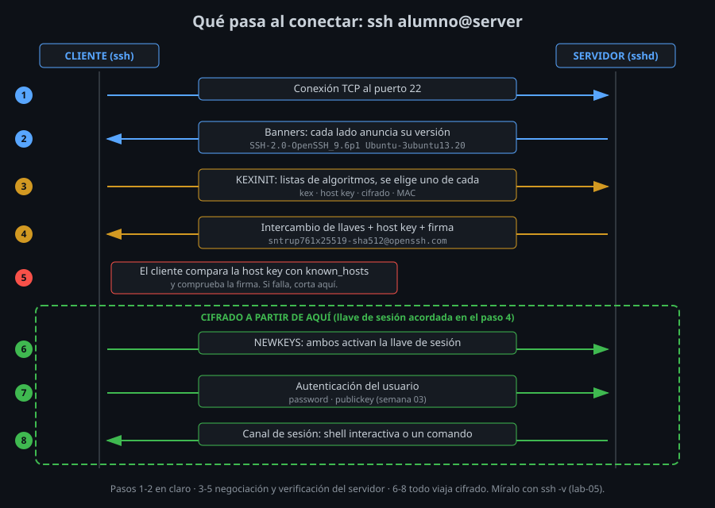

# Cliente, servidor y el laboratorio

⏱ Lectura: ~35 min

## Las dos mitades y sus archivos



### El cliente: `ssh` y `~/.ssh/`

| Archivo | Qué es | Semana |
|---|---|---|
| `~/.ssh/known_hosts` | Host keys de los servidores que ya aceptaste | 01–02 |
| `~/.ssh/config` | Tus alias y opciones por host | 01, 05 |
| `~/.ssh/id_ed25519` y `.pub` | Tu par de llaves (privada y pública) | 03 |
| `/etc/ssh/ssh_config` | Opciones por defecto para todos los usuarios de la máquina | 01 |

`ssh` es estricto con los permisos: si otro usuario puede escribir en tu `~/.ssh/config`, se niega a leerlo (`Bad owner or permissions`). **Qué:** una comprobación de seguridad. **Para qué:** que nadie pueda redirigir tus alias a su máquina. **Impacto:** `~/.ssh` va con `700` y los archivos con `600`; lo verás en el lab-07.

### El servidor: `sshd` y `/etc/ssh/`

| Archivo | Qué es | Semana |
|---|---|---|
| `/etc/ssh/sshd_config` | Configuración del servidor: puerto, métodos de autenticación, quién puede entrar | 07 |
| `/etc/ssh/ssh_host_*_key` | **Host keys** privadas: la identidad del servidor. Nunca salen de él | 01–02 |
| `/etc/ssh/ssh_host_*_key.pub` | Sus partes públicas: las que acaban en tu `known_hosts` | 01–02 |
| `~/.ssh/authorized_keys` (del usuario remoto) | Llaves públicas que pueden entrar como ese usuario | 03 |

`sshd` corre como `root` y escucha en el puerto 22. Por cada conexión crea un proceso hijo privilegiado (`[priv]`) y este, tras autenticarte, otro con **tus** permisos (`alumno@pts/0`). Es la **separación de privilegios**: el código que habla con desconocidos de Internet tiene el mínimo poder posible. Lo ves en el lab-04.

## El laboratorio

No necesitas alquilar servidores. `compose.yaml` levanta cuatro contenedores Docker:



| Host | Qué es | Para qué lo usarás |
|---|---|---|
| `client` | Tu shell, con el cliente `ssh`. Monta el repositorio en `/bc-ssh` | Desde aquí haces todos los labs |
| `server` | Servidor con `sshd` en la red `publica` | Destino de las semanas 01 a 08 |
| `bastion` | Servidor en las redes `publica` y `privada` | Puerta de entrada a la red interna (semana 09) |
| `interno` | Servidor solo en la red `privada` | Inalcanzable directamente desde `client` |

Tres comandos, siempre **desde tu equipo** en la raíz del repositorio:

```bash
docker compose up -d              # levanta (o deja levantados) los servidores
docker compose run --rm client    # abre una shell en un client nuevo
docker compose exec server CMD    # ejecuta CMD dentro de server, sin SSH
```

`docker compose exec` es tu **canal independiente**: te permite preguntar al servidor por su huella sin pasar por la red SSH, igual que un administrador real te la daría por otra vía.

Dos avisos que se repiten en todo el bootcamp:

- **Usuario `alumno`, contraseña `alumno`.** Es débil a propósito y **solo existe en el laboratorio**. Nunca uses algo así en un servidor real.
- **Host keys nuevas en cada contenedor.** Si recreas un servidor (`docker compose up -d --force-recreate server`), cambia su identidad y tu cliente lo detectará. Lo provocas a propósito en el lab-06.

## Qué pasa al conectar



1. **TCP.** El cliente abre una conexión al puerto 22. Si falla aquí, es un problema de red, no de SSH.
2. **Banners.** Cada lado envía una línea con su versión: `SSH-2.0-OpenSSH_9.6p1 ...`. Es lo único que viaja en claro y lo que lees con `nc server 22` (lab-01).
3. **Negociación.** Cada lado envía su lista de algoritmos preferidos; se elige uno para cada función.
4. **Intercambio de llaves (KEX).** Cliente y servidor calculan juntos una **llave de sesión** sin enviarla por la red. El servidor firma ese intercambio con su **host key**.
5. **Verificación del servidor.** El cliente comprueba la firma y busca la host key en `known_hosts`. Si no la conoce, te pregunta; si es otra distinta, corta.
6. **Cifrado.** A partir de aquí todo viaja cifrado con la llave de sesión.
7. **Autenticación del usuario.** Contraseña, llave o certificado. Tu contraseña viaja **dentro** del cifrado: nunca en claro.
8. **Sesión.** Se abre una shell o se ejecuta el comando que pediste.

`ssh -v` cuenta estas fases línea a línea (lab-05). Saber en qué fase se para una conexión es la mitad del diagnóstico (lab-06).

## known_hosts: la memoria del cliente

La primera vez que te conectas a un host, el cliente no tiene con qué comparar su host key. Te enseña la huella y pregunta. Esto se llama **TOFU** (*trust on first use*):

```
ED25519 key fingerprint is SHA256:m/sNQegz9dMrhYOD58Pm4keTPbbWHqnCL05A0Q3W1g8.
Are you sure you want to continue connecting (yes/no/[fingerprint])?
```

- **Qué:** si respondes `yes`, la llave se guarda en `~/.ssh/known_hosts`. **Para qué:** desde entonces cada conexión comprueba que el servidor sea el mismo. **Impacto:** la protección solo vale si **comparaste** la huella la primera vez con una obtenida por otro canal.
- Si un día la llave no coincide, verás `REMOTE HOST IDENTIFICATION HAS CHANGED!` y `ssh` cortará antes de pedir la contraseña. Puede ser una reinstalación o un ataque: confirma por el canal independiente antes de borrar la línea con `ssh-keygen -R HOST`.
- **Nunca** desactives la comprobación con `StrictHostKeyChecking no` o `UserKnownHostsFile /dev/null` para "quitarte el aviso": es exactamente lo que necesita alguien que se haga pasar por tu servidor. La semana 02 explica las alternativas seguras para automatizar.

## Códigos de salida

| Código | Significa |
|---|---|
| El del comando remoto (0–254) | La conexión fue bien; es lo que devolvió el comando en el servidor |
| 255 | Falló `ssh`: nombre, red, identidad del servidor o autenticación |

Un script distingue así "el comando falló" de "no llegué al servidor" (lab-03).

## La configuración del cliente

En vez de `ssh -p 2222 -l alumno server.ejemplo.com`, escribes un alias en `~/.ssh/config`:

```
Host lab-server
    HostName server
    User alumno
```

Y ya basta con `ssh lab-server`. Las reglas que importan esta semana:

1. **Orden de lectura:** línea de comandos (`-l`, `-p`, `-o`), luego `~/.ssh/config` (o el de `-F`), luego `/etc/ssh/ssh_config`.
2. **Gana el primer valor** que se encuentra para cada opción. Por eso `Host *` va al final, como valor por defecto.
3. **`ssh -G HOST`** imprime la configuración final sin conectarse. Pruébalo siempre antes de conectar.

La semana 05 la convierte en una configuración modular con `Include` y `Match`.

## Puntos clave

- Cliente: `ssh` y `~/.ssh/`. Servidor: `sshd` y `/etc/ssh/`. Los permisos importan.
- El laboratorio: `client` para trabajar, `server` y `bastion` alcanzables, `interno` solo a través de `bastion`.
- Una conexión pasa por TCP, banners, negociación, KEX, verificación del servidor, cifrado, autenticación y sesión.
- `known_hosts` solo protege si verificaste la huella por otro canal la primera vez.
- 255 = falló `ssh`. Cualquier otro código es del comando remoto.

<!-- nav -->
---

## 🔗 Navegación

| Anterior | Siguiente |
|---|---|
| ← [Teoría — Qué es SSH y qué problema resuelve](01-que-es-ssh.md) | [Teoría — Criptografía mínima para entender SSH](03-criptografia-basica.md) → |

[↑ Semana 01](../README.md)
