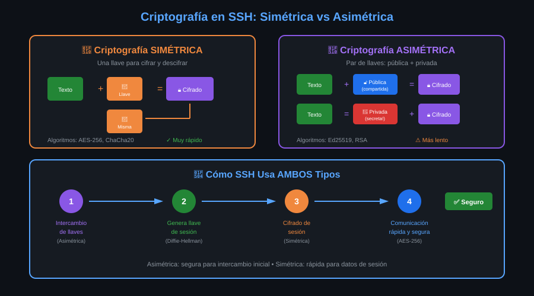

# Criptografía mínima para entender SSH

⏱ Lectura: ~30 min

No necesitas matemáticas para usar SSH, pero sí saber qué hace cada pieza. Si no, los mensajes de `ssh -v` y las decisiones de las próximas semanas (qué llave generar, qué algoritmo desactivar) serán una lista de nombres raros.

## Tres herramientas

| Herramienta | Qué hace | En SSH sirve para |
|---|---|---|
| **Cifrado simétrico** | Una sola llave cifra y descifra | Cifrar todos los datos de la sesión |
| **Criptografía asimétrica** | Un par de llaves: una privada (secreta) y una pública (compartible) | Acordar la llave de sesión y **firmar**: demostrar quién eres |
| **Función hash** | Resume cualquier dato en una cadena corta y fija; un cambio mínimo da un resumen totalmente distinto | Huellas (*fingerprints*) e integridad de cada paquete |



## Cifrado simétrico: rápido, pero con un problema

La misma llave cifra y descifra. Es muy rápido: puede cifrar gigabytes por segundo, así que es el que protege todo lo que escribes y recibes.

**El problema:** las dos partes tienen que tener la misma llave. ¿Cómo se la mandas al servidor si todavía no hay un canal seguro? Si viaja en claro, quien escuche la tiene.

En SSH 9.6 los cifrados por defecto son `chacha20-poly1305@openssh.com` y `aes256-gcm@openssh.com`. Los dos son **AEAD**: cifran y comprueban la integridad a la vez, por eso `ssh -v` muestra `MAC: <implicit>`.

## Criptografía asimétrica: el par de llaves

Cada parte tiene dos llaves relacionadas matemáticamente:

- **Privada:** no sale nunca de su dueño. Con ella se **firma**.
- **Pública:** se reparte sin miedo. Con ella cualquiera **comprueba** una firma.

Que la pública sea pública no compromete nada: de ella no se puede deducir la privada en un tiempo razonable.

El diagrama muestra el uso clásico (cifrar con la pública, descifrar con la privada). SSH usa la asimetría de otras dos formas:

1. **Acordar la llave de sesión** (intercambio de llaves, KEX). Cada lado genera un valor temporal, envía su parte pública y, combinando la suya privada con la pública del otro, ambos llegan al **mismo secreto** sin que viaje por la red. Quien escuche ve las dos partes públicas y no puede calcularlo. Esa es la idea de Diffie-Hellman (1976).
2. **Firmar.** El servidor firma el intercambio con su **host key** privada; tu cliente comprueba la firma con la pública que tiene en `known_hosts`. Un impostor sin la llave privada no puede firmar. A partir de la semana 03 tú harás lo mismo con tu llave de usuario.

## La estrategia híbrida

SSH combina las dos para quedarse con lo mejor de cada una:

| Fase | Herramienta | Por qué |
|---|---|---|
| Acordar la llave de sesión | Asimétrica (KEX) | Resuelve el problema de compartir la llave sin canal seguro |
| Demostrar la identidad del servidor | Asimétrica (firma con host key) | Solo el servidor verdadero tiene la privada |
| Cifrar la sesión | Simétrica | Es cientos de veces más rápida |
| Comprobar que nada se alteró | Hash (dentro del AEAD o como MAC) | Detecta cualquier cambio en un paquete |

La llave de sesión es **efímera**: se descarta al cerrar. Aunque alguien grabe hoy tu tráfico y mañana robe la host key del servidor, no puede descifrar la grabación. A esto se llama **secreto hacia adelante** (*forward secrecy*).

## Huellas: un hash para comparar llaves

Una llave pública ed25519 ocupa unos 70 caracteres en base64. Compararla a ojo es inviable, así que se compara su **hash SHA-256**, codificado en base64:

```
SHA256:m/sNQegz9dMrhYOD58Pm4keTPbbWHqnCL05A0Q3W1g8
```

Esa es la huella que te enseña `ssh` en la primera conexión y la que imprime `ssh-keygen -lf ARCHIVO.pub`. Si dos huellas coinciden, las llaves son la misma.

## Los algoritmos que verás en OpenSSH 9.6

| Función | Por defecto en 9.6 | Lo ves en `ssh -v` como |
|---|---|---|
| Intercambio de llaves | `sntrup761x25519-sha512@openssh.com` | `kex: algorithm:` |
| Host key | `ssh-ed25519` | `kex: host key algorithm:` |
| Cifrado | `chacha20-poly1305@openssh.com` | `cipher:` |
| Huellas | SHA-256 | `SHA256:...` |

`sntrup761x25519` es **híbrido**: combina X25519 (curva elíptica clásica) con sntrup761, un algoritmo pensado para resistir a futuras computadoras cuánticas. Si uno de los dos se rompe, el otro sigue protegiendo. OpenSSH 10 cambia el valor por defecto a `mlkem768x25519-sha256`; lo verás en la semana 13.

Algoritmos que **no** deberías ver: `ssh-dss` (DSA, eliminado), `diffie-hellman-group1-sha1` y cualquier cosa con `sha1` o `cbc`. La semana 07 los desactiva en el servidor.

## Puntos clave

- Simétrica para los datos (rápida), asimétrica para acordar la llave y para firmar, hash para huellas e integridad.
- La host key **firma**; no cifra la sesión.
- La llave de sesión es efímera: secreto hacia adelante.
- Una huella `SHA256:...` es el resumen de una llave pública; compararla es comparar la llave.
- OpenSSH 9.6 ya usa un intercambio de llaves híbrido resistente a computación cuántica.

<!-- nav -->
---

## 🔗 Navegación

| Anterior | Siguiente |
|---|---|
| ← [Teoría — Cliente, servidor y el laboratorio](02-cliente-servidor-y-laboratorio.md) | [Índice de labs](../2-practicas/README.md) → |

[↑ Semana 01](../README.md)
