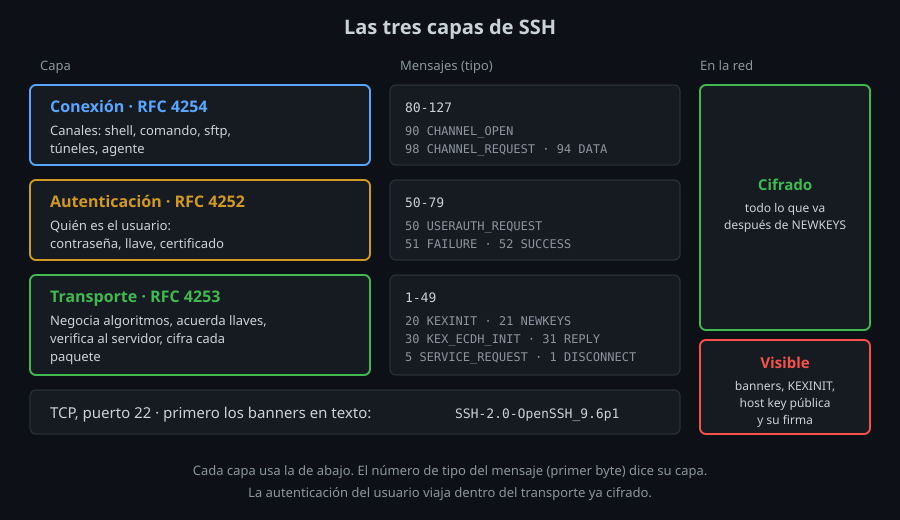

# Las tres capas del protocolo SSH

⏱ Lectura: ~30 min

En la semana 01 viste las fases de una conexión desde fuera ([diagrama](../../week-01-fundamentos_ssh_y_primera_conexion/1-teoria/02-cliente-servidor-y-laboratorio.md#qué-pasa-al-conectar)). Ahora entras: qué mensajes se envían, en qué orden y quién ve cada uno. Esto es lo que te permite leer un `ssh -vvv` sin perderte y entender por qué un túnel (semana 08) o un `scp` (semana 06) viajan por la misma conexión que tu shell.

## Tres protocolos, uno encima de otro

SSH-2 no es un protocolo, son tres, definidos en RFC separados (la arquitectura general está en el RFC 4251):



| Capa | RFC | Qué hace | Lo usas cuando |
|---|---|---|---|
| **Transporte** | 4253 | Negocia algoritmos, acuerda llaves, autentica al **servidor**, cifra y protege cada paquete | Siempre: es la base |
| **Autenticación** (*userauth*) | 4252 | Autentica al **usuario**: contraseña, llave, certificado | Una vez por conexión |
| **Conexión** | 4254 | Multiplexa **canales** dentro de la conexión cifrada: shells, comandos, túneles, subsistemas como SFTP | Cada sesión, `scp`, túnel... |

- **Qué:** cada capa usa la de abajo y no sabe nada de la de arriba. **Para qué:** cambiar el método de autenticación (semanas 03 y 10) no toca el cifrado, y añadir un túnel no repite la autenticación. **Impacto:** cuando algo falla, el mensaje de error pertenece a una capa concreta, y eso acota dónde buscar.
- La autenticación del usuario ocurre **dentro** del transporte ya cifrado y con el servidor ya verificado. Por eso tu contraseña nunca viaja en claro y por eso `ssh` corta **antes** de pedírtela si la host key no cuadra.

## Antes de todo: los banners

Lo primero que viaja por el TCP son dos líneas de texto, una por lado:

```
SSH-2.0-OpenSSH_9.6p1 Ubuntu-3ubuntu13.20
```

`SSH-2.0` es la versión del protocolo y lo demás identifica el software. Es lo único que se envía como texto plano legible; desde aquí todo son **paquetes binarios**.

## El paquete binario

Todo mensaje SSH viaja dentro de un paquete con esta forma (RFC 4253 §6):

| Campo | Tamaño | Para qué |
|---|---|---|
| `packet_length` | 4 bytes | Cuánto mide el paquete |
| `padding_length` | 1 byte | Cuánto relleno lleva |
| `payload` | variable | El mensaje; su **primer byte es el tipo** |
| `padding` | 4–255 bytes | Relleno aleatorio: oculta la longitud real del mensaje |
| `MAC` | según el algoritmo | Comprueba que el paquete no se alteró (con AEAD va integrado) |

Antes del intercambio de llaves el paquete va sin cifrar y sin MAC. Después, todo él va cifrado y autenticado.

## Los tipos de mensaje y sus rangos

El primer byte del `payload` es un número del 1 al 255. Cada capa tiene reservado un rango (RFC 4250 §4.1.2), así que **el número dice la capa**:

| Rango | Capa | Mensajes que verás |
|---|---|---|
| 1–19 | Transporte, genéricos | 1 `DISCONNECT`, 5 `SERVICE_REQUEST`, 6 `SERVICE_ACCEPT`, 7 `EXT_INFO` |
| 20–29 | Transporte, negociación | 20 `KEXINIT`, 21 `NEWKEYS` |
| 30–49 | Transporte, propios del método de KEX | 30 `KEX_ECDH_INIT`, 31 `KEX_ECDH_REPLY` |
| 50–79 | Autenticación | 50 `USERAUTH_REQUEST`, 51 `USERAUTH_FAILURE`, 52 `USERAUTH_SUCCESS` |
| 80–127 | Conexión | 80 `GLOBAL_REQUEST`, 90 `CHANNEL_OPEN`, 91 `CHANNEL_OPEN_CONFIRMATION`, 94 `CHANNEL_DATA`, 96 `CHANNEL_EOF`, 97 `CHANNEL_CLOSE`, 98 `CHANNEL_REQUEST`, 99 `CHANNEL_SUCCESS` |

`ssh -vvv` imprime cada uno como `send packet: type 20` o `receive packet: type 52`. En el lab-02 escribes un script que traduce esos números a capas.

Una conexión `ssh server true` completa, resumida:

1. `KEXINIT` ↔ `KEXINIT`: cada lado ofrece sus algoritmos ([teoría 02](02-intercambio-de-llaves.md)).
2. `KEX_ECDH_INIT` → `KEX_ECDH_REPLY`: intercambio de llaves; el servidor firma con su host key.
3. `NEWKEYS` ↔ `NEWKEYS`: a partir de aquí, todo cifrado.
4. `SERVICE_REQUEST ssh-userauth` → `SERVICE_ACCEPT`: el cliente pide pasar a la capa de autenticación.
5. `USERAUTH_REQUEST` → `FAILURE` (el cliente probó `publickey` y no tiene llaves) → `USERAUTH_REQUEST` (contraseña) → `SUCCESS`.
6. `CHANNEL_OPEN session` → `CONFIRMATION`, `CHANNEL_REQUEST exec "true"` → `SUCCESS`.
7. El servidor envía `CHANNEL_REQUEST exit-status`, `EOF` y `CLOSE`; el cliente cierra y envía `DISCONNECT`.

## Canales: muchas cosas por una conexión

La capa de conexión abre **canales**, cada uno con su número, dentro de la misma conexión cifrada:

| Tipo de canal | Para qué | Semana |
|---|---|---|
| `session` | Una shell, un comando (`exec`) o un subsistema (`sftp`) | 01, 06 |
| `direct-tcpip` | Túnel local (`-L`) | 08 |
| `forwarded-tcpip` | Túnel remoto (`-R`) | 08 |
| `auth-agent@openssh.com` | Reenvío del agente (`-A`) | 04 |

Cada canal tiene su propio control de flujo (`WINDOW_ADJUST`): un `scp` grande no bloquea la shell que tienes abierta en otro canal. `ssh -v` lo muestra como `channel 0: new session`.

## Lo que ve alguien que escucha la red

| Visible | Cifrado |
|---|---|
| IPs y puertos, tamaño y momento de cada paquete | Usuario y contraseña |
| Los dos banners | Comandos y su salida |
| Las listas de algoritmos de cada `KEXINIT` | Nombres de canales y de subsistemas |
| La host key **pública** del servidor y su firma | Todo lo que va después de `NEWKEYS` |

Que la host key pública se vea no es un problema: es pública. Lo que nadie puede hacer sin la privada es **firmar**. En el lab-01 lo compruebas con `tcpdump`.

El tamaño y el momento de los paquetes sí filtran algo: el ritmo al que tecleas. Desde OpenSSH 9.5 el cliente envía paquetes falsos mientras escribes para ocultarlo (`ObscureKeystrokeTiming`, activo por defecto).

## Extensiones: `ext-info` y `kex-strict`

En el `KEXINIT` aparecen nombres que no son algoritmos, por ejemplo `ext-info-c` y `kex-strict-c-v00@openssh.com` en la lista del cliente:

- **`ext-info`** (RFC 8308): "puedo recibir `EXT_INFO`", el mensaje 7, con el que el servidor anuncia por ejemplo qué algoritmos de firma acepta para las llaves de usuario.
- **`kex-strict`**: la defensa contra el ataque **Terrapin** (CVE-2023-48795, diciembre de 2023), que permitía a un intermediario borrar mensajes del inicio de la conexión sin que se notara. Con `kex-strict` en los dos lados, el número de secuencia de los paquetes se reinicia tras `NEWKEYS` y cualquier mensaje inesperado durante el KEX corta la conexión. OpenSSH 9.6 lo trae; si el servidor es más antiguo, no se aplica.

## Puntos clave

- SSH son tres capas: transporte (servidor y cifrado), autenticación (usuario) y conexión (canales).
- Todo viaja en paquetes binarios con relleno aleatorio y MAC; el primer byte del contenido es el tipo de mensaje, y su rango dice la capa.
- La autenticación del usuario va dentro del transporte ya cifrado y con el servidor ya verificado.
- Una conexión lleva muchos canales: shell, `scp`, túneles y agente comparten el mismo cifrado.
- Quien escucha ve banners, listas de algoritmos y la host key pública; no ve usuario, contraseña ni datos.

<!-- nav -->
---

## 🔗 Navegación

| Anterior | Siguiente |
|---|---|
| ← [Semana 02 — Protocolo por dentro: KEX, host keys y known_hosts](../README.md) | [Teoría — Negociación e intercambio de llaves](02-intercambio-de-llaves.md) → |

[↑ Semana 02](../README.md)
