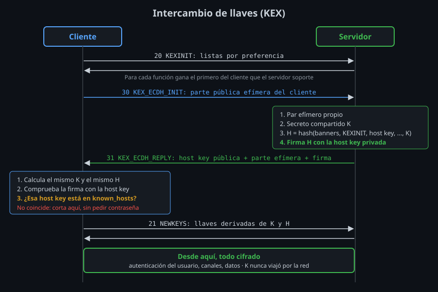

# Negociación e intercambio de llaves

⏱ Lectura: ~30 min

La [criptografía de la semana 01](../../week-01-fundamentos_ssh_y_primera_conexion/1-teoria/03-criptografia-basica.md) explicó **por qué** SSH usa asimetría para acordar una llave y simetría para los datos. Aquí ves **cómo**: quién elige los algoritmos, qué se envía en cada mensaje y dónde exactamente queda demostrada la identidad del servidor.

## Paso 1: `KEXINIT`, cada lado ofrece

Justo después de los banners, cliente y servidor envían a la vez un mensaje `KEXINIT` con **listas ordenadas por preferencia** para cada función:

| Lista | Qué decide | En `ssh -vv` |
|---|---|---|
| `kex_algorithms` | Cómo se acuerda la llave | `KEX algorithms:` |
| `server_host_key_algorithms` | Con qué tipo de llave firma el servidor | `host key algorithms:` |
| `encryption` (una por sentido) | Cifrado simétrico | `ciphers ctos:` / `ciphers stoc:` |
| `mac` (una por sentido) | Integridad, si el cifrado no es AEAD | `MACs ctos:` / `MACs stoc:` |
| `compression` (una por sentido) | Compresión | `compression ctos:` |

`ctos` es *client to server* y `stoc`, *server to client*: cada sentido podría usar un algoritmo distinto, aunque en la práctica coinciden.

## La regla: decide el orden del cliente

Para cada lista gana **el primer algoritmo de la lista del cliente que también esté en la del servidor** (RFC 4253 §7.1).

- **Qué:** el servidor solo filtra (lo que no está en su lista no se puede usar); el orden lo pone el cliente. **Para qué:** el cliente elige el más seguro que el servidor soporte. **Impacto:** si quieres que un cliente use otro algoritmo, cambias **su** orden; si quieres prohibir un algoritmo, lo quitas del **servidor** (semana 07).
- Si para alguna función no hay ningún algoritmo común, la conexión se corta:

  ```
  Unable to negotiate with 172.20.0.3 port 2200: no matching key exchange method found. Their offer: diffie-hellman-group14-sha1
  ```

  `Their offer` es la lista del servidor. Es lo primero que lees ante este error (lab-04).

- Si el cifrado elegido es AEAD (`chacha20-poly1305`, `aes*-gcm`), la lista de MAC se negocia igual pero no se usa: `ssh -v` lo muestra como `MAC: <implicit>`.

## Paso 2: el intercambio de llaves



Con el algoritmo de KEX ya elegido (por ejemplo `curve25519-sha256`):

1. **`KEX_ECDH_INIT`.** El cliente genera un par de llaves **efímero** (solo para esta conexión) y envía su parte pública.
2. **`KEX_ECDH_REPLY`.** El servidor genera su propio par efímero y, con las dos partes, calcula el **secreto compartido K**. El cliente hará el mismo cálculo y obtendrá el mismo K, que nunca viaja por la red. Después el servidor calcula el **hash de intercambio H**, un resumen de todo lo ocurrido:

   > H = hash(banner del cliente, banner del servidor, los dos `KEXINIT`, host key pública del servidor, las dos partes públicas efímeras, K)

   El servidor **firma H con su host key privada** y envía: su host key pública, su parte pública efímera y la firma.
3. **El cliente verifica.** Calcula K y H por su cuenta, comprueba la firma con la host key pública recibida y busca esa host key en `known_hosts` ([teoría 03](03-host-keys-y-known_hosts.md)).
4. **`NEWKEYS` ↔ `NEWKEYS`.** Los dos derivan de K y H seis valores (llaves de cifrado, de integridad y vectores iniciales, uno por sentido) y desde el siguiente paquete todo va cifrado.

**Por qué la firma cierra la puerta al intermediario.** H incluye todo lo que cada lado envió y recibió. Un intermediario que hable con el cliente por un lado y con el servidor por otro tendría dos H distintos, y para el lado del cliente necesita una firma válida de H hecha con la host key **privada** del servidor, que no tiene. Puede firmar con una llave suya, pero entonces la host key que presenta no es la de `known_hosts`. Por eso todo depende de que la llave guardada sea la verdadera.

**El identificador de sesión.** El primer H de la conexión queda como **session ID** para toda su vida. La autenticación con llave (semana 03) firma ese ID: una firma robada no sirve en otra conexión.

## Renegociar las llaves (*rekey*)

Tras cierta cantidad de datos (o de tiempo), cualquiera de los dos lados envía un nuevo `KEXINIT` y se repite el intercambio **dentro** del canal cifrado. Así no se cifran demasiados datos con una misma llave.

- `ssh -v` lo anuncia al empezar: `rekey out after 134217728 blocks` (el límite por defecto según el cifrado).
- `RekeyLimit` lo ajusta: `RekeyLimit 1G 1h` renegocia cada gigabyte o cada hora, lo que llegue antes.
- El session ID **no cambia** al renegociar. Las sesiones abiertas siguen funcionando sin que lo notes (lab-02).

## Los algoritmos de KEX que verás

| Algoritmo | Tipo | Estado en OpenSSH 9.6 |
|---|---|---|
| `sntrup761x25519-sha512@openssh.com` | Híbrido: clásico + poscuántico | Por defecto, primero en la lista |
| `mlkem768x25519-sha256` | Híbrido con ML-KEM (estándar NIST) | **OpenSSH 9.9+**; por defecto desde OpenSSH 10.0. En 9.6, usa `sntrup761x25519` |
| `curve25519-sha256` | Curva elíptica X25519 | Disponible; el de referencia de los clásicos |
| `ecdh-sha2-nistp256/384/521` | Curvas NIST | Disponible |
| `diffie-hellman-group14-sha256`, `group16-sha512`, `group18-sha512` | Diffie-Hellman clásico | Disponible, más lento |
| `diffie-hellman-group14-sha1`, `group1-sha1` | DH con SHA-1 | Soportado pero **desactivado** por defecto |

Los híbridos existen por el ataque **"guarda ahora, descifra después"**: alguien graba hoy tráfico cifrado para descifrarlo cuando exista una computadora cuántica capaz de romper X25519. El híbrido combina las dos llaves: hay que romper **ambas**. La semana 13 trata la migración a ML-KEM.

## Cambiar las listas

Cuatro opciones de cliente (`~/.ssh/config` o `-o`) y las mismas en el servidor (`sshd_config`):

| Opción | Lista |
|---|---|
| `KexAlgorithms` | Intercambio de llaves |
| `HostKeyAlgorithms` | Tipos de host key aceptados |
| `Ciphers` | Cifrados |
| `MACs` | Integridad |

El valor admite cuatro formas:

| Forma | Ejemplo | Efecto |
|---|---|---|
| Lista | `KexAlgorithms curve25519-sha256` | Sustituye la lista entera |
| `+` | `KexAlgorithms +diffie-hellman-group14-sha1` | Añade al **final** de la lista por defecto |
| `-` | `KexAlgorithms -sntrup761x25519-sha512@openssh.com` | Quita de la lista por defecto |
| `^` | `KexAlgorithms ^curve25519-sha256` | Pone al **principio** de la lista por defecto |

Tres comandos para saber qué hay:

| Comando | Dónde | Responde a |
|---|---|---|
| `ssh -Q kex` (`cipher`, `mac`, `key`) | Cliente | ¿Qué sabe hacer este binario? |
| `ssh -G HOST \| grep kexalgorithms` | Cliente | ¿Qué ofrecerá para ese host, con mi config? |
| `sshd -T \| grep kexalgorithms` | Servidor, como root | ¿Qué acepta este servidor? |

`-Q` lista también algoritmos soportados pero desactivados por defecto, como `diffie-hellman-group1-sha1`. Estar en `-Q` no significa estar en la oferta.

**Regla práctica.** Un algoritmo antiguo se activa con `+` solo en el bloque `Host` del servidor que lo necesita, nunca en `Host *`: así un servidor viejo no rebaja la seguridad de todos los demás (lab-04).

## Puntos clave

- Cada lado envía en `KEXINIT` sus listas por preferencia; gana el primero del cliente que el servidor soporte.
- Cliente y servidor calculan el mismo secreto K sin enviarlo; el servidor firma el hash H de todo el intercambio con su host key.
- La firma de H solo protege si la host key con que la compruebas es la verdadera: eso es `known_hosts`.
- El primer H es el session ID; las renegociaciones cambian las llaves, no el ID.
- `+`, `-` y `^` modifican la lista por defecto; un algoritmo antiguo se activa solo para el host que lo necesita.

<!-- nav -->
---

## 🔗 Navegación

| Anterior | Siguiente |
|---|---|
| ← [Teoría — Las tres capas del protocolo SSH](01-capas-del-protocolo.md) | [Teoría — Host keys y `known_hosts`](03-host-keys-y-known_hosts.md) → |

[↑ Semana 02](../README.md)
