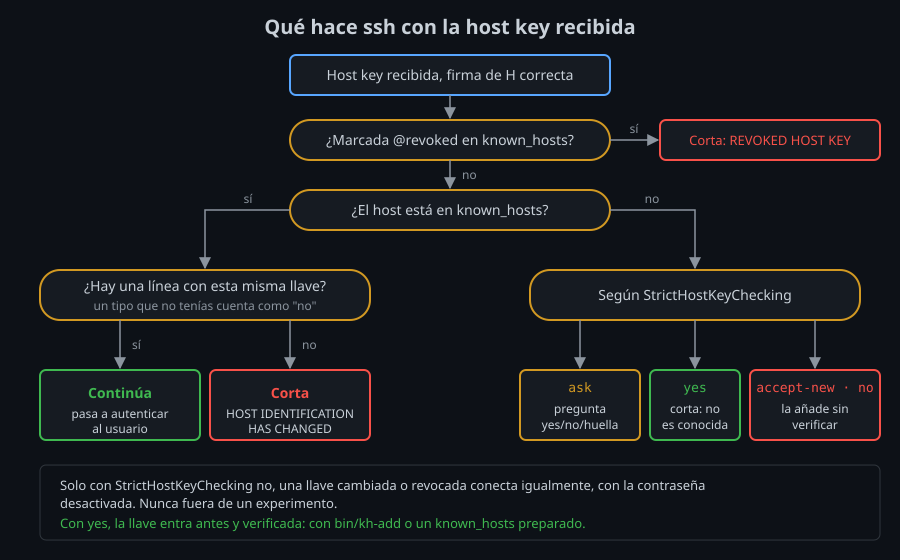

# Host keys y `known_hosts`

⏱ Lectura: ~30 min

La [teoría 02](02-intercambio-de-llaves.md) acabó en una idea: la firma del intercambio solo protege si la host key con la que la compruebas es la verdadera. Este archivo trata de eso: qué host keys tiene un servidor, cómo las guarda el cliente y qué hace `ssh` cuando no cuadran.

## Las host keys del servidor

Un servidor OpenSSH tiene normalmente **tres** pares, uno por tipo, en `/etc/ssh/`:

| Archivo | Tipo | Algoritmos de firma que ofrece |
|---|---|---|
| `ssh_host_ed25519_key` | Ed25519 | `ssh-ed25519` |
| `ssh_host_ecdsa_key` | ECDSA P-256 | `ecdsa-sha2-nistp256` |
| `ssh_host_rsa_key` | RSA 3072 | `rsa-sha2-512`, `rsa-sha2-256` |

- Cada `.pub` es la parte pública; la privada (sin extensión) solo la lee root. `ssh-keygen -A` genera las que falten: es lo que hace el laboratorio al arrancar cada contenedor.
- Una llave RSA puede firmar con SHA-1 (`ssh-rsa`, desactivado por defecto desde OpenSSH 8.8) o con SHA-2 (`rsa-sha2-256/512`). El **tipo de llave** es el mismo; cambia el **algoritmo de firma**.
- En cada conexión el servidor firma con **una sola** de sus llaves: la que salga de la negociación de `host key algorithms`.

### Qué tipo elige el cliente

El cliente reordena su lista `HostKeyAlgorithms`: pone **primero los tipos que ya tiene en `known_hosts` para ese host**. Si conoces la ECDSA de `server`, pedirá ECDSA aunque prefiera Ed25519.

- **Qué:** preferir lo conocido. **Para qué:** no provocar una pregunta ni un aviso con un servidor que ya verificaste. **Impacto:** si un host conocido presenta un tipo de llave que no tienes guardado, `ssh` lo trata como **llave cambiada** y corta. Un atacante podría escoger justo el tipo que te falta para colarse como "llave nueva" (lab-05).

## Huellas

La huella es el hash de la llave pública. `ssh-keygen -lf ARCHIVO.pub` la calcula:

| Formato | Opción | Ejemplo |
|---|---|---|
| SHA-256 en base64 (por defecto) | `-E sha256` | `SHA256:GiOO/MygF0Rrs+8btbv8PAxfRi9aDhaYQwNyfIza69M` |
| MD5 en hexadecimal (antiguo) | `-E md5` | `MD5:04:0c:59:7d:df:a2:7f:01:...` |
| *Randomart* (dibujo) | `-v` | Una caja de caracteres derivada de la huella |

El formato MD5 lo verás en documentación vieja y en algunos paneles de proveedores: para comparar, pide la huella en el mismo formato. El *randomart* (`VisualHostKey yes`) ayuda a notar un cambio a simple vista, no sustituye a comparar la huella.

## `ssh-keyscan`: leer sin entrar

`ssh-keyscan HOST` hace la parte de transporte de una conexión, recoge las host keys públicas e imprime líneas en formato `known_hosts`. No se autentica.

```
server ssh-ed25519 AAAAC3NzaC1lZDI1NTE5AAAAIHMNPVhkH/6lwbRqaCvR9UVSOxAdtySpoVRIqPkn7kbF
```

**`ssh-keyscan` no verifica nada.** Lee la llave por la misma red por la que se colaría un intermediario. Sirve para **obtener** la llave; la **verificación** sigue siendo comparar su huella con una obtenida por un canal independiente. Eso hace `bin/kh-add` en el [proyecto](../3-proyecto/README.md).

## El formato de `known_hosts`

Una línea por llave:

```
[marcador] nombres tipo llave-base64 [comentario]
```

| Campo | Ejemplos | Notas |
|---|---|---|
| marcador | `@revoked`, `@cert-authority` | Opcional; ver más abajo |
| nombres | `server` · `server,172.20.0.3` · `*.lab` · `[server]:2200` | Varios separados por comas; admite `*`, `?` y `!` para negar. Un puerto distinto de 22 se escribe `[host]:puerto` |
| tipo | `ssh-ed25519`, `ecdsa-sha2-nistp256`, `ssh-rsa` | El tipo de **llave** (una llave RSA se guarda como `ssh-rsa` aunque firme con SHA-2) |
| llave | `AAAAC3Nza...` | La llave pública en base64 |

Un host puede tener varias líneas, una por tipo de llave.

### Nombres hasheados

Con `HashKnownHosts yes` (el valor del laboratorio, en `/etc/ssh/ssh_config`), el nombre se guarda así:

```
|1|+tTkGiEqu9SSbQPERTL/eVw0r1Q=|C1ya15BEwZEAqHNIRyRMNGjjdGo= ssh-ed25519 AAAAC3Nza...
```

- `|1|` indica el formato; luego van una **sal** aleatoria y el **HMAC-SHA1** del nombre con esa sal como llave, ambos en base64.
- **Qué:** el archivo no dice a qué hosts te conectas. **Para qué:** si alguien roba tu `known_hosts` (o el de un servidor comprometido), no obtiene una lista de siguientes objetivos. **Impacto:** no puedes leer el archivo a ojo; usas `ssh-keygen -F HOST`, que calcula el HMAC por ti. En el lab-06 lo calculas a mano con `openssl`.
- `ssh-keygen -H` hashea un archivo existente y guarda el original en `known_hosts.old`. Bórralo después, o el original sigue ahí.

### Herramientas

| Comando | Qué hace |
|---|---|
| `ssh-keygen -F HOST` | Busca las líneas de `HOST` (también hasheadas) |
| `ssh-keygen -R HOST` | Borra las líneas de `HOST` (deja copia en `.old`) |
| `ssh-keygen -H` | Hashea los nombres de todo el archivo |
| `ssh-keygen -lf ~/.ssh/known_hosts` | Huella de cada línea |

Para un puerto distinto de 22, el nombre va entre corchetes y comillas: `ssh-keygen -F '[server]:2200'`.

### Marcadores

- **`@revoked`**: esta llave está comprometida. Si un servidor la presenta, `ssh` corta con `REVOKED HOST KEY DETECTED`, sin preguntar. Solo con `StrictHostKeyChecking no` sigue adelante, y aun así desactiva la contraseña, como con una llave cambiada.
- **`@cert-authority`**: la llave no es de un host, es de una **autoridad de certificados** que firma host keys. Con una sola línea confías en todos los servidores que esa CA firme. Es la solución a escala; la ves en la semana 10.

## Dónde busca `ssh`

| Opción | Por defecto | Para qué |
|---|---|---|
| `UserKnownHostsFile` | `~/.ssh/known_hosts ~/.ssh/known_hosts2` | Tus llaves; `ssh` escribe en el primero |
| `GlobalKnownHostsFile` | `/etc/ssh/ssh_known_hosts /etc/ssh/ssh_known_hosts2` | Llaves que el administrador reparte para todos los usuarios de la máquina; `ssh` no escribe aquí |
| `HostKeyAlias` | — | Guarda y busca la llave con otro nombre. Útil cuando llegas al mismo servidor por varios nombres, o a varios servidores por el mismo `localhost:puerto` de un túnel (semana 08) |

## Qué hace `ssh` según `StrictHostKeyChecking`



| Valor | Host nuevo | Llave cambiada |
|---|---|---|
| `ask` (por defecto) | Pregunta `yes/no/[fingerprint]` | Corta |
| `yes` | Corta: `No ED25519 host key is known` | Corta |
| `accept-new` | La añade sin preguntar | Corta |
| `no` / `off` | La añade sin preguntar | **Conecta**, pero desactiva contraseña y *keyboard-interactive* |

- `accept-new` es TOFU automático: cómodo, pero la primera conexión queda sin verificar. Solo vale en entornos de usar y tirar, como los labs.
- `no` con una llave cambiada se conecta a quien sea; que desactive la contraseña no te protege si usas llaves o reenvías el agente. **Nunca** lo uses fuera de un experimento.
- Para automatizar (CI, scripts), lo correcto es `yes` con `known_hosts` **preparado de antemano** con llaves verificadas (semana 12).

## Rotar host keys: `UpdateHostKeys`

Cambiar la host key de un servidor rompe a todos sus clientes a la vez. La extensión `hostkeys-00@openssh.com` permite hacerlo sin romper nada:

1. Tras autenticarte, el servidor envía la lista de **todas** sus host keys (el `GLOBAL_REQUEST` tipo 80 que verás en el lab-02).
2. Si `UpdateHostKeys` está activo, el cliente añade las que no tenía, **solo** porque llegan por una conexión ya verificada con una llave conocida:

   ```
   Learned new hostkey: ECDSA SHA256:D2Vh3iNoBr1S3wOQbjLDfw85+ab+RK9FhZv14i1wg4c
   ```

3. El administrador puede añadir una llave nueva, esperar a que los clientes la aprendan y luego retirar la vieja.

`UpdateHostKeys` está activo por defecto **salvo** si cambias `UserKnownHostsFile` (o activas `VerifyHostKeyDNS`). `ask` pregunta antes de añadir.

## Otras formas de distribuir llaves

| Método | Cómo | Cuándo |
|---|---|---|
| Canal independiente | Consola, panel del proveedor, `docker compose exec` | Pocos servidores; lo que haces en el bootcamp |
| `GlobalKnownHostsFile` | El administrador reparte `/etc/ssh/ssh_known_hosts` | Equipos gestionados |
| Registros `SSHFP` en DNS | `VerifyHostKeyDNS yes`; exige DNSSEC para valer algo | Dominios con DNSSEC |
| Certificados de host | `@cert-authority` en `known_hosts` | Muchos servidores (semana 10) |

## Puntos clave

- Un servidor tiene una host key por tipo y firma con la que salga de la negociación.
- El cliente prefiere los tipos que ya conoce; un tipo desconocido de un host conocido cuenta como llave cambiada.
- `ssh-keyscan` obtiene llaves pero no las verifica: la verificación es comparar huellas por otro canal.
- `known_hosts` admite patrones, puertos, nombres hasheados y los marcadores `@revoked` y `@cert-authority`.
- `StrictHostKeyChecking yes` con llaves verificadas de antemano es lo correcto para automatizar; `no` nunca.
- `UpdateHostKeys` permite rotar host keys sin romper a los clientes.

<!-- nav -->
---

## 🔗 Navegación

| Anterior | Siguiente |
|---|---|
| ← [Teoría — Negociación e intercambio de llaves](02-intercambio-de-llaves.md) | [Índice de labs](../2-practicas/README.md) → |

[↑ Semana 02](../README.md)
