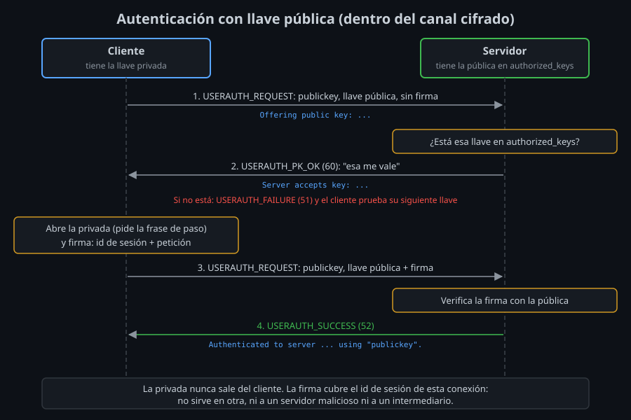

# Autenticación con llave pública

⏱ Lectura: ~30 min

En la semana 02 viste que el servidor demuestra **quién es** firmando con su host key. Esta semana es el camino inverso: **tú** demuestras quién eres firmando con tu propia llave. Es el mismo mecanismo, y por eso protege igual de bien.

## Qué tiene de malo la contraseña

Con `PasswordAuthentication`, tu cliente envía la contraseña **completa** dentro del canal cifrado. El cifrado la protege de quien escucha la red, pero no de quien está al otro lado:

- **El servidor la ve en claro.** Tiene que verla para compararla. Si el servidor está comprometido, o si es un intermediario cuya host key aceptaste sin verificar (semana 02), se queda con ella y puede usarla en todos los sitios donde la repitas.
- **Se puede adivinar.** Cualquiera que llegue al puerto 22 puede probar contraseñas; los servidores expuestos a Internet reciben miles de intentos al día. Una contraseña la elige una persona; una llave Ed25519 son 256 bits aleatorios.
- **Se escribe a mano.** Para automatizar (un backup, un despliegue) habría que guardarla en un script, en claro.

## La idea: firmar, no enviar

Una llave tiene dos mitades que se generan juntas:

| Mitad | Dónde vive | Para qué sirve |
|---|---|---|
| **Privada** | Solo en tu equipo, en `~/.ssh/` | **Firmar**: producir un valor que solo ella puede producir |
| **Pública** | En cada servidor donde quieres entrar, en `~/.ssh/authorized_keys` | **Verificar** esa firma; no sirve para firmar |

La pública no es un secreto: puedes ponerla en cien servidores, publicarla en GitHub o enviarla por correo. De ella no se puede calcular la privada.

Para entrar, no envías nada secreto: firmas un dato que el servidor conoce, y él comprueba la firma con la pública que tiene guardada. Si la firma es válida, quien la hizo tiene la privada.

## El intercambio, paso a paso



Todo ocurre en la capa de **autenticación** (mensajes 50–79, [teoría 01 de la semana 02](../../week-02-protocolo_kex_y_known_hosts/1-teoria/01-capas-del-protocolo.md)), ya dentro del canal cifrado:

1. **El cliente pregunta** (`SSH_MSG_USERAUTH_REQUEST`, método `publickey`, sin firma): "¿aceptarías esta llave pública para el usuario `alumno`?". En `ssh -v`: `Offering public key: ...`.
2. **El servidor busca** esa llave en `~/.ssh/authorized_keys` del usuario. Si no está, responde `SSH_MSG_USERAUTH_FAILURE` y el cliente prueba la siguiente llave. Si está, responde `SSH_MSG_USERAUTH_PK_OK` (60). En `ssh -v`: `Server accepts key: ...`.
3. **El cliente firma.** Ahora sí abre la privada (aquí te pide la frase de paso, si la tiene) y envía otra vez la petición, esta vez con una firma sobre el **identificador de sesión** y los datos de la petición.
4. **El servidor verifica** la firma con la pública. Si es válida: `SSH_MSG_USERAUTH_SUCCESS` (52). En `ssh -v`: `Authenticated to server ... using "publickey"`.

El paso 1 existe para no abrir la privada (ni pedirte la frase) con llaves que el servidor no va a aceptar.

### Por qué la firma no se puede reutilizar

El **identificador de sesión** es el hash del primer intercambio de llaves de esta conexión ([teoría 02 de la semana 02](../../week-02-protocolo_kex_y_known_hosts/1-teoria/02-intercambio-de-llaves.md)). Cada conexión tiene uno distinto, y ninguna de las dos partes lo elige sola.

**Impacto:** una firma vale solo para la conexión en la que se hizo. Un servidor malicioso que la recibe no puede usarla para entrar en otro servidor en tu nombre: allí el identificador de sesión es otro. Un intermediario tampoco: tiene **dos** conexiones (contigo y con el servidor real) con identificadores distintos, y tu firma solo vale para la suya. Compáralo con la contraseña, que vale igual en todas partes.

## Qué ve cada parte

| | Contraseña | Llave |
|---|---|---|
| Qué recibe el servidor | El secreto entero | La pública y una firma válida solo para esta sesión |
| Un servidor comprometido puede... | Reutilizar tu contraseña en otros sitios | Nada fuera de esta conexión |
| Adivinarla por fuerza bruta | Posible si es débil | Imposible en la práctica |
| Automatizar sin dejar un secreto en claro | No | Sí, con frase de paso y agente (semana 04) o con una llave restringida ([teoría 03](03-authorized_keys-y-opciones.md)) |
| Si se filtra | Cambias la contraseña en cada servidor | Borras una línea de `authorized_keys` en cada servidor |

La llave tiene un punto débil propio: **el archivo de la privada**. Quien lo copie puede entrar donde tú entras. Por eso se protege con una frase de paso y con permisos ([teoría 02](02-tipos-de-llave-y-frase-de-paso.md)).

## Qué métodos hay y en qué orden

El servidor dice qué métodos acepta en cada `FAILURE`. En `ssh -v`:

```
debug1: Authentications that can continue: publickey,password
```

El cliente los prueba en el orden de `PreferredAuthentications` (por defecto: `gssapi-with-mic,hostbased,publickey,keyboard-interactive,password`), saltándose los que el servidor no ofrece. Por eso, si tu llave está instalada, nunca ves la pregunta de la contraseña: `publickey` va antes. Y por eso, si la llave falla, ves la contraseña: es el método siguiente, no un error.

## Qué llaves prueba el cliente

Sin configuración, `ssh` prueba en orden las llaves del agente (semana 04) y después estos archivos, si existen: `~/.ssh/id_rsa`, `id_ecdsa`, `id_ecdsa_sk`, `id_ed25519`, `id_ed25519_sk`, `id_xmss`, `id_dsa`. En `ssh -v` aparecen como `Will attempt key: ...`.

- **Qué:** `IdentityFile RUTA` (o `-i RUTA`) añade una llave concreta, e `IdentitiesOnly yes` hace que se ofrezcan **solo** las de `IdentityFile`.
- **Para qué:** cada llave rechazada cuenta como un intento fallido, y `sshd` corta tras `MaxAuthTries` (6 por defecto) con `Too many authentication failures`. Además, cada llave que ofreces le dice al servidor que la tienes.
- **Impacto:** con muchas llaves, sin `IdentitiesOnly` puedes no llegar nunca a la correcta. Lo provocarás en el [lab 05](../2-practicas/lab-05-varias-llaves/README.md).

## Puntos clave

- La contraseña viaja entera al servidor; con llave solo viajan la pública y una firma.
- La privada firma, la pública verifica; la pública puede estar en cualquier sitio.
- El cliente primero pregunta si la llave vale (`PK_OK`) y solo entonces firma.
- La firma cubre el identificador de sesión: no vale en otra conexión, ni para un servidor malicioso ni para un intermediario.
- Si `publickey` falla, el cliente pasa al siguiente método: por eso ves la pregunta de la contraseña.
- Cada llave rechazada gasta un intento; `IdentitiesOnly yes` evita gastarlos en llaves ajenas.

<!-- nav -->
---

## 🔗 Navegación

| Anterior | Siguiente |
|---|---|
| ← [Semana 03 — Autenticación con llaves](../README.md) | [Teoría — Tipos de llave, archivos y frase de paso](02-tipos-de-llave-y-frase-de-paso.md) → |

[↑ Semana 03](../README.md)
