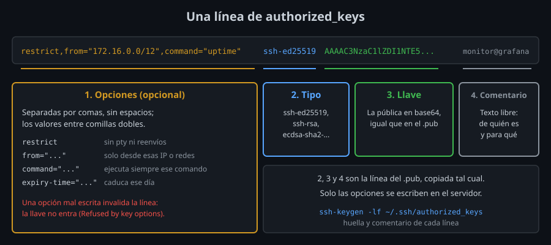

# `authorized_keys` y sus opciones

⏱ Lectura: ~30 min

En el paso 2 de la [teoría 01](01-autenticacion-con-llave-publica.md#el-intercambio-paso-a-paso), el servidor "busca la llave en `authorized_keys`". Este archivo trata de ese lado del servidor: dónde está el archivo, qué comprueba `sshd` antes de leerlo y cómo una línea puede limitar lo que hace la llave.

## Dónde está y quién lo escribe

- **Qué:** `~/.ssh/authorized_keys` **del usuario en el servidor**. Una línea por llave que puede entrar como ese usuario. `sshd` lo lee en cada intento: un cambio vale desde la siguiente conexión, sin reiniciar nada.
- **Para qué:** cada usuario decide qué llaves entran en su cuenta sin pedírselo al administrador.
- **Impacto:** quien puede escribir en ese archivo puede entrar como ese usuario. Por eso `sshd` es tan estricto con sus permisos (más abajo).

La ruta la fija `AuthorizedKeysFile` en `sshd_config`; por defecto `.ssh/authorized_keys .ssh/authorized_keys2`, relativas a la carpeta personal. En la semana 07 la cambiarás.

### `ssh-copy-id`

`ssh-copy-id -i LLAVE.pub HOST` instala la pública entrando con la contraseña una última vez:

1. Intenta entrar **con la llave nueva**: si ya funciona, no la añade otra vez (`All keys were skipped because they already exist`).
2. Si no, entra con contraseña, crea `~/.ssh` (700) y `authorized_keys` (600) si no existen y **añade** la línea al final.

Es lo mismo que hacer a mano:

```bash
cat ~/.ssh/id_ed25519.pub | ssh HOST 'mkdir -p -m 700 ~/.ssh && cat >> ~/.ssh/authorized_keys && chmod 600 ~/.ssh/authorized_keys'
```

Usa la mano cuando la línea lleva opciones: `ssh-copy-id` copia la `.pub` tal cual.

## Qué comprueba `sshd` antes de leerlo: `StrictModes`

Con `StrictModes yes` (el valor por defecto), `sshd` ignora `authorized_keys` si alguien que no es el usuario (o root) podría haberlo modificado. Revisa el archivo y **cada directorio** hasta la carpeta personal:

| Ruta | Dueño | Escritura permitida |
|---|---|---|
| `/home/alumno` | `alumno` o root | Solo el dueño |
| `~/.ssh` | `alumno` o root | Solo el dueño |
| `~/.ssh/authorized_keys` | `alumno` o root | Solo el dueño |

- **Qué:** si los demás (o el grupo) pueden escribir en alguno, `sshd` rechaza **todas** las llaves de ese usuario.
- **Para qué:** si otro usuario puede escribir en tu carpeta personal, puede renombrar tu `~/.ssh` y crear uno suyo con su llave dentro.
- **Impacto:** el cliente solo ve `Permission denied (publickey,password)` y pasa a pedir la contraseña. La razón está **en el log del servidor**:

```
Authentication refused: bad ownership or modes for directory /home/alumno
```

En el laboratorio, ese log se lee **en tu equipo** con `docker compose logs server`. En un servidor real, con `journalctl -u ssh`.

Ubuntu y Debian añaden una excepción: el permiso de escritura para el **grupo** se acepta si el grupo solo tiene al propio usuario (el grupo personal `alumno`). Para los demás (`o+w`) no hay excepción.

## El formato de una línea



```
restrict,from="172.16.0.0/12",command="uptime" ssh-ed25519 AAAAC3NzaC1lZDI1NTE5AAAAI... monitor@grafana
```

Cuatro campos separados por espacios: **opciones** (opcional), tipo, llave y comentario. Las opciones van separadas por comas, **sin espacios** (un espacio termina las opciones), y los valores entre comillas dobles. Las líneas vacías y las que empiezan por `#` se ignoran.

Una opción mal escrita invalida **la línea entera**: `sshd` la descarta (`Refused by key options` en su log) y la llave no entra. Es más seguro que ignorar la opción y dejar entrar la llave sin la restricción que querías.

## Las opciones

| Opción | Qué hace |
|---|---|
| `restrict` | Desactiva todo lo que no es ejecutar un comando: terminal (pty), reenvío de puertos, del agente y de X11, y `~/.ssh/rc`. Incluye también lo que se añada en versiones futuras de OpenSSH |
| `pty`, `port-forwarding`, `agent-forwarding`, `X11-forwarding` | Vuelven a permitir una de esas cosas después de `restrict` |
| `command="CMD"` | Ejecuta siempre `CMD`, pida lo que pida el cliente |
| `from="PATRONES"` | La llave solo vale desde esas IP, redes CIDR o nombres; `!` niega: `from="10.0.0.0/8,!10.0.0.66"` |
| `expiry-time="AAAAMMDD[HHMM[SS]]"` | La llave deja de valer en esa fecha (hora local del servidor; con `Z` al final, UTC) |
| `permitopen="HOST:PUERTO"` | Con reenvío de puertos activo, solo hacia ese destino (semana 08) |
| `environment="VAR=valor"` | Define una variable; **ignorada** salvo `PermitUserEnvironment yes` en el servidor, que está desactivado por defecto |
| `principals="..."`, `cert-authority` | Para certificados (semana 10) |

### Partir de `restrict`

- **Qué:** empezar cada línea limitada por `restrict` y añadir solo lo necesario, en lugar de enumerar lo que se quita (`no-pty,no-port-forwarding,no-agent-forwarding,...`).
- **Para qué:** con la lista de `no-...`, si olvidas una opción, o si una versión nueva de OpenSSH añade una capacidad, la llave la tiene. Con `restrict`, lo nuevo nace desactivado.
- **Impacto:** `restrict` solo deja ejecutar comandos sin terminal. Para una persona: `restrict,pty`. Para un script: `restrict,command="..."`. Tu `bin/ak-line` siempre empieza así.

### `command=` y `SSH_ORIGINAL_COMMAND`

Con `command=`, lo que pidió el cliente no se ejecuta, pero llega al comando forzado en la variable `SSH_ORIGINAL_COMMAND`:

```
command="echo pediste: $SSH_ORIGINAL_COMMAND"  →  ssh server 'ls -l /tmp'  →  pediste: ls -l /tmp
```

Así se escribe un "envoltorio": un script que mira `SSH_ORIGINAL_COMMAND`, deja pasar unos pocos comandos permitidos y rechaza el resto. Lo construirás en el [lab 06](../2-practicas/lab-06-opciones-de-authorized-keys/README.md). Nunca ejecutes `SSH_ORIGINAL_COMMAND` directamente con `eval` o `bash -c`: eso devuelve al cliente el control total que `command=` quitaba.

## Varias llaves y rotación

Cada línea es independiente: varias llaves pueden entrar en la misma cuenta (tu portátil, tu equipo de casa, un script de backup), cada una con sus opciones. Para retirar una, se borra su línea; las demás no se enteran.

**Rotar** una llave (cambiarla por una nueva) sin quedarte fuera, en este orden:

1. Generas la nueva.
2. La añades a `authorized_keys` **sin quitar la vieja**.
3. Compruebas que entras con la nueva (`ssh -o IdentitiesOnly=yes -i NUEVA HOST`).
4. Solo entonces borras la línea de la vieja.

`ssh-keygen -lf ~/.ssh/authorized_keys` lista la huella y el comentario de cada línea: es la forma de saber qué línea es de qué llave. Lo harás en el [lab 07](../2-practicas/lab-07-rotar-una-llave/README.md).

## Puntos clave

- `authorized_keys` está en la cuenta del servidor y se lee en cada conexión.
- `ssh-copy-id` añade la pública sin duplicar; para líneas con opciones, se escribe a mano.
- Con `StrictModes`, un permiso de escritura ajeno en la carpeta personal, `~/.ssh` o el archivo anula todas tus llaves; el motivo solo aparece en el log del servidor.
- Una opción mal escrita invalida la línea entera.
- `restrict` primero y después solo lo necesario.
- `command=` fuerza el comando; lo pedido llega en `SSH_ORIGINAL_COMMAND`.
- Para rotar: añadir la nueva, probarla y solo después quitar la vieja.

<!-- nav -->
---

## 🔗 Navegación

| Anterior | Siguiente |
|---|---|
| ← [Teoría — Tipos de llave, archivos y frase de paso](02-tipos-de-llave-y-frase-de-paso.md) | [Índice de labs](../2-practicas/README.md) → |

[↑ Semana 03](../README.md)
