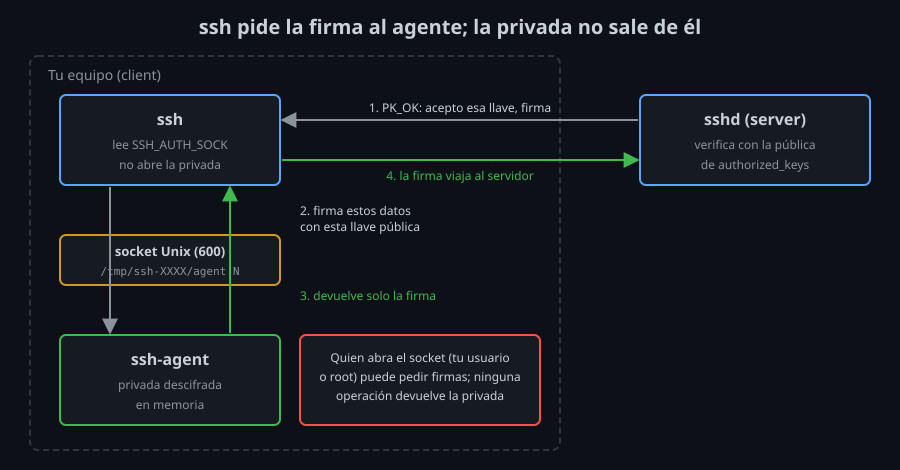

# `ssh-agent`: la frase una vez, la llave en memoria

⏱ Lectura: ~30 min

En la semana 03 protegiste la privada con una frase de paso. Como `ssh` la descifra en cada conexión, ahora escribes la frase cada vez que entras. `ssh-agent` resuelve eso: descifras la llave **una vez** y un proceso la guarda en memoria para firmar por ti.

## Qué es

- **Qué:** un proceso tuyo que guarda llaves privadas ya descifradas y **firma** con ellas cuando se lo piden. Nunca entrega la privada: ni a `ssh`, ni a nadie.
- **Para qué:** escribir la frase una vez por sesión de trabajo, no en cada `ssh`, `scp` o `git push`.
- **Impacto:** mientras el agente tiene la llave, quien pueda hablar con él puede pedirle firmas. Por eso importa quién llega a su socket (más abajo) y cuánto tiempo guarda cada llave.

## Cómo habla `ssh` con el agente



El agente escucha en un **socket Unix**: un archivo especial por el que dos procesos del mismo equipo se envían mensajes. Su ruta está en la variable `SSH_AUTH_SOCK`:

1. `ssh` llega al paso 3 de la autenticación con llave ([semana 03, teoría 01](../../week-03-autenticacion_con_llaves_ssh/1-teoria/01-autenticacion-con-llave-publica.md#el-intercambio-paso-a-paso)): tiene que firmar.
2. En vez de abrir el archivo de la privada, envía al agente por `SSH_AUTH_SOCK` los datos a firmar y la llave **pública** que quiere usar.
3. El agente firma con la privada que tiene en memoria y devuelve solo la **firma**.
4. `ssh` envía la firma al servidor. El servidor no nota la diferencia.

Si `SSH_AUTH_SOCK` está vacía, o el socket no tiene agente detrás, `ssh` no usa ningún agente y abre los archivos de las llaves como en la semana 03.

## Arrancarlo

```bash
eval "$(ssh-agent)"
```

`ssh-agent` arranca en segundo plano e imprime código de shell:

```
SSH_AUTH_SOCK=/tmp/ssh-nVyZhZhHLF1W/agent.10; export SSH_AUTH_SOCK;
SSH_AGENT_PID=11; export SSH_AGENT_PID;
echo Agent pid 11;
```

`eval` ejecuta ese código en **tu** shell: así `SSH_AUTH_SOCK` queda definida en la terminal donde lo ejecutas, y en los programas que lances desde ella. Sin `eval`, el agente arranca, pero ninguna terminal sabe dónde está.

- **Qué:** una variable de entorno vive en un proceso y en sus hijos. Otra terminal no la ve.
- **Impacto:** cada `eval "$(ssh-agent)"` arranca **otro** agente vacío. En tu escritorio, el sistema suele arrancar uno al iniciar sesión (por eso `ssh-add -l` funciona en tu terminal sin hacer nada). En el contenedor del laboratorio no hay ninguno. En el proyecto escribirás `bin/agent-up`, que reutiliza el agente en lugar de arrancar uno nuevo cada vez.

## `ssh-add`: qué tiene el agente

| Comando | Qué hace |
|---|---|
| `ssh-add RUTA` | Descifra la privada (pide la frase) y la carga en el agente |
| `ssh-add -l` | Lista las huellas de las llaves cargadas |
| `ssh-add -L` | Lista las llaves públicas completas |
| `ssh-add -d RUTA` | Quita esa llave del agente (no borra el archivo) |
| `ssh-add -D` | Quita todas |
| `ssh-add -t 3600 RUTA` | Carga la llave durante 3600 s; luego el agente la olvida |
| `ssh-add -x` / `-X` | Bloquea o desbloquea el agente con una contraseña |
| `ssh-add -c RUTA` | Pide confirmación en cada uso ([teoría 02](02-agent-forwarding-y-riesgos.md#ssh-add--c-confirmar-cada-firma)) |
| `ssh-add -h DESTINO RUTA` | La llave solo vale para ese destino ([teoría 02](02-agent-forwarding-y-riesgos.md#ssh-add--h-la-llave-solo-vale-en-un-camino)) |

`ssh-add -l` sale con un código que distingue los tres estados posibles, y lo usarás en scripts:

| Código | Mensaje | Significa |
|:--:|---|---|
| 0 | (lista de huellas) | Hay agente y tiene llaves |
| 1 | `The agent has no identities.` | Hay agente, vacío |
| 2 | `Could not open a connection to your authentication agent.` | No hay agente en `SSH_AUTH_SOCK` |

### `AddKeysToAgent`: cargar al usar

- **Qué:** con `AddKeysToAgent yes` en `~/.ssh/config`, la primera vez que `ssh` descifra una llave (y te pide la frase), la deja en el agente. Con un tiempo (`AddKeysToAgent 1h`), la deja durante ese tiempo.
- **Para qué:** no tener que acordarte de `ssh-add`: la primera conexión del día pide la frase y las siguientes no.
- **Impacto:** si no hay agente, la opción no hace nada. Tu kit usará `1h`.

### Caducidad y bloqueo

Una llave cargada sigue cargada hasta que el agente muere: si te levantas del equipo, cualquiera que se siente en tu terminal entra donde tú entras. Para acotarlo:

- `ssh-add -t TIEMPO` (o `ssh-agent -t TIEMPO`, que lo aplica a todas las llaves que se añadan) limita el tiempo de cada llave.
- `ssh-add -x` bloquea el agente con una contraseña: sigue vivo, pero no firma ni lista nada hasta `ssh-add -X`.
- `ssh-add -D` al terminar.

## Quién puede usar tu agente

El agente no pregunta quién le habla: firma para cualquier proceso que abra su socket. La protección son los permisos del socket:

```
drwx------ 2 alumno alumno 4096 Nov  8 05:40 /tmp/ssh-L7VziiXCbW0Y
srw------- 1 alumno alumno    0 Nov  8 05:40 /tmp/ssh-L7VziiXCbW0Y/agent.12
```

- La `s` inicial indica un socket. La carpeta está en 700 y el socket en 600: solo tu usuario llega a él.
- **Impacto:** cualquier programa que ejecutes con tu usuario, y root en ese equipo, pueden pedir firmas a tu agente. No pueden **sacar** la privada: el agente no tiene ninguna operación que la devuelva, y en Linux impide que otros procesos de tu usuario lean su memoria (root sí podría). Pero mientras la llave está cargada pueden usarla.

En tu propio equipo eso es aceptable: si algo malicioso corre con tu usuario, ya puede leer tus archivos. El problema aparece cuando el socket llega a **otro** equipo, que es lo que hace el agent forwarding ([teoría 02](02-agent-forwarding-y-riesgos.md)).

## El agente y las llaves que ofrece `ssh`

Con un agente, `ssh -v` marca sus llaves con `agent` y las prueba **antes** que los archivos:

```
debug1: get_agent_identities: bound agent to hostkey
debug1: Will attempt key: alumno@client ED25519 SHA256:RuPq... agent
debug1: Will attempt key: /home/alumno/.ssh/id_rsa
```

- Es la causa del `Too many authentication failures` del [lab 05 de la semana 03](../../week-03-autenticacion_con_llaves_ssh/2-practicas/lab-05-varias-llaves/README.md): un agente con muchas llaves gasta los intentos. `IdentitiesOnly yes` limita también las del agente a las de `IdentityFile`; el agente sigue firmando, pero solo con esas.
- `bound agent to hostkey`: desde OpenSSH 8.9, `ssh` le dice al agente con qué servidor está hablando (su host key). Es lo que permite las restricciones por destino de `ssh-add -h`.
- `IdentityAgent none` (o `-o IdentityAgent=none`) hace que `ssh` ignore el agente en esa conexión.

## Puntos clave

- El agente guarda llaves descifradas y firma por ti; la privada nunca sale de él.
- `SSH_AUTH_SOCK` dice dónde está; `eval "$(ssh-agent)"` la define en la terminal actual.
- `ssh-add -l` sale con 0 (llaves), 1 (vacío) o 2 (no hay agente).
- `AddKeysToAgent` carga la llave en la primera conexión; `-t` le pone caducidad.
- Quien abre el socket (tu usuario o root) puede pedir firmas, no llevarse la llave.

<!-- nav -->
---

## 🔗 Navegación

| Anterior | Siguiente |
|---|---|
| ← [Semana 04 — `ssh-agent`, agent forwarding y llaves FIDO2](../README.md) | [Teoría — Agent forwarding y sus riesgos](02-agent-forwarding-y-riesgos.md) → |

[↑ Semana 04](../README.md)
