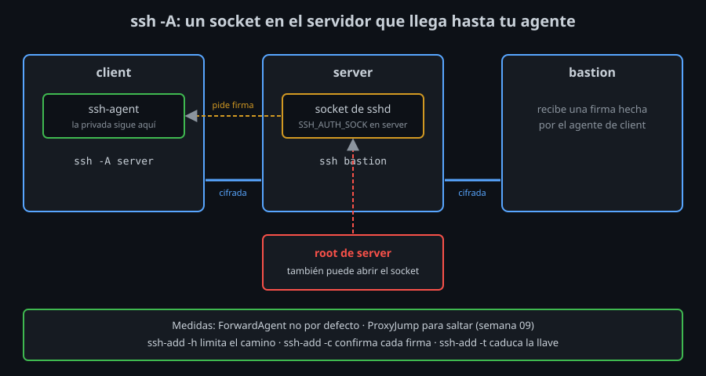

# Agent forwarding y sus riesgos

⏱ Lectura: ~30 min

Entras en `server` con tu llave. Desde ahí quieres entrar en `bastion`. Tu llave está en tu equipo, no en `server`, y copiarla allí sería repartir tu privada. El **agent forwarding** resuelve eso sin copiarla, a cambio de un riesgo que tienes que entender antes de activarlo.

## Qué es

- **Qué:** con `ssh -A` (o `ForwardAgent yes` en `config`), la conexión lleva también un canal hacia tu agente. En el servidor, `sshd` crea un socket y define `SSH_AUTH_SOCK`; lo que llega a ese socket viaja por la conexión cifrada hasta tu agente.
- **Para qué:** que un `ssh` (o `git`) que corre **en el servidor** pueda firmar con tu llave, que sigue en tu equipo.
- **Impacto:** tu agente firma para el servidor remoto mientras dure la conexión. La privada no sale de tu equipo, pero su **uso** sí.



En el servidor:

```
/tmp/ssh-oRdY0q3XIz/agent.55
256 SHA256:eqh+7yREBaoeM76ZLjEnBLSLUX6pj9k2CXc2Gz3feno alumno@client (ED25519)
```

Es `echo $SSH_AUTH_SOCK` y `ssh-add -l` ejecutados **en `server`**: la llave que lista está en tu cliente. Sin `-A`, en el servidor `SSH_AUTH_SOCK` está vacía y `ssh-add -l` da `Could not open a connection to your authentication agent.`

Al cerrar la conexión, el socket del servidor desaparece.

## El riesgo

El socket del servidor no sabe quién le habla, igual que el de tu equipo ([teoría 01](01-ssh-agent.md#quién-puede-usar-tu-agente)). En tu equipo, quien llega a él eres tú o root **de tu equipo**. En el servidor, llegan:

- **root del servidor**, que puede abrir cualquier socket;
- cualquier proceso que corra con tu usuario en el servidor.

Mientras tu conexión con `-A` está abierta, cualquiera de ellos puede pedirle firmas a tu agente y **entrar como tú en cualquier servidor que acepte tu llave**. No se lleva la privada: el abuso termina al cerrar la conexión. Pero en ese tiempo no ves nada, porque el agente firma sin avisar.

**Impacto:** activar el forwarding hacia un servidor es confiar en todos los que son root en él, y en que no esté comprometido. `man ssh` lo resume así: el forwarding debe activarse con cuidado, solo hacia servidores en los que confías.

## El lado del servidor

| Dónde | Qué | Efecto |
|---|---|---|
| `sshd_config` | `AllowAgentForwarding no` | Ninguna conexión recibe socket (semana 07) |
| `authorized_keys` | `restrict` (o `no-agent-forwarding`) | Esa llave no recibe socket aunque pidas `-A` |
| `authorized_keys` | `restrict,agent-forwarding` | Esa llave sí, todo lo demás no |

Con `restrict` (semana 03), `ssh -v -A` muestra `Requesting authentication agent forwarding.`, pero en el servidor `SSH_AUTH_SOCK` sigue vacía: el servidor se niega sin error.

## Cómo reducir el riesgo

En orden de preferencia:

1. **No reenviar por defecto.** `ForwardAgent no` en `Host *` de tu `config` (ya es el valor por defecto; escribirlo deja la decisión explícita). Si un host lo necesita, se activa solo en su bloque.
2. **No reenviar para saltar.** Para llegar a un servidor a través de otro, `ProxyJump` (semana 09) es mejor: la conexión al destino se cifra de punta a punta desde tu equipo, y la firma ocurre en tu equipo. El servidor intermedio solo reenvía bytes cifrados y no recibe ningún socket.
3. **Si reenvías, restringe la llave** con `ssh-add -h`.
4. **Si reenvías, mira cada uso** con `ssh-add -c`.
5. **Siempre, caducidad corta** con `ssh-add -t`.

### `ssh-add -h`: la llave solo vale en un camino

Desde OpenSSH 8.9, al cargar una llave puedes decir **para qué destinos** vale:

```bash
ssh-add -h server -h 'server>bastion' ~/.ssh/lab
```

- `-h server`: tu equipo puede usar la llave para entrar en `server`.
- `-h 'server>bastion'`: desde `server`, con el agente reenviado, puede usarse para entrar en `bastion`. Las comillas evitan que la shell lea `>` como una redirección.
- Cualquier otro uso se rechaza: desde tu equipo hacia `bastion` directamente, desde `server` hacia otro host, o desde `bastion` hacia más allá.

Funciona porque `ssh` le dice al agente con qué host key está hablando en cada salto (`bound agent to hostkey`, [teoría 01](01-ssh-agent.md#el-agente-y-las-llaves-que-ofrece-ssh)) y el agente compara con las host keys de **tu** `known_hosts`. Por eso:

- Cada destino tiene que estar en tu `known_hosts` al ejecutar `ssh-add -h`; si no: `No host keys found for destination "server"`.
- Si nadie en el camino tiene OpenSSH 8.9 o superior, la restricción no se puede comprobar y la llave se rechaza.
- **Impacto:** root de `server` sigue pudiendo usar tu socket, pero solo para entrar en `bastion`, que es lo que ya ibas a hacer. No puede usarlo para ir a ningún otro sitio.

En `ssh-add -l` en `server`, una llave sin permiso para ningún salto desde `server` ni siquiera aparece: `The agent has no identities.`

### `ssh-add -c`: confirmar cada firma

```bash
ssh-add -c ~/.ssh/lab
```

Con `-c`, el agente pregunta antes de cada firma. Para preguntar ejecuta el programa de la variable `SSH_ASKPASS` **del agente** (la que tenía al arrancar), con el texto de la pregunta como argumento:

```
Allow use of key alumno@client? Key fingerprint SHA256:rVQkW8T3KNYujnQIc83LWgO3tIWA4pzq65z6hL/GWDk.
```

- Si el programa sale con 0, firma. Con otro código, o si no hay programa, se niega, y el cliente ve `agent refused operation`.
- En un escritorio, `SSH_ASKPASS` suele ser una ventana con "Sí/No" (`ssh-askpass`). En el laboratorio no hay ventanas: en el [lab 06](../2-practicas/lab-06-confirmar-cada-uso/README.md) escribirás uno en bash.
- **Impacto:** una firma que no esperabas aparece como una pregunta que no esperabas. Es la única de estas medidas que te avisa de un uso.

### `ssh-add -t`: que dure poco

Una llave con `-t 1h` deja de estar en el agente pasada una hora, haya conexiones reenviadas o no. Acota el tiempo en el que un abuso es posible.

## Puntos clave

- `ssh -A` crea en el servidor un socket que llega a tu agente; la privada no viaja, su uso sí.
- Mientras dura la conexión, root del servidor puede usar ese socket para entrar como tú en otros servidores.
- `ForwardAgent no` por defecto; para saltar, `ProxyJump`.
- Si reenvías: `ssh-add -h` limita el camino, `ssh-add -c` te pregunta cada firma, `ssh-add -t` acota el tiempo.
- En el servidor, `restrict` en `authorized_keys` o `AllowAgentForwarding no` impiden el forwarding.

<!-- nav -->
---

## 🔗 Navegación

| Anterior | Siguiente |
|---|---|
| ← [Teoría — `ssh-agent`: la frase una vez, la llave en memoria](01-ssh-agent.md) | [Teoría — Llaves FIDO2: la privada dentro de un dispositivo](03-llaves-fido2-sk.md) → |

[↑ Semana 04](../README.md)
