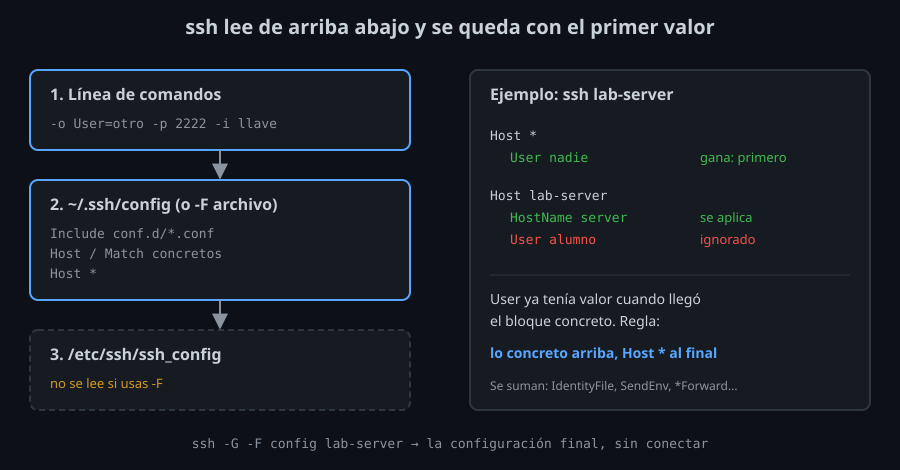

# Cómo lee `ssh` su configuración

⏱ Lectura: ~30 min

Desde la semana 01 tu kit tiene un `config` con alias y valores por defecto. Esta semana lo partes en archivos, le añades condiciones y reutilizas conexiones. Antes, tienes que saber exactamente **qué valor gana** cuando una opción aparece en varios sitios: casi todos los errores de configuración de `ssh` vienen de ahí.

## De dónde salen los valores



Para cada conexión, `ssh` recorre tres fuentes, en este orden:

1. **La línea de comandos:** `-o Opción=valor` y las opciones cortas (`-p 2222`, `-l alumno`, `-i llave`).
2. **El archivo del usuario:** `~/.ssh/config`, o el que indiques con `-F archivo`.
3. **El archivo del sistema:** `/etc/ssh/ssh_config`, que en Ubuntu incluye además `/etc/ssh/ssh_config.d/*.conf`.

Con `-F`, `ssh` lee **solo** ese archivo: ni `~/.ssh/config` ni el del sistema. En el cliente del laboratorio, el del sistema activa `HashKnownHosts` y `GSSAPIAuthentication`; con `-F /dev/null` (un archivo vacío) desaparecen:

```bash
ssh -G server | grep -E '^(hashknownhosts|gssapiauthentication) '
ssh -G -F /dev/null server | grep -E '^(hashknownhosts|gssapiauthentication) '
```
```
gssapiauthentication yes
hashknownhosts yes
gssapiauthentication no
hashknownhosts no
```

Por eso tu kit escribe en su `config` todo lo que necesita, sin contar con lo que traiga el sistema: con `ssh -F config` funciona igual en cualquier equipo.

## El primer valor gana

- **Qué:** para cada opción, `ssh` se queda con el **primer** valor que encuentra y descarta los siguientes. No hay "el último sobrescribe", como en casi todos los demás archivos de configuración.
- **Para qué:** que lo más concreto (la línea de comandos, el bloque de un host) se ponga por delante de lo general.
- **Impacto:** el orden de los bloques importa. Un `Host *` al principio fija valores para **todos** los hosts, y los bloques de debajo ya no pueden cambiarlos.

```
Host *
    User nadie

Host lab-server
    HostName server
    User alumno
```
```bash
ssh -G -F config lab-server | grep '^user '
```
```
user nadie
```

`User alumno` llega tarde: `User` ya tenía valor. La regla que sigues desde la semana 01 sale de aquí: **bloques concretos arriba, `Host *` al final**. `HostName` sí se aplica, porque `Host *` no lo define.

Dentro de un mismo bloque también gana la primera línea. La excepción son las opciones que **se acumulan**, porque tiene sentido tener varias: `IdentityFile`, `CertificateFile`, `LocalForward`, `RemoteForward`, `DynamicForward` y `SendEnv`. Cada línea añade un valor a la lista, en el orden en que aparecen.

## `ssh -G`: la configuración final, sin conectar

```bash
ssh -G -F config lab-server
```

- **Qué:** escribe todas las opciones con el valor que usaría `ssh` para ese destino (unas 90 líneas, en minúsculas) y termina sin conectar.
- **Para qué:** comprobar un cambio antes de usarlo, y averiguar de qué bloque sale un valor inesperado.
- **Impacto:** muestra los valores, no de dónde vienen. Para saber qué archivos leyó, añade `-v`: cada uno aparece como `debug1: Reading configuration data ...`.

Dos detalles de su salida:

- Los valores siguen el formato interno: `StrictHostKeyChecking yes` aparece como `stricthostkeychecking true`, y `ControlPersist 10m` como `controlpersist 600`.
- Los tokens (más abajo) de `IdentityFile` salen sin sustituir: `identityfile ~/.ssh/%r@%h`. `ssh` los sustituye al usar el archivo.

`-G` es la herramienta de toda la semana, y la que usan las comprobaciones del autograding.

## Patrones en `Host`

`Host` compara sus patrones con el nombre que **escribes** en la línea de comandos (el alias), no con su `HostName`:

| Patrón | Coincide con |
|--------|--------------|
| `lab-server` | ese nombre exacto |
| `lab-*` | cualquier nombre que empiece por `lab-` (`*`: cero o más caracteres) |
| `lab-?` | `lab-` y un carácter más (`?`: exactamente uno) |
| `server bastion` | cualquiera de los dos (lista separada por espacios) |
| `* !lab-bastion` | todos menos `lab-bastion` (`!`: negación) |

Un patrón negado solo **excluye**: `Host !lab-bastion` sin un patrón positivo al lado no coincide con nada.

Varios bloques pueden coincidir con el mismo nombre, y sus opciones se combinan (con la regla del primer valor). Así puedes poner lo común a un grupo en un bloque y lo propio de cada host en otro:

```
Host lab-server
    HostName server

Host lab-bastion
    HostName bastion

Host lab-*
    User alumno
    IdentityFile ~/.ssh/lab
```

## Tokens

Algunas opciones aceptan **tokens**, marcadores que `ssh` sustituye en cada conexión:

| Token | Valor |
|-------|-------|
| `%h` | el host al que conecta (el `HostName`, si hay) |
| `%n` | el nombre que escribiste en la línea de comandos |
| `%p` | el puerto |
| `%r` | el usuario remoto |
| `%u` | tu usuario local |
| `%d` | tu carpeta personal |
| `%C` | un hash de 40 caracteres de equipo local, host, puerto y usuario remoto |
| `%%` | un `%` literal |

Los usan, entre otras, `HostName`, `IdentityFile`, `ControlPath` ([teoría 03](03-multiplexing.md)) y `Match exec` ([teoría 02](02-include-match-y-perfiles.md#match-exec)). En `HostName`, `%h` es el nombre escrito: `Host *.lab` con `HostName %h.example.com` convierte `web.lab` en `web.lab.example.com`.

## Puntos clave

- Línea de comandos, después `~/.ssh/config` (o `-F`), después `/etc/ssh/ssh_config`. Con `-F`, solo ese archivo.
- El **primer** valor gana: lo concreto arriba, `Host *` al final.
- `IdentityFile`, `CertificateFile`, `SendEnv` y los `*Forward` se acumulan.
- `ssh -G` muestra la configuración final sin conectar; `ssh -v` dice qué archivos leyó.
- `Host` compara con el nombre escrito; `*`, `?`, listas y `!` para excluir.

<!-- nav -->
---

## 🔗 Navegación

| Anterior | Siguiente |
|---|---|
| ← [Semana 05 — Configuración avanzada del cliente](../README.md) | [Teoría — `Include`, `Match` y perfiles con `-P`](02-include-match-y-perfiles.md) → |

[↑ Semana 05](../README.md)
