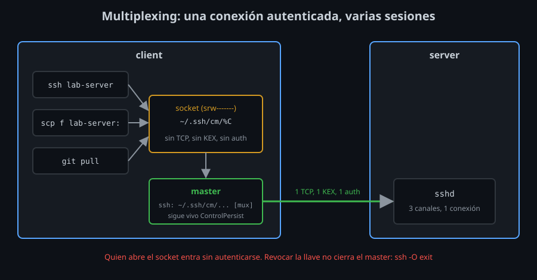

# Multiplexing: una conexión, muchas sesiones

⏱ Lectura: ~30 min

Cada `ssh` abre una conexión TCP, hace el intercambio de llaves ([semana 02](../../week-02-protocolo_kex_y_known_hosts/README.md)) y se autentica ([semana 03](../../week-03-autenticacion_con_llaves_ssh/README.md)). Para una sesión interactiva no importa. Para un script que lanza veinte `ssh` seguidos, o para `git` y `scp` repetidos, es casi todo el tiempo. El **multiplexing** hace ese trabajo una vez y reutiliza la conexión.

## Cómo funciona



1. El primer `ssh` a un host conecta y se autentica como siempre, y además abre un **socket Unix** en la ruta de `ControlPath`. Ese proceso es el **master**.
2. El siguiente `ssh` al mismo host encuentra el socket, pide al master una sesión nueva y termina ahí: sin TCP, sin intercambio de llaves, sin autenticación.
3. Dentro de la conexión del master viajan varios **canales** a la vez, uno por sesión. El protocolo SSH ya funcionaba así; el multiplexing solo deja que procesos distintos compartan los canales.

Medido en el laboratorio, 20 conexiones seguidas a `server`:

| | Tiempo |
|---|---|
| Sin multiplexing | 3,9 s |
| Con multiplexing | 0,34 s |

En una red real, con decenas de milisegundos por ida y vuelta, la diferencia es mayor.

## Las tres opciones

```
Host *
    ControlMaster auto
    ControlPath ~/.ssh/cm/%C
    ControlPersist 10m
```

### `ControlMaster`

- **Qué:** si `ssh` crea un master o usa uno. `auto`: usa el que haya y, si no hay, se convierte en master. `no` (el valor por defecto): nunca lo crea, aunque sí usa uno que exista.
- **Para qué:** `auto` da el comportamiento que quieres casi siempre, sin pensar en quién conectó primero.
- **Impacto:** existen también `yes` (siempre master), `ask` y `autoask` (preguntan antes de usarlo, con `SSH_ASKPASS`).

### `ControlPath`

- **Qué:** la ruta del socket. Una por destino: por eso lleva tokens.
- **Para qué:** `%C`, un hash de host, puerto y usuarios, da un nombre distinto para cada destino y siempre de la misma longitud.
- **Impacto:** un socket Unix admite rutas de menos de 108 bytes en Linux. Con `%r@%h:%p` y un nombre de host largo, `ssh` falla:
  ```
  ControlPath too long ('/tmp/xxxx...xxxx' >= 108 bytes)
  ```
  `ssh` **no crea la carpeta**. Si `~/.ssh/cm` no existe:
  ```
  unix_listener: cannot bind to path /home/alumno/.ssh/cm/e02bc41e....WLqX5bFu6IxodDPi: No such file or directory
  ```
  y la conexión falla entera. Por eso tu kit la crea con `bin/kit-link`.

### `ControlPersist`

- **Qué:** cuánto sigue vivo el master, en segundo plano, después de cerrar la última sesión. `no` (por defecto): el master es tu primer `ssh` y termina con él. `10m`: diez minutos más. `yes`: hasta que lo cierres.
- **Para qué:** que el siguiente comando, unos minutos después, encuentre la conexión abierta.
- **Impacto:** cuanto más largo, más tiempo hay una conexión autenticada esperando (ver [riesgos](#riesgos)).

## Controlar el master: `ssh -O`

| Orden | Efecto | Salida |
|-------|--------|--------|
| `ssh -O check HOST` | dice si hay master | `Master running (pid=81)` |
| `ssh -O exit HOST` | cierra el master y sus sesiones | `Exit request sent.` |
| `ssh -O stop HOST` | deja de aceptar sesiones nuevas; termina cuando acaban las abiertas | `Stop listening request sent.` |

Sin master, todas fallan con código 255:

```
Control socket connect(/home/alumno/.ssh/cm/e02bc41e...): No such file or directory
```

`HOST` sirve para calcular la ruta del socket con tu configuración. `-S RUTA` da la ruta directamente. En `ps`, el master aparece como `ssh: /home/alumno/.ssh/cm/e02bc41e... [mux]`.

## Lo que el master decide

Una sesión nueva por el master **no** vuelve a negociar nada: usa la conexión tal como se abrió.

- **La autenticación ya está hecha.** Si quitas tu llave de `authorized_keys`, o cambias de llave con `-i`, las sesiones por el master siguen entrando hasta que el master se cierre.
- **Las opciones de la conexión son las del master.** El agent forwarding es el ejemplo que más importa. Con un master abierto **sin** `-A`, un `ssh -A` posterior no reenvía nada. Con un master abierto **con** `-A`, **todas** las sesiones siguientes reciben el agente, aunque no lo pidan:
  ```
  master con -A: [/tmp/ssh-K5fk2Yjkxv/agent.536]
  después, sin -A: [/tmp/ssh-K5fk2Yjkxv/agent.536]
  ```
  Un solo `ssh -A` a un host deja el agente reenviado allí mientras viva el master, `ControlPersist` incluido. Otra razón para `ForwardAgent no` ([semana 04](../../week-04-ssh_agent_y_llaves_fido2/1-teoria/02-agent-forwarding-y-riesgos.md)).
- **`ssh -v` lo dice:** `debug1: auto-mux: Trying existing master at '/home/alumno/.ssh/cm/e02bc41e...'`.

### Cuándo no quieres el master

Para probar de verdad una llave, un `authorized_keys` o una opción de conexión, salta el master:

```bash
ssh -o ControlMaster=no -o ControlPath=none HOST
```

Tu kit lo deja en `ssh -P sinmux HOST`, con un perfil ([teoría 02](02-include-match-y-perfiles.md#perfiles-tag-y--p)).

## Riesgos

- **El socket es una puerta abierta.** Quien pueda conectarse a él abre sesiones en el servidor **sin autenticarse**. El socket es `srw-------` (solo tú), y la carpeta debe ser 700. Root en tu equipo siempre puede usarlo, igual que tu agente ([semana 04](../../week-04-ssh_agent_y_llaves_fido2/1-teoria/02-agent-forwarding-y-riesgos.md)).
- **Una revocación no corta un master.** Después de cambiar llaves o `authorized_keys`, cierra los masters (`ssh -O exit`, o `bin/mux stop` de tu kit).
- **`ControlPersist` largo** alarga esa ventana. Diez minutos ahorran casi todo el tiempo de conexión sin dejar conexiones abiertas toda la noche.

## Puntos clave

- El master hace TCP, intercambio de llaves y autenticación una vez; las demás sesiones viajan por su socket.
- `ControlMaster auto`, `ControlPath ~/.ssh/cm/%C` (la carpeta tiene que existir, y la ruta, < 108 bytes) y `ControlPersist 10m`.
- `ssh -O check|exit|stop HOST` controla el master.
- El master ya está autenticado y decide las opciones: una revocación o un `-A` posterior no le cambian nada, y un master abierto con `-A` reenvía el agente a todas las sesiones.
- `-o ControlMaster=no -o ControlPath=none` (o un perfil) salta el master.

<!-- nav -->
---

## 🔗 Navegación

| Anterior | Siguiente |
|---|---|
| ← [Teoría — `Include`, `Match` y perfiles con `-P`](02-include-match-y-perfiles.md) | [Índice de labs](../2-practicas/README.md) → |

[↑ Semana 05](../README.md)
