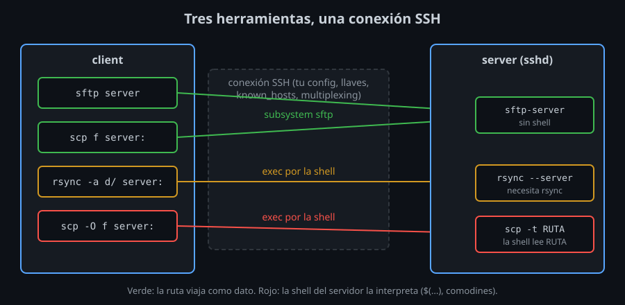

# `scp` y `sftp`: copiar por una conexión SSH

⏱ Lectura: ~30 min

Hasta ahora usaste SSH para ejecutar órdenes en otro equipo. La misma conexión cifrada y autenticada sirve para mover archivos: no hace falta otro servidor, otro puerto ni otra contraseña. OpenSSH trae dos herramientas para eso, `scp` y `sftp`, y esta semana añadirás una tercera, `rsync`, que usa SSH como transporte.

## Tres herramientas, una conexión



Las tres abren una conexión `ssh` normal (con tu `config`, tus llaves, `known_hosts` y multiplexing) y dentro de ella un **canal**. Lo que cambia es qué piden por ese canal:

| Herramienta | Pide al servidor | Programa que responde |
|---|---|---|
| `sftp` | el **subsistema** `sftp` | `sftp-server` (o `internal-sftp`) |
| `scp` (OpenSSH 9.0+) | el subsistema `sftp` | `sftp-server` |
| `scp -O` (protocolo antiguo) | ejecutar `scp -t RUTA` con la shell del usuario | `scp` del servidor |
| `rsync` | ejecutar `rsync --server ...` con la shell del usuario | `rsync` del servidor |

Un **subsistema** es un programa con nombre que `sshd` arranca sin pasar por la shell del usuario. Se declara en `sshd_config`:

```
Subsystem sftp /usr/lib/openssh/sftp-server
```

- **Qué:** cuando un cliente pide el subsistema `sftp`, `sshd` ejecuta ese programa conectado al canal.
- **Para qué:** que la transferencia no dependa de la shell remota ni de lo que escriba al arrancar (un `.bashrc` que imprime un saludo rompe los protocolos que pasan por la shell).
- **Impacto:** sin esa línea, `sftp` y `scp` fallan con `subsystem request failed`; `scp -O` y `rsync` siguen funcionando.

## `scp`

`scp` copia como `cp`: `scp ORIGEN... DESTINO`. Lo remoto se escribe `[usuario@]host:ruta`.

```bash
scp notas.txt server:            # al home de alumno en server
scp notas.txt server:docs/       # ruta relativa: desde el home
scp server:/etc/os-release .     # del servidor a la carpeta actual
scp -r datos server:copia        # una carpeta entera
scp server:a.txt bastion:        # entre dos servidores, pasando por tu equipo
```

| Opción | Qué hace |
|---|---|
| `-r` | Copia carpetas, recursivamente |
| `-p` | Conserva fechas de modificación y permisos |
| `-F config` | Lee ese `ssh_config` (alias, llaves, multiplexing del kit) |
| `-P 2222` | Puerto. **Mayúscula**: `-p` ya es "conservar". En `ssh` es `-p` |
| `-i llave` | La llave a usar, como en `ssh` |
| `-l 8000` | Límite de ancho de banda, en **kilobits** por segundo |
| `-3` | Entre dos remotos, pasar por tu equipo. Es lo que hace por defecto desde OpenSSH 8.7 |
| `-R` | Entre dos remotos, que el origen conecte directamente al destino (con **sus** llaves y **su** `known_hosts`) |
| `-O` | Usar el protocolo antiguo en lugar de SFTP |
| `-q` | Sin barra de progreso ni avisos |

### El protocolo antiguo y por qué cambió

Hasta OpenSSH 8.9, `scp` ejecutaba en el servidor `scp -t RUTA` (recibir) o `scp -f RUTA` (enviar) **a través de la shell del usuario**. La shell interpretaba la ruta: comodines, variables, `$(...)`. Eso permitía `scp 'server:*.log' .`, pero también que un nombre de archivo ejecutara órdenes (es la vulnerabilidad CVE-2020-15778, y la razón del cambio). Desde OpenSSH 9.0, `scp` usa SFTP por debajo: la ruta viaja como dato, nadie la interpreta, y los comodines los expande el propio `scp`.

- **Qué:** `-O` vuelve al protocolo antiguo.
- **Para qué:** solo para servidores muy viejos o mínimos (algunos equipos de red) que no tienen subsistema `sftp`.
- **Impacto:** con `-O`, un nombre de archivo que llega de fuera de tu script puede ejecutar órdenes en el servidor ([lab 01, paso 6](../2-practicas/lab-01-scp/README.md)).

`scp` copia siempre todo: no sabe reanudar ni enviar solo lo que cambió. Para copias puntuales es lo más sencillo; para sincronizar, `rsync`.

## `sftp`

**SFTP** (*SSH File Transfer Protocol*) no es FTP sobre SSH: es un protocolo propio de operaciones sobre archivos (abrir, leer, escribir, listar, renombrar, cambiar permisos) que viaja dentro de un canal SSH. No tiene nada que ver con FTP ni con FTPS, y no necesita más puertos que el 22.

`sftp` es su cliente interactivo:

```bash
sftp server            # sesión interactiva
sftp -F config lab-server
sftp server:docs/notas.txt .    # bajar un archivo y salir
sftp -b lote.sftp server        # ejecutar las órdenes de un archivo
```

### Órdenes de la sesión

Cada orden actúa en un lado; las que empiezan por `l` actúan en tu equipo:

| Remoto | Local | Qué hace |
|---|---|---|
| `pwd` | `lpwd` | Carpeta actual |
| `cd` | `lcd` | Cambiar de carpeta |
| `ls -l` | `lls -l` | Listar |
| `mkdir` | `lmkdir` | Crear carpeta |
| `rm`, `rmdir`, `rename`, `chmod` | | Borrar, renombrar, permisos en el servidor |
| `put [-R] LOCAL [REMOTO]` | | Subir (`-R`: carpetas) |
| `get [-R] REMOTO [LOCAL]` | | Bajar |
| `reput`, `reget` | | Reanudar una subida o bajada cortada, desde el tamaño que ya hay |
| `df -h` | | Espacio libre en el servidor |
| | `!orden` | Ejecutar una orden en tu equipo |
| `bye` | | Salir (también `exit`, `quit`, Ctrl+D) |

### Lotes con `-b`

- **Qué:** `sftp -b ARCHIVO` ejecuta las órdenes del archivo, una por línea, sin preguntar nada. `-b -` las lee de la entrada estándar.
- **Para qué:** automatizar transferencias en scripts y `cron`, con un código de salida fiable.
- **Impacto:** el lote **se para en la primera orden que falla** y `sftp` sale con 1. Un `-` delante de una orden (`-mkdir copia`) ignora su error; úsalo solo donde fallar no importa. `-b` necesita autenticación sin teclado (llave sin frase o agente): no puede pedir contraseñas.

### Hasta dónde llega `sftp`

`sftp-server` corre como tu usuario y llega a todo lo que tu usuario puede leer o escribir, no solo a tu home: `cd /etc` funciona. Para encerrar a un usuario en una carpeta hace falta `ChrootDirectory` en `sshd_config` (semana 07). `sftp-server -R` impide escribir, y `-d` elige la carpeta inicial, pero ninguna de las dos encierra ([lab 06, paso 9](../2-practicas/lab-06-llave-solo-para-rsync/README.md)).

## `sshfs`: montar una carpeta remota

`sshfs server:datos ~/remoto` monta una carpeta remota como si fuera local, usando SFTP por debajo. Es cómodo para editar con tus programas habituales, pero cada lectura viaja por la red, y si la conexión cae, los programas que tienen archivos abiertos se bloquean. Necesita FUSE en el equipo cliente, que un contenedor sin privilegios no tiene: por eso no está en el laboratorio. Desmonta con `fusermount -u ~/remoto`.

## Cuál usar

| Necesitas | Usa |
|---|---|
| Copiar uno o pocos archivos, una vez | `scp` |
| Moverte por el servidor, ver qué hay, bajar y subir a mano | `sftp` |
| Un script que sube o baja archivos concretos y comprueba errores | `sftp -b` |
| Mantener una carpeta sincronizada, copias de seguridad, reanudar | `rsync` ([teoría 02](02-rsync.md)) |
| Un servidor sin `rsync` y miles de archivos | `tar` por `ssh` ([lab 07, paso 7](../2-practicas/lab-07-transferencias-grandes/README.md)) |

Con tu kit, cualquiera de ellas usa los alias y el multiplexing si le pasas el `config`: `scp -F config`, `sftp -F config`, `rsync -e 'ssh -F config'`.

<!-- nav -->
---

## 🔗 Navegación

| Anterior | Siguiente |
|---|---|
| ← [Semana 06 — Transferencia de archivos: scp, sftp y rsync](../README.md) | [Teoría — `rsync`: enviar solo lo que cambió](02-rsync.md) → |

[↑ Semana 06](../README.md)
