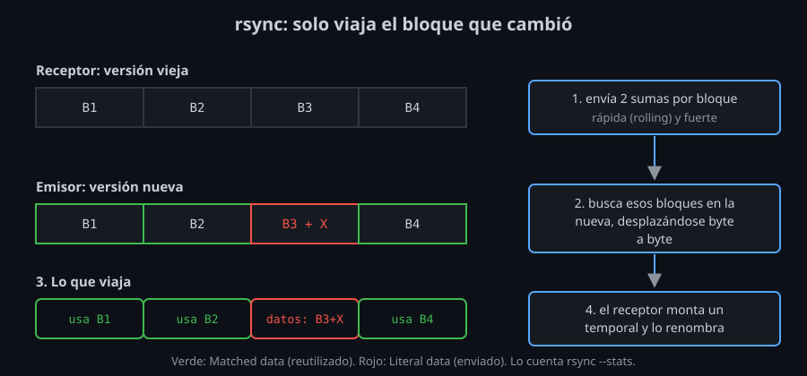
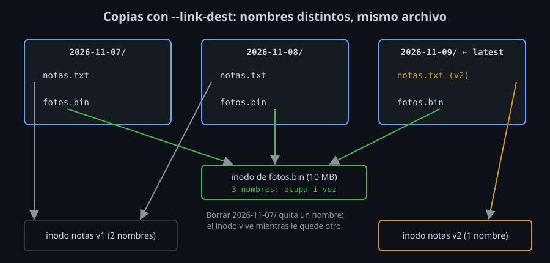

# `rsync`: enviar solo lo que cambió

⏱ Lectura: ~35 min

`scp` copia siempre todo. Para una carpeta de mil archivos en la que cambiaron dos, o un archivo de varios GB en el que cambió un trozo, eso es casi todo trabajo inútil. `rsync` compara los dos lados y envía solo la diferencia. No es parte de OpenSSH: es un programa aparte que usa `ssh` como transporte, y por eso tiene que estar instalado **en los dos extremos**.

## Cómo conecta

```bash
rsync -a datos/ server:copia
```

1. `rsync` lanza `ssh server rsync --server ...` (lo ves con `-vv`, [lab 03, paso 8](../2-practicas/lab-03-rsync/README.md)).
2. En el servidor arranca otro `rsync` en modo servidor, conectado al canal SSH.
3. Los dos hablan el protocolo de `rsync` por ese canal: listas de archivos, sumas de comprobación y datos.

La orden de conexión se cambia con `-e` o con la variable `RSYNC_RSH`:

```bash
rsync -a -e 'ssh -F ~/ssh-infra-kit/config' datos/ lab-server:copia
RSYNC_RSH='ssh -F ~/ssh-infra-kit/config' rsync -a datos/ lab-server:copia
```

- **Qué:** la orden con la que `rsync` abre la conexión. `-e` gana a `RSYNC_RSH`.
- **Para qué:** usar alias, llaves, `known_hosts` y multiplexing de tu kit.
- **Impacto:** `bin/backup` y `bin/mirror` exportan `RSYNC_RSH` con el `config` del kit solo si no viene ya definida; así los tests (y tú) podéis cambiarla.

## Qué decide copiar: la *quick check*

Para cada archivo, `rsync` compara **tamaño y fecha de modificación** en los dos lados. Si coinciden, lo da por igual y no lo lee. Es muy rápido, y casi siempre basta.

Falla en un caso: un archivo que cambió de contenido sin cambiar de tamaño ni de fecha (alguien restauró la fecha con `touch -r`, o el cambio cayó en el mismo segundo que la copia anterior). Para eso existe `-c` (`--checksum`): calcula un hash de cada archivo en los dos lados. Detecta todo, pero lee todos los archivos enteros: úsalo para verificar una copia, no en cada sincronización ([lab 03, paso 7](../2-practicas/lab-03-rsync/README.md)).

## Qué envía: el algoritmo de diferencias

Cuando un archivo sí cambió y ya existe una versión en el destino, `rsync` no lo envía entero:



1. El **receptor** parte su versión vieja en bloques y envía dos sumas de cada uno: una rápida (*rolling checksum*) y una fuerte.
2. El **emisor** recorre su versión nueva, desplazándose byte a byte, y busca bloques cuya suma rápida coincida; si coincide, confirma con la fuerte.
3. Por cada bloque encontrado envía solo "usa tu bloque N"; lo que no encuentra lo envía tal cual.
4. El receptor monta el archivo nuevo en un temporal y, al terminar, lo renombra sobre el viejo.

`--stats` lo cuenta: `Matched data` es lo reutilizado y `Literal data` lo enviado. Un byte cambiado en 20 MB envía unos KB ([lab 03, paso 6](../2-practicas/lab-03-rsync/README.md)). Entre dos carpetas locales, `rsync` no usa este algoritmo (`--whole-file` por defecto): leer el disco cuesta lo mismo que copiar.

## Las opciones de cada día

| Opción | Qué hace |
|---|---|
| `-a` | *Archive*: recursivo y conserva permisos, fechas, enlaces simbólicos, dueño y grupo (`-rlptgoD`). Casi siempre quieres esta |
| `-v` | Un nombre por archivo transferido |
| `-n` | *Dry run*: hace todo menos escribir. Combínalo con `-i` |
| `-i` | Una línea por cambio, con su motivo |
| `-z` | Comprime en el camino. Ayuda con texto en redes lentas; con datos ya comprimidos solo gasta CPU |
| `-c` | Compara por contenido, no por tamaño y fecha |
| `--stats` | Resumen: archivos, bytes enviados, `Literal` y `Matched` |
| `-e ORDEN` | La orden de conexión (ver arriba) |

### La barra final del origen

Es el error más común con `rsync`, y por eso va aparte:

```bash
rsync -a datos  server:copia     # crea copia/datos/...
rsync -a datos/ server:copia     # copia/... : el contenido de datos
```

Sin barra, se copia **la carpeta**; con barra, **su contenido**. En el destino la barra no cambia nada. `bin/backup` y `bin/mirror` añaden la barra al origen siempre, para que no dependa de cómo lo escribas.

### Leer `-i`

```
<f.st...... a.txt
```

| Posición | Valores |
|---|---|
| 1 | `<` se envía, `>` se recibe, `c` se crea (carpeta, enlace), `.` no se transfiere, `*` mensaje (`*deleting`) |
| 2 | `f` archivo, `d` carpeta, `L` enlace simbólico |
| 3 a 11 | Qué cambió: `c` contenido, `s` tamaño, `t` fecha, `p` permisos, `o` dueño, `g` grupo. `+++++++++`: nuevo |

## Borrar en el destino

Por defecto `rsync` añade y actualiza, pero no borra: lo que eliminaste en el origen sigue en el destino. `--delete` borra en el destino lo que ya no está en el origen, y lo marca con `*deleting`.

- **Qué:** el destino pasa a ser un espejo exacto del origen.
- **Para qué:** publicar una web, desplegar una carpeta, mantener una réplica sin restos.
- **Impacto:** un origen equivocado borra el destino. Una carpeta vacía, o `"$ORIGEN/"` con la variable sin definir (que se convierte en `/`), deja el destino como el origen: vacío, o con tu disco entero. Por eso, siempre primero `rsync -n -i --delete ...` y busca las líneas `*deleting` ([lab 04](../2-practicas/lab-04-delete-y-exclude/README.md)). `bin/mirror` lo hace por defecto.

`--delete` solo actúa dentro de las carpetas que se transfieren. Sin la barra en el origen, la carpeta transferida es `destino/datos/`, y lo que sobre en `destino/` no se toca.

### Filtros

```bash
rsync -a --delete --exclude '*.log' --exclude 'cache/' web/ server:web
rsync -a --delete --exclude-from=excluir.txt web/ server:web
```

- Un patrón sin `/` coincide con el nombre en cualquier carpeta; con `/` al final, solo con carpetas; con `/` al principio, se ancla a la raíz del origen.
- Lo excluido **tampoco se borra** en el destino: un patrón protege los dos lados. `--delete-excluded` sí lo borra.
- Entre comillas, para que la shell no expanda `*.log` en local.

### `--backup-dir`

`--backup --backup-dir=DIR` mueve a `DIR` todo lo que `rsync` borraría o sobrescribiría, en lugar de perderlo. Una ruta relativa se cuenta desde el destino: `--backup-dir=../borrados-$(date +%F)` queda al lado, fuera del alcance del siguiente `--delete`.

## Copias con `--link-dest`

Una copia de seguridad útil es **completa** (la abres y está todo) e **histórica** (puedes volver a la de hace tres días). Copiar todo cada día ocupa demasiado; copiar solo lo que cambia obliga a reconstruir. `--link-dest` da las dos cosas con **enlaces duros**.

En Linux, un archivo en disco (un **inodo**) puede tener varios nombres. `ln a b` crea un segundo nombre para el mismo inodo: no ocupa más, y el inodo solo se libera cuando se borra su último nombre. `stat -c %h` dice cuántos nombres tiene.



```bash
rsync -a --link-dest=/backups/2026-11-07 server:datos/ /backups/2026-11-08/
```

- **Qué:** para cada archivo igual al de `--link-dest`, crea en el destino un enlace duro a él en lugar de copiarlo. Lo que cambió se copia (con el algoritmo de diferencias contra la versión de `--link-dest`).
- **Para qué:** cada copia es completa e independiente, pero solo ocupa lo que cambió desde la anterior. Borrar la copia más antigua es seguro: los archivos que comparte con otras siguen ahí.
- **Impacto:** una ruta relativa se busca desde la carpeta de **destino**, no desde donde estás. Si no existe, `rsync` avisa (`--link-dest arg does not exist`) y **sigue**, copiando todo entero: usa rutas absolutas. Y nunca edites un archivo dentro de una copia: sus enlaces en las otras copias son el mismo archivo ([lab 05](../2-practicas/lab-05-snapshots-con-link-dest/README.md)).

`rsync` nunca modifica un archivo en su sitio (salvo con `--inplace`): escribe uno nuevo y lo renombra. Por eso actualizar la copia nueva no toca las anteriores.

## Transferencias largas

| Opción | Qué hace |
|---|---|
| `--partial` | Si se corta, conserva lo transferido en lugar de borrarlo; la siguiente pasada lo reutiliza y lo verifica |
| `--partial-dir=DIR` | Igual, pero guarda el trozo en `DIR`, no con el nombre definitivo |
| `-P` | `--partial --progress` |
| `--info=progress2` | Una línea de progreso para toda la transferencia |
| `--bwlimit=5m` | Limita el ancho de banda (5 MB/s) |
| `--timeout=60` | Aborta si no hay datos durante 60 s, en lugar de quedarse colgado |

Muchos archivos pequeños son lentos por el coste de cada conexión, no por los datos: una sola orden `rsync` para toda la carpeta, o el multiplexing de la [semana 05](../../week-05-configuracion_avanzada_cliente_ssh/1-teoria/03-multiplexing.md), lo eliminan ([lab 07](../2-practicas/lab-07-transferencias-grandes/README.md)).

<!-- nav -->
---

## 🔗 Navegación

| Anterior | Siguiente |
|---|---|
| ← [Teoría — `scp` y `sftp`: copiar por una conexión SSH](01-scp-y-sftp.md) | [Teoría — Copias de seguridad por SSH y llaves que solo copian](03-copias-de-seguridad-y-llaves-restringidas.md) → |

[↑ Semana 06](../README.md)
