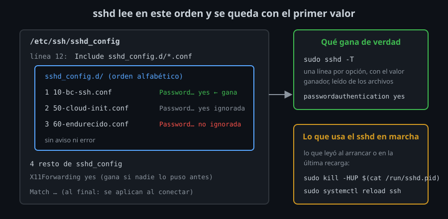

# `sshd_config` por dentro

⏱ Lectura: ~25 min

Hasta ahora has trabajado en el lado del cliente: `ssh`, `~/.ssh/config`, llaves, agente. Al otro lado siempre había un `sshd` con la configuración que traía el laboratorio. Esta semana cambias de lado: eres quien administra el servidor y decide quién entra, cómo y qué puede hacer dentro. Antes de cambiar nada hace falta saber de dónde saca `sshd` cada valor, cómo comprobar qué está usando y cómo aplicar un cambio sin cortar a nadie.

## Los archivos

En Ubuntu 24.04 (y en Debian, Fedora y la mayoría de distribuciones actuales) la configuración está repartida en dos sitios:

| Archivo | Quién lo escribe | Para qué |
|---|---|---|
| `/etc/ssh/sshd_config` | El paquete `openssh-server` | Valores de la distribución. Casi todo comentado: los comentarios muestran el valor por defecto |
| `/etc/ssh/sshd_config.d/*.conf` | Tú, tus herramientas (Ansible, `cloud-init`) | Tus cambios, un archivo por tema |

La línea 12 de `sshd_config` es:

```
Include /etc/ssh/sshd_config.d/*.conf
```

- **Qué:** `sshd` lee los `.conf` de la carpeta en orden alfabético, en el punto donde está el `Include`, y después sigue con el resto de `sshd_config`.
- **Para qué:** no tocar el archivo del paquete. Cuando una actualización trae un `sshd_config` nuevo, tus cambios no chocan con los suyos y no tienes que fusionar a mano.
- **Impacto:** para saber qué configuración tiene un servidor ya no basta con mirar un archivo: hay que mirar la carpeta y el orden.

## El primer valor gana

Para casi todas las opciones, `sshd` se queda con **el primer valor que lee** e ignora los siguientes. Es la misma regla que el cliente (semana 05), y por eso el `Include` está arriba: lo de `sshd_config.d/` gana a lo que venga después en `sshd_config`.



Dentro de la carpeta, el orden alfabético decide. El caso real más común:

```
/etc/ssh/sshd_config.d/50-cloud-init.conf:PasswordAuthentication yes
/etc/ssh/sshd_config.d/60-endurecido.conf:PasswordAuthentication no
```

Muchas imágenes de nube traen un `50-cloud-init.conf` que activa las contraseñas. Si escribes tu `PasswordAuthentication no` en un archivo que va después, **no tiene ningún efecto**, y no hay error ni aviso. El lab 01 lo reproduce.

| Hay excepciones | Cómo se comportan |
|---|---|
| `AllowUsers`, `AllowGroups`, `DenyUsers`, `DenyGroups` | Se acumulan: todas las líneas cuentan |
| `HostKey`, `ListenAddress`, `Port` | También se acumulan: varias llaves, varias direcciones |
| `Subsystem` | En OpenSSH 9.6 el primero gana sin aviso; en versiones anteriores, repetirlo era un error |

## Comprobar sin adivinar: `sshd -t` y `sshd -T`

| Orden | Qué hace | Cuándo |
|---|---|---|
| `sudo sshd -t` | Lee la configuración como al arrancar. No escribe nada si está bien; si hay un error, dice archivo y línea y sale con 255 | **Antes de cada recarga**. Siempre |
| `sudo sshd -T` | Escribe la configuración efectiva completa: unas 95 líneas, una por opción, con el valor ganador | Para saber qué valor gana de verdad |
| `sudo sshd -T -C user=ana,addr=10.0.0.5` | Lo mismo, pero aplicando los bloques `Match` como si se conectara `ana` desde esa dirección | Para probar un `Match` sin conectar (teoría 02) |

`sshd -T` escribe los nombres en minúsculas, y a veces con otro nombre: `PermitRootLogin prohibit-password` aparece como `permitrootlogin without-password`. Un `grep -i` lo encuentra igual.

> [!IMPORTANT]
> `sshd -T` lee **los archivos**, no lo que usa el `sshd` que está en marcha. Si cambiaste un archivo y no recargaste, `sshd -T` muestra el valor nuevo pero las conexiones siguen con el antiguo. El lab 01 lo comprueba con una contraseña que sigue entrando.

## Procesos: por qué recargar no corta a nadie

```
    PID    PPID USER     COMMAND
      1       0 root     sshd: /usr/sbin/sshd -D -e [listener] 0 of 10-100 startups
     29       1 root     sshd: alumno [priv]
     40      29 alumno   sshd: alumno@notty
```

- **`[listener]`**: el proceso que escucha en el puerto 22. Solo acepta conexiones nuevas; `0 of 10-100 startups` son las que están autenticándose ahora (`MaxStartups`, teoría 02).
- **`[priv]`**: uno por conexión, como root. Hace lo que necesita privilegios (leer `authorized_keys` de otro usuario, abrir una terminal).
- **`alumno@notty`**: el proceso de la sesión, ya con los permisos de `alumno`. Si un fallo en el código de `sshd` deja a alguien tomar este proceso, solo obtiene lo que `alumno` ya podía hacer. Esta separación se llama *privilege separation*.

Cada conexión es una copia del `sshd` que había al llegar, **con la configuración de ese momento**. Recargar solo afecta al `listener`:

| Forma de recargar | Dónde |
|---|---|
| `sudo systemctl reload ssh` | Un servidor Ubuntu o Debian con systemd. Ejecuta antes `sshd -t` y no recarga si falla |
| `sudo kill -HUP $(cat /run/sshd.pid)` | El laboratorio: los contenedores no tienen systemd. `sshd` guarda su PID en `/run/sshd.pid` |

- **Qué:** con la señal `HUP`, el `listener` se vuelve a ejecutar a sí mismo y lee de nuevo la configuración. En los logs: `Received SIGHUP; restarting.`
- **Para qué:** aplicar un cambio sin cortar las sesiones abiertas. Esas sesiones siguen con la configuración antigua hasta que se cierran.
- **Impacto:** las dos caras de lo mismo. Tu sesión abierta es tu red de seguridad si el cambio te deja fuera (teoría 03). Pero que tu sesión siga funcionando **no demuestra nada**: hay que probar con una conexión nueva, y sin el master del multiplexing (semana 05), que es otra sesión antigua.

Si la configuración tiene un error y recargas con `kill -HUP`, el `listener` no puede volver a arrancar y muere. Nadie más puede entrar. En el laboratorio, `sshd` es el proceso principal del contenedor y el contenedor entero se para. Por eso `sshd -t` va siempre antes.

## Dónde mirar los logs

| Dónde | Orden |
|---|---|
| Laboratorio | `docker compose logs server` en tu equipo (`sshd -e` escribe en la salida del contenedor) |
| Ubuntu con systemd | `sudo journalctl -u ssh` |
| Sistemas con syslog | `/var/log/auth.log` |

Con `LogLevel INFO` (el valor por defecto) ves quién entra y con qué llave. Con `LogLevel VERBOSE` (lo que usa el kit) ves además las llaves rechazadas y en qué línea de `authorized_keys` estaba la que entró. Lo vas a mirar mucho esta semana: cuando algo no funciona, el cliente casi siempre dice solo `Permission denied`; el porqué está en el log del servidor.

<!-- nav -->
---

## 🔗 Navegación

| Anterior | Siguiente |
|---|---|
| ← [Semana 07 — Servidor: `sshd_config`, `Match`, chroot SFTP y hardening](../README.md) | [Teoría — Quién entra y cómo](02-autenticacion-y-acceso.md) → |

[↑ Semana 07](../README.md)
