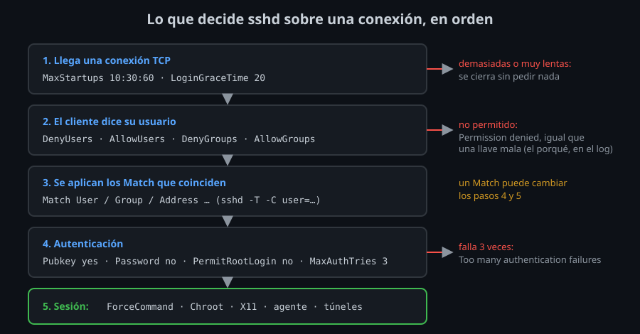

# Quién entra y cómo

⏱ Lectura: ~30 min

Endurecer (*hardening*) un servidor SSH no es activar muchas opciones: es quitar todo lo que no necesitas, para que lo que queda sea poco y lo entiendas entero. Esta teoría va en el orden en que `sshd` decide sobre una conexión: primero si el usuario puede intentarlo, después con qué método, después qué valores le aplican. Cada opción, con su valor en el kit y lo que cuesta.



## Antes de autenticar: límites a quien llega

Un servidor con el puerto 22 abierto a Internet recibe intentos de entrada a los pocos minutos de arrancar. Son programas que prueban usuarios y contraseñas comunes en millones de direcciones. Estas opciones limitan lo que puede hacer cada conexión antes de entrar:

| Opción | Por defecto | Kit | Qué limita |
|---|---|---|---|
| `LoginGraceTime` | 120 | `20` | Segundos para terminar de autenticarse. Pasado ese tiempo, `sshd` cierra |
| `MaxStartups` | `10:30:100` | `10:30:60` | Con 10 conexiones sin autenticar, rechaza el 30 % de las nuevas, y más cuantas más haya; con 60, todas |
| `MaxAuthTries` | 6 | `3` | Intentos por conexión. Cada llave que ofrece el cliente gasta uno |

- **Qué:** las tres cuentan conexiones **sin autenticar**. Una sesión abierta no cuenta.
- **Para qué:** que una oleada de intentos no ocupe todos los huecos y deje fuera a quien sí tiene llave.
- **Impacto:** con `MaxAuthTries 3`, un cliente con cuatro llaves en el agente y sin `IdentitiesOnly` puede no llegar a probar la buena: `Too many authentication failures`. Tu kit usa `IdentitiesOnly yes` desde la semana 03 justo por esto.

## Quién puede intentarlo: `AllowUsers`, `AllowGroups`, `DenyUsers`, `DenyGroups`

| Opción | Efecto |
|---|---|
| `DenyUsers ana bot` | Estos usuarios nunca entran |
| `AllowUsers alumno ana` | Solo estos usuarios entran |
| `DenyGroups` / `AllowGroups` | Lo mismo con grupos. Cuenta el grupo principal y los secundarios (`id USUARIO`) |

`sshd` las comprueba en este orden: `DenyUsers`, `AllowUsers`, `DenyGroups`, `AllowGroups`. Un usuario tiene que pasar **todas** las que estén escritas: una negación gana siempre, y si hay `AllowUsers` y `AllowGroups`, tiene que estar en las dos.

- **Qué:** el kit usa `AllowGroups ssh-users sftp-only`.
- **Para qué:** en un servidor hay muchas cuentas que no son personas: `postgres`, `www-data`, un usuario creado para una prueba. Con `AllowGroups`, entrar por SSH es algo que se da a propósito, con `usermod -aG ssh-users`, y no algo que tiene cualquier cuenta con una llave en su `authorized_keys`.
- **Impacto:** **si tu usuario no está en `ssh-users`, te quedas fuera**. Los logs lo dicen claro: `User alumno from 172.20.0.4 not allowed because none of user's groups are listed in AllowGroups`. El cliente solo ve `Permission denied`, lo mismo que con una llave mala: no le das pistas a quien prueba.

Los patrones admiten `*`, `?` y `USUARIO@DIRECCIÓN`: `AllowUsers ana@10.0.0.0/8` solo deja entrar a `ana` desde esa red.

## Con qué método

| Opción | Kit | Por qué |
|---|---|---|
| `PubkeyAuthentication` | `yes` (por defecto) | Llaves: lo que usas desde la semana 03 |
| `PasswordAuthentication` | `no` | Una contraseña se adivina probando; una llave Ed25519, no |
| `KbdInteractiveAuthentication` | `no` | La otra vía para pedir contraseña, a través de PAM. Ubuntu ya la trae en `no` |
| `PermitRootLogin` | `no` | Ver abajo |
| `PermitEmptyPasswords` | `no` (por defecto) | Nunca la cambies |

`PermitRootLogin` tiene cuatro valores, y el que trae OpenSSH por defecto **no es `no`**:

| Valor | root entra con |
|---|---|
| `yes` | Contraseña o llave |
| `prohibit-password` (por defecto; `sshd -T` lo escribe `without-password`) | Solo llave |
| `forced-commands-only` | Solo llave con `command=` en `authorized_keys` |
| `no` | Nada |

- **Qué:** el kit usa `no`.
- **Para qué:** root existe en todos los servidores, así que todos los ataques lo prueban. Y si cada persona entra con su cuenta y usa `sudo`, los logs dicen **quién** hizo cada cosa; con root, todos son root.
- **Impacto:** para administrar, entras con tu usuario y `sudo`. Si una herramienta necesita root (algunas copias de seguridad), `forced-commands-only` con una llave restringida es mejor que abrir root del todo.

> [!WARNING]
> Antes de poner `PasswordAuthentication no`, comprueba que tu llave funciona: `ssh -o PreferredAuthentications=publickey server true`. Si no, te quedas fuera tú también. En el laboratorio, la contraseña `alumno` es débil **a propósito y solo existe en el laboratorio**: esta semana dejas de usarla.

## `Match`: valores distintos para conexiones distintas

Un bloque `Match` aplica sus opciones solo a las conexiones que cumplen la condición:

```
Match Group sftp-only
    ChrootDirectory /srv/sftp/%u
    ForceCommand internal-sftp -d /subidas
```

| Condición | Ejemplo |
|---|---|
| `User` | `Match User ana,bot` |
| `Group` | `Match Group sftp-only` |
| `Address` | `Match Address 10.0.0.0/8,192.168.1.10` |
| `Host` | `Match Host *.empresa.com` (necesita `UseDNS yes`: casi nunca se usa) |
| `LocalPort` | `Match LocalPort 2222` |
| `all` | `Match all`: vuelve a todas las conexiones |

Varias condiciones en la misma línea se tienen que cumplir **todas**: `Match Group ssh-users Address 10.0.0.0/8`.

Cinco reglas que el lab 04 comprueba una a una:

1. **Un `Match` dura hasta el siguiente `Match` o hasta el final del archivo incluido.** La sangría no cuenta. Una opción global escrita debajo de un `Match`, en el mismo archivo, pasa a ser parte del `Match`.
2. **Un `Match` sí cambia un valor global**, aunque el global esté escrito antes: `sshd` lee primero los valores globales y, al conectar, aplica encima los `Match` que coinciden. Si dos `Match` que coinciden ponen la misma opción, gana el primero. Por eso el kit pone cada `Match` en su propio archivo: se lee de un vistazo a quién afecta.
3. **No todas las opciones valen dentro de un `Match`.** `Port`, `ListenAddress` o `HostKey` afectan al `listener`, que no sabe todavía quién se conecta: `Directive 'Port' is not allowed within a Match block`.
4. **Una lista solo con negaciones no coincide con nada.** `Match User !ana` no es "todos menos ana": no coincide nunca. Se escribe `Match User *,!ana`.
5. **Pruébalo sin conectar:** `sudo sshd -T -C user=ana,addr=10.0.0.5` aplica los `Match` como si entrara `ana` desde esa dirección.

## Qué hace la sesión

Una vez dentro, estas opciones quitan lo que un servidor no necesita:

| Opción | Kit | Qué quita |
|---|---|---|
| `X11Forwarding` | `no` | Que el servidor abra ventanas en tu escritorio. Una aplicación X11 remota puede leer tu teclado. Ubuntu lo trae en `yes` |
| `AllowAgentForwarding` | `no` | Que root en el servidor use tus llaves mientras estás conectado (semana 04) |
| `AllowTcpForwarding` | `yes` (por defecto) | Túneles `-L`, `-R` y `ProxyJump`. El kit los deja: los necesitas en las semanas 08 y 09 |
| `DisableForwarding` | solo en `Match` | Todos los reenvíos de una vez: X11, agente, puertos y sockets |
| `PermitTTY` | solo en `Match` | La terminal interactiva |
| `ClientAliveInterval` / `ClientAliveCountMax` | `300` / `2` | Cierra la sesión de un equipo que dejó de responder (red caída, portátil cerrado) tras 300 × 2 s |
| `MaxSessions` | 10 (por defecto) | Sesiones por conexión. Con multiplexing, cada `ssh` por el master es una sesión |
| `PermitUserEnvironment` | `no` (por defecto) | Que el usuario cambie variables como `LD_PRELOAD` desde `~/.ssh/environment` |
| `AcceptEnv` | `LANG LC_*` (Ubuntu) | Qué variables puede enviar el cliente con `SendEnv` / `SetEnv` |

`AllowAgentForwarding no` tiene un límite que conviene saber: quien tiene shell en el servidor puede montar su propio reenvío con un túnel. Lo que de verdad protege es no reenviar el agente desde el cliente (`ForwardAgent no` del kit, semana 04). La opción del servidor es una segunda barrera, no la única.

<!-- nav -->
---

## 🔗 Navegación

| Anterior | Siguiente |
|---|---|
| ← [Teoría — `sshd_config` por dentro](01-sshd-config-por-dentro.md) | [Teoría — Usuarios solo SFTP y cambios sin quedarte fuera](03-sftp-chroot-y-cambios-seguros.md) → |

[↑ Semana 07](../README.md)
