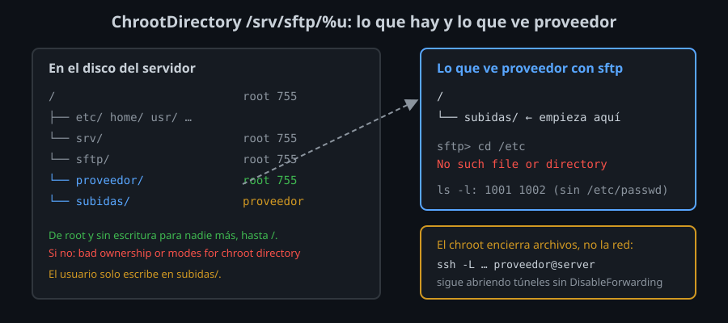
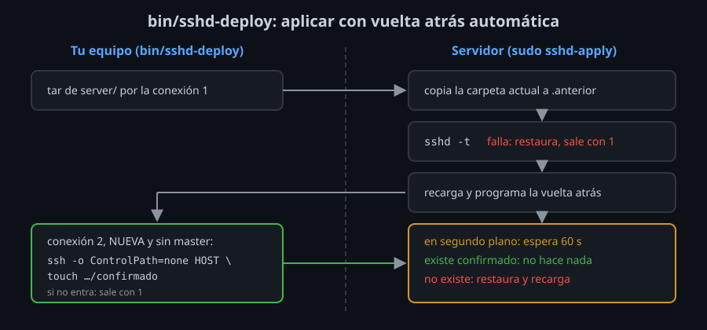

# Usuarios solo SFTP y cambios sin quedarte fuera

⏱ Lectura: ~25 min

Dos temas que van juntos porque los dos son sobre no romper nada. El primero: dar a alguien acceso para subir archivos sin darle el servidor entero. El segundo: cambiar la configuración de `sshd` en un servidor al que solo llegas por SSH, sabiendo que un error te deja fuera.

## Solo archivos: `ForceCommand internal-sftp`

Un proveedor que deja informes cada noche, una web que recibe subidas: necesitan `sftp`, no una shell. Hay tres capas, y cada una cierra algo distinto:

| Capa | Qué cierra | Qué deja abierto |
|---|---|---|
| Shell `/usr/sbin/nologin` | La shell interactiva: `This account is currently not available.` | Todo lo demás. Y `sftp` tampoco funciona: el servidor arranca `sftp-server` a través de la shell del usuario |
| `ForceCommand internal-sftp` | Cualquier orden: `This service allows sftp connections only.` `sftp` sí funciona, con el servidor SFTP que va dentro de `sshd` | El disco entero: puede leer `/etc/passwd` o cualquier archivo que sus permisos le dejen |
| `ChrootDirectory /srv/sftp/%u` | El resto del disco: dentro de su sesión, `/` es esa carpeta | Los túneles: un usuario encerrado con `sftp` sigue pudiendo abrir `ssh -L` hacia la red del servidor |
| `DisableForwarding yes` + `PermitTTY no` | Túneles, agente, X11 y terminal | Nada más que archivos |

Por eso el kit usa las cuatro en `30-sftp.conf`. El lab 05 las añade de una en una y prueba qué deja pasar cada una.

## Las reglas del chroot

*chroot* (*change root*) cambia la raíz del sistema de archivos para un proceso: lo que el proceso ve como `/` es en realidad `/srv/sftp/proveedor`. No puede subir más arriba, porque para él no hay nada más arriba.



`sshd` exige que **la carpeta del chroot y todas las que están por encima sean de root y nadie más pueda escribir en ellas**. Si no, corta la conexión y escribe en el log:

```
bad ownership or modes for chroot directory "/srv/sftp/proveedor"
```

- **Qué:** `/srv/sftp/proveedor` es `root:root` con permisos `755`. El usuario no puede escribir en ella.
- **Para qué:** si el usuario pudiera escribir en la raíz de su chroot, podría crear allí un `etc/` o un `lib/` falsos y engañar a programas que root ejecuta dentro (es como se han escapado de chroots mal hechos).
- **Impacto:** el usuario necesita una carpeta suya dentro: `/srv/sftp/proveedor/subidas`, de `proveedor`. `ForceCommand internal-sftp -d /subidas` hace que empiece ahí.

Más cosas que cambian dentro del chroot:

- `internal-sftp` no necesita ningún archivo dentro del chroot. `/usr/lib/openssh/sftp-server` sí (y sus bibliotecas): por eso se usa `internal-sftp`.
- No hay `/etc/passwd`: `ls -l` muestra números en lugar de nombres de usuario.
- No hay `/etc/hosts` ni DNS: un túnel hacia `localhost` falla con `unknown host`, pero hacia `127.0.0.1` funciona. Que el nombre no resuelva no es una protección; `DisableForwarding` sí.
- `authorized_keys` se lee **antes** de entrar en el chroot, desde el home normal del usuario (`/home/proveedor/.ssh/`).

## Cambiar `sshd` sin quedarte fuera

Un cambio en `sshd` es el único cambio en un servidor que puede quitarte la forma de arreglarlo. Si te equivocas en `nginx`, entras por SSH y lo arreglas. Si te equivocas en `sshd`, ya no entras. Las formas de quedarte fuera, de más a menos obvia:

| Error | Qué pasa |
|---|---|
| Un error de sintaxis y recargar sin `sshd -t` | `sshd` no arranca. Nadie entra |
| `PasswordAuthentication no` sin una llave que funcione | Tu contraseña ya no vale y no tienes llave |
| `AllowGroups ssh-users` sin estar en el grupo | `not allowed because none of user's groups are listed in AllowGroups` |
| Un `Match` que te encierra en un chroot o te quita la shell | Entras, pero no puedes hacer nada |
| Probar por el master del multiplexing | La prueba dice que todo va bien. Al día siguiente, el master se cerró y no entras |

### El procedimiento



1. **Deja una sesión abierta** y no la cierres hasta el final. Sigue con la configuración antigua aunque recargues: es tu forma de deshacer.
2. **Valida:** `sudo sshd -t`. Si falla, no recargues.
3. **Programa la vuelta atrás antes de recargar:** un proceso que, si en 60 s nadie lo cancela, restaura la copia y recarga. Es un *dead man's switch*: se activa si tú no haces nada, porque si te quedaste fuera, no podrás hacer nada.
4. **Recarga.**
5. **Prueba con una conexión nueva y sin master:** `ssh -o ControlPath=none server true` (o `ssh -P sinmux` con tu kit). Si entra, cancela la vuelta atrás.
6. **Si nada funciona:** la consola del proveedor. Todo proveedor de nube y todo hipervisor tiene una consola que no pasa por SSH (consola serie, VNC, KVM). En el laboratorio es `docker compose exec server bash`, que entra como root sin SSH.

`bin/sshd-deploy` del kit hace los pasos 2 a 5 en una orden. Su mitad en el servidor, `server/sshd-apply`, valida, guarda la copia, recarga y deja programada la vuelta atrás; la mitad en tu equipo prueba con una conexión nueva y, si entra, crea el archivo que la cancela.

### Por qué el kit sustituye la carpeta entera

`sshd-apply` no añade los archivos del kit a `/etc/ssh/sshd_config.d/`: **la sustituye** por la del kit.

- **Qué:** lo que no está en el kit no está en el servidor.
- **Para qué:** un `50-cloud-init.conf` con `PasswordAuthentication yes` que no conocías no puede ganar a tu configuración, y dos servidores con el mismo kit tienen exactamente la misma configuración.
- **Impacto:** si una herramienta del servidor escribe ahí su propio archivo, el siguiente `sshd-deploy` lo borra. Si lo necesitas, cópialo al kit.

<!-- nav -->
---

## 🔗 Navegación

| Anterior | Siguiente |
|---|---|
| ← [Teoría — Quién entra y cómo](02-autenticacion-y-acceso.md) | [Índice de labs](../2-practicas/README.md) → |

[↑ Semana 07](../README.md)
