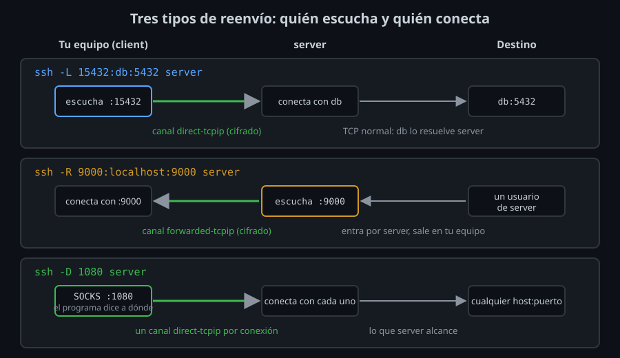
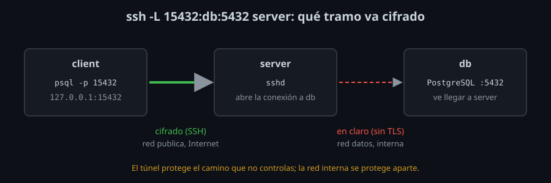

# Reenvío de puertos: `-L` y `-R`

⏱ Lectura: ~30 min

Hasta ahora, una conexión SSH llevaba una shell, un comando o archivos. Esta semana lleva **otras conexiones TCP** dentro. Con eso llegas a una base de datos que no escucha en Internet, enseñas a un servidor algo que corre en tu equipo, o navegas como si estuvieras en otra red. Todo cifrado, y sin abrir ningún puerto nuevo en el firewall: solo el 22.

## Canales: lo que ya viajaba dentro de SSH

Una conexión SSH no es un único tubo. Después del intercambio de llaves (semana 02) y la autenticación (semana 03), el cliente y el servidor abren **canales** dentro de ella. Cada canal es una conversación independiente, con su propio número:

| Canal | Lo abre | Para qué |
|---|---|---|
| `session` | `ssh server`, `ssh server comando`, `sftp` | Una shell, un comando o un subsistema (SFTP) |
| `direct-tcpip` | El cliente, con `-L` o `-D` | "Servidor, conecta tú con este host y puerto, y pásame los datos" |
| `forwarded-tcpip` | El servidor, con `-R` | "Cliente, alguien se conectó a mi puerto: conéctalo tú con este destino" |

El multiplexing de la semana 05 ya usaba esto: varias sesiones, varios canales, una conexión. Un túnel es un canal más. Lo ves con `ssh -v`:

```
debug1: Connection to port 8080 forwarding to localhost port 8080 requested.
debug1: channel 2: new direct-tcpip [direct-tcpip] (inactive timeout: 0)
```

## `-L`: un puerto de tu equipo que sale por el servidor



```bash
ssh -L [DIRECCIÓN_LOCAL:]PUERTO_LOCAL:DESTINO:PUERTO_DESTINO server
```

1. `ssh` abre `PUERTO_LOCAL` en **tu equipo** y se queda escuchando.
2. Cuando un programa se conecta a ese puerto, `ssh` abre un canal `direct-tcpip` y le dice a `server`: "conecta con `DESTINO:PUERTO_DESTINO`".
3. `server` hace esa conexión **desde él mismo** y pasa los datos en los dos sentidos.

Lo importante es el paso 3: **`DESTINO` lo resuelve y lo alcanza `server`, no tú**. Por eso:

- `ssh -L 8080:localhost:8080 server`: `localhost` es el propio `server`. Llegas a un servicio que en `server` solo escucha en `127.0.0.1` (lab 01).
- `ssh -L 15432:db:5432 server`: `db` es un nombre que solo existe en la red de `server`. Tu equipo no sabe ni qué IP tiene (lab 02).

**Qué:** un puerto local que es una puerta a la red del servidor. **Para qué:** usar con tus herramientas (`psql`, el navegador, tu aplicación) un servicio que no está publicado. **Impacto:** el servicio ve llegar la conexión **desde `server`**, no desde ti; sus reglas de acceso (un firewall, `pg_hba.conf`) tienen que permitir a `server`.

### Dónde escucha el puerto local

Sin `DIRECCIÓN_LOCAL`, `ssh` escucha solo en `localhost` (`127.0.0.1` y `::1`). Es lo que quieres: solo los programas de tu equipo usan el túnel.

| Escribes | Escucha en | Quién puede usarlo |
|---|---|---|
| `-L 8080:...` | `127.0.0.1` y `::1` | Tu equipo |
| `-L 127.0.0.1:8080:...` | `127.0.0.1` | Tu equipo (el kit lo escribe así: no depende de ninguna otra opción) |
| `-L 0.0.0.0:8080:...` | Todas tus interfaces | **Cualquiera que llegue a tu equipo**, y por él, a la red del servidor |

La opción de cliente `GatewayPorts yes` hace que un `-L` sin dirección escuche en todas las interfaces. Por eso el kit escribe siempre `127.0.0.1:` delante: el túnel no cambia si alguien activa esa opción.

### Puertos y errores

- Un puerto local por debajo de 1024 necesita root en un Linux normal. En los contenedores de Docker no (Docker lo permite a cualquier usuario), así que en el laboratorio no verás ese error: usa siempre puertos altos, como `15432` para PostgreSQL (`5432` + `10000`), para no chocar con un servicio de tu equipo.
- Si el puerto local ya está ocupado, `ssh` avisa (`bind [127.0.0.1]:8080: Address already in use`) **y sigue conectado sin túnel**. Con `ExitOnForwardFailure yes` sale con 255. Un script siempre quiere lo segundo.

## `-R`: un puerto del servidor que entra a tu equipo

```bash
ssh -R [DIRECCIÓN_REMOTA:]PUERTO_REMOTO:DESTINO:PUERTO_DESTINO server
```

Es `-L` al revés: **`server`** abre `PUERTO_REMOTO`, y lo que llega ahí lo conecta **tu equipo** con `DESTINO:PUERTO_DESTINO`. Ahora `DESTINO` lo resuelves tú.

| Caso | Orden |
|---|---|
| Enseñar a `server` una web que corre en tu portátil | `ssh -R 9000:localhost:9000 server` |
| Entrar desde fuera a un equipo detrás de un NAT que sí puede salir (una Raspberry en casa) | En el equipo: `ssh -R 2222:localhost:22 servidor-publico`; desde el servidor público: `ssh -p 2222 localhost` |
| Que `server` use tu equipo como proxy (OpenSSH 7.6+) | `ssh -R 1081 server`: un SOCKS en `server` que sale por tu red |

**Impacto:** con `-R` metes la red de tu equipo dentro del servidor. Cualquiera con cuenta en `server` puede conectar a ese puerto mientras dure el túnel.

### `GatewayPorts` del servidor

Por defecto, `sshd` abre el puerto de un `-R` solo en su `localhost`, aunque pidas `0.0.0.0`. Lo decide la opción de **servidor** `GatewayPorts`:

| `GatewayPorts` (en `sshd_config`) | El puerto de `-R` escucha en |
|---|---|
| `no` (por defecto) | `127.0.0.1` y `::1` del servidor, pidas lo que pidas |
| `clientspecified` | Lo que pida el cliente (`-R 0.0.0.0:9001:...` = todas) |
| `yes` | Todas las interfaces, siempre |

Lo ves en el lab 03: con `no`, `curl server:9001` desde fuera falla; con `clientspecified`, entra. Déjalo en `no` salvo que quieras publicar algo de verdad.

## `-N`, `-f` y cómo cerrar un túnel

Un túnel no necesita shell:

- `-N`: no ejecutes nada en el servidor. Solo canales de túnel (`SessionType none` en `ssh_config`).
- `-f`: vete a segundo plano **después** de autenticarte (te deja escribir la frase de paso antes). `ForkAfterAuthentication yes` en `ssh_config`.

`ssh -f -N -L ...` te devuelve la terminal y el túnel sigue en un proceso `ssh`. Para cerrarlo, `kill` a ese proceso: `pgrep -a ssh` te dice su PID. El lab 05 enseña a cerrarlo con el master del multiplexing y el proyecto, con `bin/tunnel down`.

## Lo que el túnel cifra y lo que no

Un túnel cifra **el tramo entre tu equipo y `server`**. Del servidor al destino, la conexión es la de siempre: si el protocolo no cifra (PostgreSQL sin TLS, HTTP), va en claro por esa red.



En el lab 02 lo ves con `tcpdump` en `server`: tu consulta SQL y su resultado viajan legibles entre `server` y `db`. El túnel protege el camino por Internet (o por la wifi del café), que es el que no controlas. La red interna entre el servidor y la base de datos se protege aparte: una red dedicada (como `datos` en el laboratorio), TLS en PostgreSQL, o un `-L` a `localhost` del propio servidor de base de datos, con lo que no queda tramo en claro.

<!-- nav -->
---

## 🔗 Navegación

| Anterior | Siguiente |
|---|---|
| ← [Semana 08 — Port forwarding, SOCKS y túneles](../README.md) | [Teoría — SOCKS, túneles en `ssh_config` y lo que el servidor permite](02-socks-config-y-limites.md) → |

[↑ Semana 08](../README.md)
