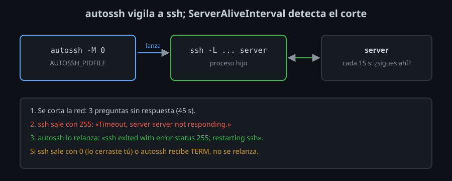

# Túneles que no se caen

⏱ Lectura: ~25 min

Un `ssh -f -N -L` sirve para una tarde. Una aplicación que usa la base de datos a través del túnel necesita algo más: que el túnel vuelva solo cuando se corta, y que nadie se quede esperando a un túnel muerto que parece vivo.

## Dos formas de morir

| Qué pasa | Ejemplos | Qué hace `ssh` | Qué ves en el puerto local |
|---|---|---|---|
| **Corte con aviso** | El servidor se reinicia, `sshd` cae, la conexión se resetea | Recibe el cierre y sale (código 255) | `Connection refused`: nadie escucha |
| **Corte sin aviso** | La wifi cae, un NAT o un firewall olvida la conexión, el servidor se cuelga | Nada: no le llega ningún paquete que diga que acabó | El puerto sigue abierto; cada conexión se queda esperando hasta su propio *timeout* |

El segundo es el peligroso: `pgrep` dice que `ssh` está vivo, el puerto escucha, y `psql` se queda colgado (`timeout expired` en el lab 07). TCP por sí solo puede tardar horas en dar por muerta una conexión en la que nadie escribe.

## `ServerAliveInterval`: preguntar si sigue ahí

```
ServerAliveInterval 15
ServerAliveCountMax 3
```

**Qué:** cada 15 s sin tráfico, `ssh` manda un mensaje por dentro del canal cifrado y espera respuesta; tras 3 sin respuesta, sale: `Timeout, server server not responding.` **Para qué:** convertir un corte sin aviso en uno con aviso, en 15 × 3 = 45 s. **Impacto:** un mensaje pequeño cada 15 s mientras el túnel está parado; además mantiene viva la conexión en los NAT que olvidan las conexiones sin tráfico.

| Opción | Lado | Cómo pregunta | ¿Se puede falsificar? |
|---|---|---|---|
| `ServerAliveInterval` / `CountMax` | Cliente | Mensaje SSH cifrado | No |
| `ClientAliveInterval` / `CountMax` | Servidor (semana 07, lab 06) | Mensaje SSH cifrado | No |
| `TCPKeepAlive` | Los dos (por defecto `yes`) | Paquete TCP vacío, cada ~2 h según el sistema | Sí, y demasiado lento para esto |

Es lo mismo que el `ClientAliveInterval` de la semana 07, visto desde el otro lado. Pon los dos: cada lado limpia sus conexiones muertas.

## `autossh`: volver a lanzar `ssh` cuando sale

`ServerAliveInterval` hace que `ssh` salga; falta alguien que lo vuelva a lanzar. Eso es `autossh`:



```bash
AUTOSSH_GATETIME=0 autossh -M 0 -f -N \
  -o ServerAliveInterval=15 -o ServerAliveCountMax=3 -o ExitOnForwardFailure=yes \
  -L 127.0.0.1:15432:db:5432 server
```

- `autossh` acepta las mismas opciones que `ssh` y se las pasa. Arranca `ssh` como proceso hijo y espera a que salga.
- `-M 0`: sin puerto de vigilancia propio. Las versiones antiguas de `autossh` comprobaban la conexión mandando datos por un par de túneles extra (`-M 20000`); hoy esa tarea la hace `ServerAliveInterval`, que va por dentro de SSH y no necesita puertos.
- `-f`: es `autossh` quien se va a segundo plano (no pases `-f` a `ssh`: `autossh` perdería a su hijo).
- `AUTOSSH_GATETIME=0`: por defecto, si `ssh` falla en sus primeros 30 s, `autossh` cree que la configuración está mal y se rinde. Con `0`, reintenta siempre, también si el servidor estaba caído al arrancar.

### Cuándo relanza y cuándo no

| `ssh` sale | `autossh` |
|---|---|
| Con 255 (conexión perdida, *timeout*, servidor reiniciado) | Lo relanza: `ssh exited with error status 255; restarting ssh` |
| Con 0 (lo cerraste tú con `kill`, `exit`, `-O exit`) | Sale también: `ssh exited with status 0; autossh exiting` |
| `autossh` recibe `TERM` | Cierra su `ssh` y sale |

Si los reintentos fallan seguidos, `autossh` espera cada vez más entre uno y otro (hasta minutos). Y si la autenticación falla (llave borrada, host key cambiada), reintenta **para siempre** sin que nadie se entere: por eso `bin/tunnel up` del kit espera unos segundos a que el puerto abra y, si no, para `autossh` y avisa.

`AUTOSSH_LOGFILE=~/autossh.log` guarda lo que hace; sin él, escribe en el `syslog` del sistema. `AUTOSSH_PIDFILE` escribe su PID: es lo que usa `bin/tunnel` para saber si el túnel está vivo y para cerrarlo.

### Un túnel con su propia conexión

Tres opciones más hacen que el túnel no dependa de nada:

- `ExitOnForwardFailure yes`: si el puerto local está ocupado, `ssh` sale con error. Sin ella, se queda conectado **sin túnel** y `autossh` cree que todo va bien.
- `SessionType none`: ni shell ni comando, como `-N`.
- `ControlMaster no` y `ControlPath none`: con un master del multiplexing, `ssh` solo le pediría el reenvío y saldría al momento. `autossh` lo relanzaría sin parar, y el túnel quedaría en manos del master ([teoría 02](02-socks-config-y-limites.md#túneles-y-multiplexing)).

## Que arranque con el equipo

`autossh` vuelve a abrir el túnel mientras está vivo; si reinicias el equipo, alguien tiene que arrancarlo. En un Linux con systemd (no en los contenedores del laboratorio, que no lo tienen), un servicio de usuario lo hace, y systemd sustituye a `autossh`: relanza `ssh` él mismo.

`~/.config/systemd/user/tun-pg.service`:

```ini
[Unit]
Description=Túnel SSH a PostgreSQL (tun-pg)
After=network-online.target

[Service]
ExecStart=/usr/bin/ssh -F %h/ssh-infra-kit/config tun-pg
Restart=always
RestartSec=10

[Install]
WantedBy=default.target
```

- `ExecStart`: `ssh` en primer plano, sin `-f`; systemd es quien lo vigila. Las opciones del túnel ya están en `tun-pg`.
- `Restart=always`, `RestartSec=10`: si `ssh` sale, por lo que sea, otro en 10 s.
- Se activa con `systemctl --user enable --now tun-pg` y se mira con `systemctl --user status tun-pg` y `journalctl --user -u tun-pg`.
- La llave tiene que poder usarse sin ti: un agente que siga vivo, o una llave propia sin frase **limitada con `permitopen`** en el servidor ([teoría 02](02-socks-config-y-limites.md#por-llave-permitopen-en-authorized_keys)), para que quien la robe solo tenga el túnel.

## Cuándo un túnel SSH no es la herramienta

Un túnel es un puerto concreto hacia un destino concreto, por una conexión TCP. Para lo que va más allá, hay otra herramienta:

| Necesidad | Mejor |
|---|---|
| Entrar por SSH a un host interno pasando por otro | `ProxyJump` (semana 09), que es un `-W` y no un `-L` |
| Toda una red, muchos puertos, UDP | Una VPN (WireGuard) |
| La base de datos para una aplicación en producción, siempre | TLS en PostgreSQL y una red privada; el túnel, para el acceso puntual de una persona |

<!-- nav -->
---

## 🔗 Navegación

| Anterior | Siguiente |
|---|---|
| ← [Teoría — SOCKS, túneles en `ssh_config` y lo que el servidor permite](02-socks-config-y-limites.md) | [Índice de labs](../2-practicas/README.md) → |

[↑ Semana 08](../README.md)
