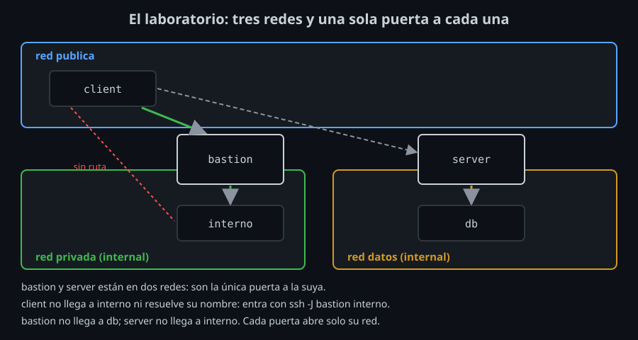

# Redes segmentadas y bastion hosts

## Por qué no todo está en Internet

Hasta ahora, cada servidor del laboratorio estaba en la misma red que tu equipo, o detrás de uno que sí lo estaba (`db`, la semana 08). En producción, la mayoría de las máquinas **no deberían** poder recibir conexiones de Internet: bases de datos, servidores de aplicaciones, colas, monitorización. Si `sshd` escucha en Internet, cualquiera puede probar contraseñas, llaves robadas o la próxima vulnerabilidad de OpenSSH contra él.

**Segmentar** la red es repartir las máquinas en redes separadas y decidir qué red puede hablar con cuál:

- Una red **pública**, alcanzable desde fuera, con lo mínimo: la web, y una sola puerta SSH.
- Una o varias redes **privadas**, sin ruta desde Internet. Sus máquinas solo hablan con las de su red, o con las de otra red a través de un equipo que esté en las dos.

Si alguien compromete una máquina de la red pública, no llega directamente a las privadas. Es el mismo principio que una puerta cortafuegos en un edificio: no impide el incendio, pero lo contiene.

## El bastion host

Un **bastion** (también *jump host* o *jump box*) es la única máquina con SSH accesible desde fuera que además está en la red privada. Para entrar en una máquina interna, primero llegas al bastion y desde ahí saltas.



En el laboratorio (`compose.yaml`):

| Máquina | Redes | Quién la alcanza |
|---|---|---|
| `client` (tu equipo) | `publica` | — |
| `server` | `publica`, `datos` | `client`, `bastion` |
| `bastion` | `publica`, `privada` | `client`, `server` |
| `interno` | `privada` | solo `bastion` |
| `db` | `datos` | solo `server` |

`privada` y `datos` son redes `internal: true` de Docker: no tienen salida a ninguna otra red. `client` ni siquiera puede resolver el nombre `interno`.

### Qué ganas

- **Una sola puerta que vigilar.** Endureces, actualizas y auditas una máquina, no veinte. Los hosts internos pueden tener un `sshd` igual de cuidado, pero ya no son lo primero que se encuentra un atacante.
- **Un solo sitio donde cortar.** Quitar la llave de alguien del bastion le cierra toda la red privada, aunque su llave siga en cada host interno ([lab 07](../2-practicas/lab-07-auditoria-y-cortes/README.md)).
- **Un registro de quién entra.** Cada salto pasa por el bastion: su log dice qué llave, cuándo y hacia qué host.

### Qué no ganas, y el riesgo nuevo

- **El bastion es el objetivo.** Quien lo controle llega a toda la red privada. Por eso un bastion no tiene más servicios que `sshd`, ni más usuarios de los necesarios, ni herramientas de más ([teoría 03](03-endurecer-el-bastion.md)).
- **Es un punto único de fallo.** Si el bastion cae, nadie entra en la red privada. En producción se ponen dos, o un plan para entrar por la consola del proveedor.
- **No sustituye a la seguridad de los hosts internos.** Siguen necesitando llaves, `sshd_config` endurecido y actualizaciones: la red privada no es de confianza solo por ser privada.

## Saltar mal: dos sesiones encadenadas

La forma ingenua de llegar a `interno` es entrar en `bastion` y, desde su shell, hacer otro `ssh`:

```bash
ssh -t bastion ssh interno
```

`-t` pide una terminal para el `ssh` de dentro, que la necesita para preguntar la contraseña. Funciona, pero:

- **El `ssh` de dentro corre en el bastion.** La segunda autenticación la hace el bastion: necesita una contraseña, una llave privada **en el bastion**, o tu agente reenviado (`-A`). Las tres son malas ideas: la contraseña viaja descifrada por la memoria del bastion; la llave privada, copiada allí, la lee cualquiera con `root` en el bastion; y el agente reenviado lo usa cualquiera con `root` en el bastion mientras estás conectado ([lab 05](../2-practicas/lab-05-agente-reenviado/README.md)).
- **El bastion comprueba la host key de `interno`, no tú.** Su `known_hosts` decide. Si alguien controla el bastion, controla también esa verificación.
- **El bastion ve todo en claro.** El `ssh` interno se descifra y vuelve a cifrar en el bastion: tus comandos y su salida pasan por su memoria.
- **`scp`, `rsync`, túneles y `git` no saben hacerlo.** Cada uno necesitaría su propio par de pasos.

## Saltar bien: un `ssh` dentro de otro

Con `ssh -J bastion interno` (`ProxyJump`), tu `ssh` hace dos conexiones, **las dos desde tu equipo**:

1. Una con `bastion`, a la que le pide un canal hasta `interno:22`, como el `-L` de la semana 08 pero sin puerto local.
2. Otra, completa, con `interno`, **dentro** de ese canal: intercambio de llaves, host key y autenticación, de tu equipo a `interno`.

El bastion solo reenvía bytes cifrados entre tú e `interno`. No necesita tu llave, no ve tus comandos ni comprueba nada en tu nombre. Lo cuenta la [teoría 02](02-proxyjump-y-proxycommand.md).

| | `ssh -t bastion ssh interno` | `ssh -J bastion interno` |
|---|---|---|
| Quién autentica con `interno` | el bastion | tu equipo |
| Dónde hace falta tu llave o agente | en el bastion | solo en tu equipo |
| Quién comprueba la host key de `interno` | el `known_hosts` del bastion | tu `known_hosts` |
| Qué ve el bastion | todo, en claro | bytes cifrados de extremo a extremo |
| `scp`, `rsync`, túneles | a mano, salto a salto | igual que con cualquier host |
| Cuenta en el bastion | necesita una shell | basta con poder abrir un canal |

La última fila es la que permite endurecer el bastion: si nadie necesita una shell en él para saltar, las cuentas de salto pueden no tenerla.

## Lo que ve el host interno

Para `interno`, la conexión llega **desde el bastion**: su `SSH_CONNECTION` y su log muestran la IP del bastion en la red privada, nunca la tuya. Para saber quién entró, cruzas los dos logs: el del bastion (qué llave saltó a `interno` y a qué hora) y el de `interno` (qué llave entró, desde el bastion). Es otra razón para que cada persona use su propia llave y su propia cuenta de salto.

<!-- nav -->
---

## 🔗 Navegación

| Anterior | Siguiente |
|---|---|
| ← [Semana 09 — Bastion hosts y arquitecturas segmentadas](../README.md) | [Teoría — ProxyJump y ProxyCommand](02-proxyjump-y-proxycommand.md) → |

[↑ Semana 09](../README.md)
