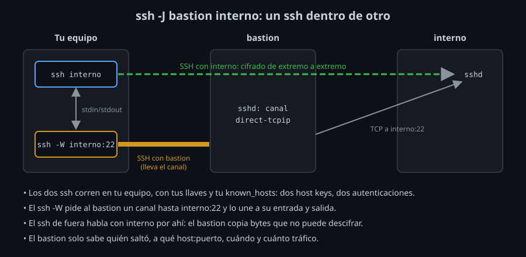

# ProxyJump y ProxyCommand

## `ssh -W`: un canal pegado a la entrada y la salida

La pieza de todo salto es `ssh -W HOST:PUERTO SALTO`. Conecta con `SALTO`, le pide un canal `direct-tcpip` hasta `HOST:PUERTO` (el mismo tipo de canal que un `-L`, semana 08) y lo une a **su propia entrada y salida estándar**: lo que le escribas sale por el canal, y lo que llegue por el canal lo escribe en su salida. No abre puerto local ni sesión.

```bash
ssh -W interno:22 bastion
```

```
SSH-2.0-OpenSSH_9.6p1 Ubuntu-3ubuntu13.20
```

Esa línea es el saludo del `sshd` de `interno`, que llega a tu terminal a través de `bastion`. Lo has conectado, pero no hablas SSH: eso lo hace otro `ssh`.

## `ProxyCommand`: un programa en lugar de TCP

Normalmente `ssh` abre una conexión TCP con el servidor. Con `ProxyCommand`, en su lugar **ejecuta un programa** y habla SSH por su entrada y salida. Si ese programa es `ssh -W`, el `ssh` de fuera habla con `interno` a través del canal:

```bash
ssh -o ProxyCommand='ssh -W %h:%p bastion' interno
```

- `%h` y `%p`: el host y el puerto del destino (`interno` y `22`). Hay más *tokens*, como `%r` (usuario); están en `man ssh_config`, sección TOKENS.
- El `ssh` de dentro (`-W`) se autentica con `bastion`; el de fuera, con `interno`. **Los dos corren en tu equipo**, con tus llaves y tu `known_hosts`.

`ProxyCommand` acepta cualquier programa que conecte su entrada y salida con el destino: `nc` a través de un proxy SOCKS (`nc -X 5 -x localhost:1080 %h %p`, semana 08), un cliente de un proveedor de nube, o el método antiguo, `ssh bastion nc %h %p`, que necesita `nc` y una shell en el bastion ([lab 03](../2-practicas/lab-03-proxycommand-y-w/README.md)).

## `ProxyJump`: lo mismo, más corto

`ProxyJump` (`-J`, OpenSSH 7.3+) escribe ese `ProxyCommand` por ti:

```bash
ssh -J bastion interno
```

Con `-v` se ve qué ejecuta:

```
debug1: Executing proxy command: exec ssh -v -W '[interno]:22' bastion
debug1: Server host key: ssh-ed25519 SHA256:KbYouQM0YPwagd76BUIJHRT5XIqzp4IThE0xmPA6eD4
Authenticated to bastion ([172.20.0.2]:22) using "publickey".
debug1: Server host key: ssh-ed25519 SHA256:483eGtfnnmJy3doWjmnH6pTWeTnSl1r2FtymhIDk9CY
Authenticated to interno (via proxy) using "publickey".
```

Dos host keys comprobadas y dos autenticaciones, todas desde tu equipo. El `ssh` del salto hereda tu `-F` y tu `-v`, pero no tus `-o`: lo que necesite el salto va en su propio bloque `Host` de la configuración.



### Varios saltos

`-J a,b destino` salta por `a`, luego por `b`, y llega al destino. Cada salto es otro `ssh -W` que va por dentro del anterior, y **todos salen de tu equipo**:

```bash
ssh -J server,bastion interno
```

```
debug1: Executing proxy command: exec ssh -J server -v -W '[interno]:22' bastion
debug1: Executing proxy command: exec ssh -v -W '[bastion]:22' server
```

Ninguna máquina intermedia necesita llaves. Cada una ve llegar la conexión desde la anterior: `interno` ve a `bastion`, `bastion` ve a `server`.

### `ssh_config`

```
Host interno
    ProxyJump bastion
```

- El salto puede ser un alias (`ProxyJump lab-salto`): entonces el `ssh` del salto usa el `HostName`, `User`, `IdentityFile` y multiplexing de ese bloque. Con `ProxyJump usuario@host:puerto`, solo lo que pone la línea y lo de `Host *`.
- El primer valor gana (semana 05): un `ProxyJump` en `Host *` al final no pisa a uno concreto antes. Para no saltar en un host que lo hereda: `ProxyJump none`, o `-J none` en la línea de órdenes.
- `Match host interno !exec "getent hosts %h >/dev/null"` salta solo si tu equipo **no** resuelve el nombre: en la oficina, dentro de la red, entras directo; fuera, por el bastion ([lab 04](../2-practicas/lab-04-saltos-en-config/README.md)).
- `scp`, `sftp` y `rsync` leen la misma configuración, y `scp -J` y `sftp -J` existen como opción. Para `rsync`: `-e 'ssh -J bastion'`.

## La host key de un host interno

Con un salto, tu `ssh` comprueba la host key de **cada** máquina. `interno` necesita su línea en tu `known_hosts` como cualquier otro servidor, y `ssh-keyscan` no llega a él. La primera conexión pregunta:

```
The authenticity of host 'interno (<no hostip for proxy command>)' can't be established.
ED25519 key fingerprint is SHA256:483eGtfnnmJy3doWjmnH6pTWeTnSl1r2FtymhIDk9CY.
This key is not known by any other names.
Are you sure you want to continue connecting (yes/no/[fingerprint])?
```

- `<no hostip for proxy command>`: `ssh` no sabe la IP de `interno`, porque no la conectó él. La línea de `known_hosts` lleva solo el nombre, y `CheckHostIP` no aplica.
- En lugar de `yes`, **pega la huella** que obtuviste por otro canal: `ssh` la compara por ti y solo acepta si coincide ([lab 02](../2-practicas/lab-02-proxyjump/README.md)).
- La llave se guarda con el nombre que usaste. Si un día entras por la IP (`ssh -J bastion 172.19.0.3`), `ssh` no la encuentra y vuelve a preguntar; `HostKeyAlias interno` le dice con qué nombre buscarla.

El kit lo automatiza con `bin/kh-add -J`: una conexión a través del salto con un `known_hosts` temporal, donde `accept-new` deja la llave sin preguntar; después, la compara con la huella esperada.

## Qué ve el bastion

El bastion abre el canal y copia bytes en las dos direcciones. Lo que pasa por ese canal es **la conexión SSH entre tú e `interno`**, cifrada con llaves que el bastion nunca tuvo. Con `tcpdump` en el bastion, del tráfico hacia `interno` solo se lee el saludo `SSH-2.0-OpenSSH_9.6p1`; tus comandos, no.

Lo que sí sabe:

- **Quién**: qué cuenta y qué llave entraron en el bastion, desde qué IP.
- **Hacia dónde**: el host y el puerto del canal (`interno:22`). Su log lo dice con `LogLevel DEBUG1`, y lo puede limitar con `PermitOpen` ([teoría 03](03-endurecer-el-bastion.md)).
- **Cuánto y cuándo**: el tamaño y el ritmo del tráfico, y la duración.

Con dos sesiones encadenadas (`ssh -t bastion ssh interno`), el bastion veía todo en claro. Con `ProxyJump`, solo los metadatos.

## Multiplexing a través de un salto

Con `ControlMaster auto` en `Host *` (semana 05), el `ssh -W` del salto también es una conexión: la primera vez que saltas, deja un master con el bastion, y el destino deja el suyo.

- La segunda conexión a `interno` va por su master, sin salto nuevo: milisegundos.
- Otro host interno detrás del mismo bastion reutiliza el master del bastion: solo negocia con el destino.
- Un mensaje de error del salto, como `administratively prohibited`, se puede perder si el salto va por un master: el log del bastion sigue diciendo qué pasó.

<!-- nav -->
---

## 🔗 Navegación

| Anterior | Siguiente |
|---|---|
| ← [Teoría — Redes segmentadas y bastion hosts](01-redes-segmentadas-y-bastion.md) | [Teoría — Endurecer el bastion](03-endurecer-el-bastion.md) → |

[↑ Semana 09](../README.md)
