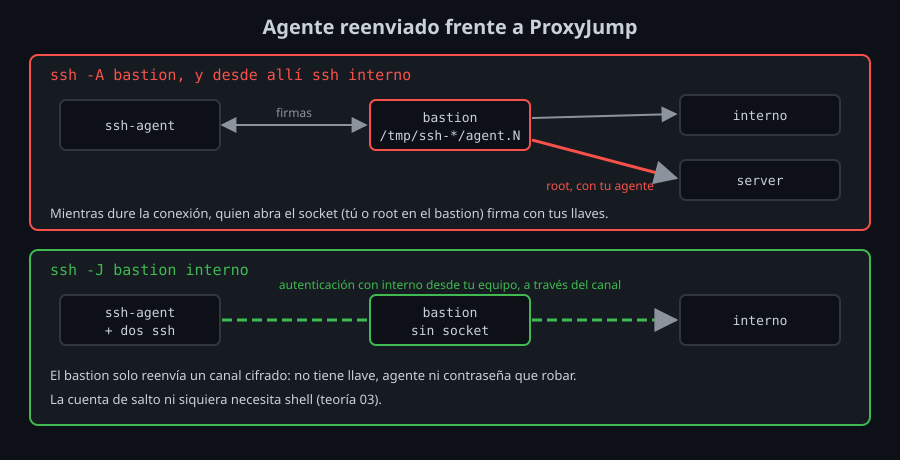

# Endurecer el bastion

El bastion es la máquina que más vale atacar: quien la controla llega a toda la red privada. Esta teoría reúne lo que lo protege, de la configuración de tu equipo al log del bastion.

## Nunca el agente reenviado

Con `ssh -A bastion`, `sshd` crea en el bastion un socket (`/tmp/ssh-XXXX/agent.N`) que lleva las peticiones de firma hasta el agente de tu equipo (semana 04). Mientras dure la conexión, **cualquiera que pueda abrir ese socket firma con tus llaves**: tú, y `root` en el bastion. Tu llave privada no sale de tu equipo, pero no hace falta: `root` entra con ella en `interno`, en `server` o en cualquier sitio donde valga ([lab 05](../2-practicas/lab-05-agente-reenviado/README.md)).



Con `ProxyJump` no hay socket: el bastion no necesita firmar nada porque la autenticación con `interno` la hace tu equipo. Por eso:

- **En el cliente**, `ForwardAgent no` (el valor por defecto; el kit lo escribe en `Host *` desde la semana 04).
- **En el servidor**, `AllowAgentForwarding no` (el kit, desde la semana 07): aunque alguien pida `-A`, no se crea el socket.

Si de verdad necesitas el agente en una máquina remota (un `git pull` con tu llave en un servidor), `ssh-add -h` limita por dónde puede usarse cada llave (OpenSSH 8.9+): `ssh-add -h bastion -h 'bastion>interno' llave` solo firma para entrar en `bastion` y, desde `bastion`, en `interno`. `root` en el bastion ya no entra con ella en `server`; en `interno`, todavía sí.

## Cuentas que solo saltan

Para saltar basta con poder abrir un canal: nadie necesita una shell en el bastion. Sin shell, quien entra no puede leer sockets de otros, escanear la red privada, descargar herramientas ni aprovechar una vulnerabilidad local para hacerse `root`.

En el bastion, un grupo para esas cuentas y una cuenta por persona, sin shell:

```bash
sudo groupadd saltadores
sudo useradd -m -s /usr/sbin/nologin -G saltadores salto
```

`/usr/sbin/nologin` como shell ya impide la sesión, pero no los reenvíos: con él solo, `salto` podría saltar a cualquier host y puerto que alcance el bastion, o publicar un `-R` en él. El resto lo dice `sshd_config`, con un `Match` como el de `sftp-only` de la semana 07:

```
Match Group saltadores
    ForceCommand /usr/sbin/nologin
    PermitTTY no
    AllowTcpForwarding local
    PermitOpen interno:22
    AllowAgentForwarding no
    AllowStreamLocalForwarding no
    X11Forwarding no
    PermitTunnel no
```

| Opción | Qué hace aquí | Lo que ve el cliente |
|---|---|---|
| `ForceCommand /usr/sbin/nologin` | Toda sesión (shell o comando) ejecuta `nologin`, aunque la cuenta tenga otra shell | `This account is currently not available.` |
| `PermitTTY no` | Sin terminal | `PTY allocation request failed on channel 0` |
| `AllowTcpForwarding local` | Permite `-L` y `-W` (`ProxyJump`); `-R` no | `Error: remote port forwarding failed for listen port 9000` |
| `PermitOpen interno:22` | El único destino de un canal | `channel 0: open failed: administratively prohibited: open failed` |
| `AllowStreamLocalForwarding no` | Sin reenvío de sockets Unix (`-L /ruta:...`) | — |
| `PermitTunnel no` | Sin interfaces `tun` (`ssh -w`, una VPN por SSH) | — |

`PermitOpen` compara **el texto** que pide el cliente, sin resolverlo: `-J salto@bastion interno` entra y `-J salto@bastion 172.19.0.3` no, aunque sea la misma máquina. Escribe en `PermitOpen` los nombres que usan tus `HostName`. Varios destinos van en la misma línea, separados por espacios.

Ya no funciona el método antiguo `ProxyCommand ssh bastion nc %h %p`: necesita ejecutar `nc` en el bastion. `ProxyJump` sí, porque solo pide un canal.

### Por llave en lugar de por cuenta

Si una persona usa su cuenta normal para administrar el bastion y para saltar, puedes limitar **una llave** concreta en `authorized_keys`, como en la semana 07:

```
restrict,port-forwarding,permitopen="interno:22",command="/usr/sbin/nologin" ssh-ed25519 AAAA... salto@portatil
```

`restrict` quita todo, `port-forwarding` devuelve los reenvíos y `permitopen` los limita. Sirve, pero una llave distinta para saltar es fácil de confundir con la otra: las cuentas de salto son más claras y se revisan con `sshd -T -C user=salto`.

## Saber quién salta a dónde

Con `LogLevel VERBOSE` (el kit, semana 07), el log del bastion dice qué llave entró, pero no a dónde saltó. Los rechazos sí aparecen:

```
Received request from 172.20.0.4 port 45884 to connect to host server port 22, but the request was denied.
```

Con `LogLevel DEBUG1` **dentro del `Match`**, solo para los saltadores, cada salto deja su destino:

```
debug1: server_request_direct_tcpip: originator 127.0.0.1 port 65535, target interno port 22
```

`originator 127.0.0.1 port 65535` es cómo marca `ssh -W` sus canales: no viene de ningún puerto real. La línea de antes, `Accepted publickey for salto from ... ED25519 SHA256:...`, dice qué llave fue. `DEBUG1` para todos llenaría el log y podría registrar datos de las sesiones; para las cuentas de salto, son unas 15 líneas por conexión.

En `interno`, la conexión llega desde la IP del bastion. Juntando los dos logs por la hora y la huella sabes quién entró en `interno` y cuándo: una razón más para **una cuenta y una llave por persona**.

## Cortar un acceso

- **Quitar su llave del bastion** le cierra la red privada entera de una vez, aunque su llave siga en `interno`: no tiene por dónde llegar.
- **Las conexiones abiertas siguen**: quitar la llave no corta una sesión ni un master ya autenticados. `sudo pkill -u salto` en el bastion las cierra.
- **Si la llave se filtró**, quítala también de los hosts internos (o revócala con una KRL, semana 10): el bastion protege la red, pero no es la única capa.

## El resto de la lista

- **Lo mínimo instalado**: `sshd` y nada más que escuche. Menos programas, menos vulnerabilidades y menos herramientas para quien entre.
- **Actualizado el primero**: es la máquina más expuesta.
- **Los hosts internos aceptan solo desde el bastion**: un firewall, o `Match Address IP_DEL_BASTION` en su `sshd_config`, o `from="IP_DEL_BASTION"` en sus `authorized_keys`. Así, otra máquina comprometida de la red privada no les sirve como bastion.
- **Más factores**: el bastion es el sitio para un segundo factor o llaves FIDO2 (semanas 04 y 11), y para certificados de corta duración en lugar de `authorized_keys` (semana 10).
- **Dos bastiones** si la red privada no puede quedarse sin acceso, cada uno con su configuración idéntica, desplegada con el mismo kit.

<!-- nav -->
---

## 🔗 Navegación

| Anterior | Siguiente |
|---|---|
| ← [Teoría — ProxyJump y ProxyCommand](02-proxyjump-y-proxycommand.md) | [Índice de labs](../2-practicas/README.md) → |

[↑ Semana 09](../README.md)
