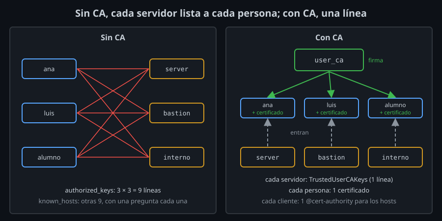

# Por qué certificados

Hasta ahora, la confianza en SSH va **de una llave a otra**. Un servidor deja entrar a quien tenga su llave pública en `authorized_keys` (semana 03), y tu equipo confía en un servidor si su host key está en `known_hosts` (semana 02). Con dos servidores y una persona, funciona. Con un equipo, no.

## Dos listas que nunca están al día

Con 10 personas y 50 servidores:

- **`authorized_keys`**: hasta 500 líneas repartidas por 50 servidores. Alguien nuevo necesita su línea en cada servidor donde trabaja; alguien que se va, que la borres de todos. Si te olvidas de uno, sigue entrando, y nada lo dice.
- **`known_hosts`**: cada persona confía en cada servidor la primera vez que entra, con la pregunta `Are you sure you want to continue connecting?`. Casi nadie compara la huella. Cada reinstalación vuelve a cambiar la host key, y el aviso de la semana 02 se convierte en rutina: justo lo que necesita un atacante.

Las dos listas crecen por el producto (personas × servidores), y nadie sabe si están al día.

## Una llave que firma llaves

Una **autoridad de certificados** (CA) de SSH es una llave normal, generada con `ssh-keygen`, con otro uso: **firmar** llaves públicas. Firmar una llave pública produce un **certificado**: la llave pública más unos datos (de quién es, para qué usuarios o nombres vale, hasta cuándo), todo firmado por la CA.

- Un servidor que confía en la CA de usuarios (`TrustedUserCAKeys`) deja entrar a cualquiera que presente un certificado válido de ella. Ya no necesita la llave de cada persona.
- Un cliente que confía en la CA de hosts (`@cert-authority` en `known_hosts`) acepta cualquier servidor con un certificado válido de ella. Ya no necesita la host key de cada servidor, ni preguntar la primera vez.

Las listas pasan de personas × servidores a **una línea** por servidor y **una línea** por cliente.

| | Con llaves sueltas | Con certificados |
|---|---|---|
| Persona nueva | Su llave en cada servidor | Un certificado |
| Servidor nuevo | Las llaves de todos en él; su huella, comprobada por todos | La CA en él; su host key firmada |
| Alguien se va | Borrar su llave de cada servidor | No firmarle más (y revocar, si hace falta) |
| Saber quién entró | Una huella en el log, que hay que buscar | La identidad y el número de serie en el log |

## Qué se firma y qué no se mueve

La CA firma la **llave pública**. La llave privada de la persona, o del servidor, no sale de donde está: el certificado es público, como la llave que lleva dentro. Para usarlo hay que demostrar, igual que siempre, que tienes la privada. Por eso un certificado robado sin su llave no sirve.

Lo que nunca debe salir de su sitio es la **llave privada de la CA**: quien la tenga se firma un certificado para cualquier usuario y entra en cualquier servidor que confíe en ella. Es la llave más valiosa que vas a tener, y se protege como tal (teoría 03).

## Lo que no hacen los certificados de SSH

No son los certificados X.509 de HTTPS: no hay cadenas de autoridades intermedias, ni autoridades públicas, ni un navegador que confíe en ellas por ti. Tú creas la CA, tú decides quién confía en ella. Un certificado de SSH no sirve para HTTPS, ni al revés.

Tampoco cierran las sesiones abiertas al caducar, ni sustituyen a `sshd_config`: un certificado puede permitir menos que el servidor, pero nunca más.

<!-- nav -->
---

## 🔗 Navegación

| Anterior | Siguiente |
|---|---|
| ← [Semana 10 — Certificados SSH: CA, principals, KRL y rotación](../README.md) | [Teoría — Certificados de usuario y de host](02-certificados-de-usuario-y-de-host.md) → |

[↑ Semana 10](../README.md)
