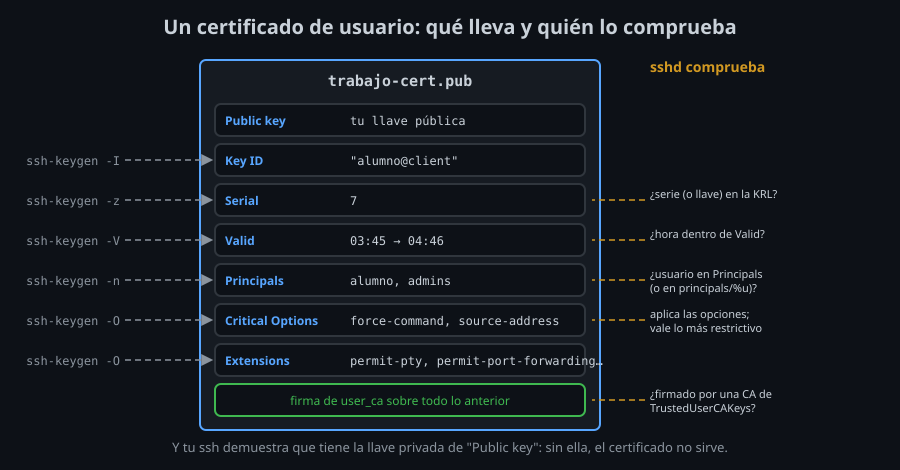

# Certificados de usuario y de host

Un certificado es un archivo `NOMBRE-cert.pub` junto a la llave `NOMBRE`. Lo crea `ssh-keygen -s` y lo lee `ssh-keygen -L`.



## Firmar

```bash
ssh-keygen -s ~/ca/user_ca -I alumno@client -n alumno -V +1h -z 7 ~/.ssh/trabajo.pub
```

| Opción | Campo | Qué es |
|---|---|---|
| `-s CA` | `Signing CA` | La llave privada que firma. Con `-U -s CA.pub`, la que esté en el agente |
| `-I` | `Key ID` | La identidad: de quién es. Aparece en el log de cada conexión |
| `-n` | `Principals` | Para qué usuarios (o roles) vale; en un certificado de host, sus nombres |
| `-V` | `Valid` | Desde cuándo y hasta cuándo |
| `-z` | `Serial` | El número de serie: lo que revocas (teoría 03) |
| `-O` | `Critical Options`, `Extensions` | Limitaciones y permisos |
| `-h` | `Type` | Certificado de host en lugar de usuario |

El resultado es `~/.ssh/trabajo-cert.pub`. `ssh` lo encuentra solo: para cada `IdentityFile`, busca el mismo nombre con `-cert.pub`. `CertificateFile` indica otro.

## Principals: como quién entras

En un certificado de usuario, los principals dicen **como qué usuario** puede entrar:

- Solo con `TrustedUserCAKeys`, el usuario que pides (`deploy@server`) tiene que estar en los principals. Si no: `Certificate invalid: name is not a listed principal`.
- **Sin principals**, el certificado valdría para cualquier usuario: `sshd` lo rechaza (`Certificate lacks principal list`). Pon siempre `-n`.
- Con `AuthorizedPrincipalsFile /etc/ssh/principals/%u`, el nombre de usuario ya no cuenta solo: entra el certificado que lleve **alguna línea del archivo de esa cuenta**. Así firmas con roles (`admins`, `despliegue`) y cada servidor decide qué rol entra en qué cuenta, sin que la CA conozca las cuentas de cada servidor. Una cuenta sin archivo no acepta certificados; su `authorized_keys` sigue valiendo.

Para aceptar una CA en una sola cuenta, sin tocar `sshd_config`, una línea en su `authorized_keys`:

```
cert-authority,principals="alumno" ssh-ed25519 AAAA... CA de usuarios
```

## Validez, opciones y extensiones

**`-V`** acepta `+8h` (desde un minuto antes de ahora, redondeado, hasta dentro de 8 horas), `-5m:+8h` (con 5 minutos de margen para relojes atrasados), `20270101:20270201` o `always:forever`. Sin `-V`, el certificado es eterno: solo la KRL lo para. Las horas son UTC y dependen de que los relojes estén en hora.

`sshd` comprueba la validez **al autenticar**. Una conexión ya abierta, y un master con sus sesiones, siguen después de caducar.

**Opciones críticas**: limitan. Un servidor que no entienda una debe rechazar el certificado, no ignorarla.

| Opción | Qué hace |
|---|---|
| `force-command=ORDEN` | Ejecuta siempre esa orden, pidas lo que pidas |
| `source-address=RED[,RED]` | Solo desde esas redes (CIDR) |
| `verify-required` | Con llaves FIDO2, exige el PIN o la huella, no solo tocarla (semana 04) |

**Extensiones**: permiten. Por defecto, todas: `permit-pty`, `permit-port-forwarding`, `permit-agent-forwarding`, `permit-X11-forwarding` y `permit-user-rc`. `-O no-pty` (y `no-port-forwarding`...) quita una; `-O clear` las quita todas, y `-O permit-pty` devuelve la que quieras.

Frente a `sshd_config`, vale **lo más restrictivo**: un certificado sin `permit-port-forwarding` no reenvía aunque el servidor lo permita, y uno con él no reenvía si el servidor tiene `AllowTcpForwarding no`.

## Del lado del servidor

```
TrustedUserCAKeys /etc/ssh/user_ca.pub
AuthorizedPrincipalsFile /etc/ssh/principals/%u
```

`TrustedUserCAKeys` es un archivo con una llave de CA por línea. `sshd` lo lee en cada autenticación: cambiarlo no requiere recargar. El log de cada entrada dice qué certificado entró:

```
Accepted publickey for alumno from 172.20.0.6 port 44728 ssh2: ED25519-CERT SHA256:/kKd... ID alumno@client (serial 0) CA ED25519 SHA256:bwlf...
```

## Certificados de host

Lo mismo, del otro lado. Firmas con `-h` la **host key pública** del servidor, con sus nombres en `-n`:

```bash
ssh-keygen -s ~/ca/host_ca -h -I server -n server,server.empresa.com -V +52w ssh_host_ed25519_key.pub
```

Y el servidor la presenta:

```
HostCertificate /etc/ssh/ssh_host_ed25519_key-cert.pub
```

El cliente confía en la CA con una línea en `known_hosts`:

```
@cert-authority *.empresa.com,server ssh-ed25519 AAAA... CA de hosts
```

Para un host que encaje en el patrón, `ssh` acepta la host key si está firmada por esa CA, el nombre que escribiste está en los principals y está en validez. Sin pregunta la primera vez, y sin aviso al reinstalar si el servidor nuevo se firma.

- Por **IP**, o por un nombre que no está en el certificado, la llave cuenta como desconocida: la pregunta de siempre. `HostKeyAlias` o un `-n` con la IP lo arreglan.
- Un certificado de host **caducado** deja fuera a todos los clientes que solo tienen la CA (`Certificate invalid: expired`): apunta cuándo caduca cada uno.
- Antes de firmar una host key, **comprueba que es la del servidor** (su huella por otro canal, como en la semana 02). Firmarla es decir a todos tus clientes que confíen en ella.

Usa dos CA distintas: quien puede firmar servidores (por ejemplo, el sistema que los instala) no tiene por qué poder firmar personas.

<!-- nav -->
---

## 🔗 Navegación

| Anterior | Siguiente |
|---|---|
| ← [Teoría — Por qué certificados](01-por-que-certificados.md) | [Teoría — Revocación, rotación y cuidado de la CA](03-revocacion-y-rotacion.md) → |

[↑ Semana 10](../README.md)
