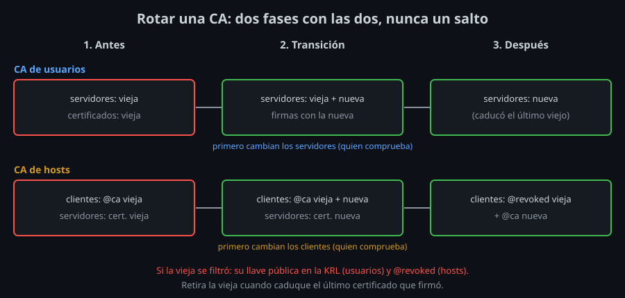

# Revocación, rotación y cuidado de la CA

Un certificado vale hasta que caduca. Esta teoría trata de lo que pasa antes: dejar fuera a alguien ya, cambiar la CA sin dejar fuera a nadie, y que la CA no se filtre.

## La KRL

Una **KRL** (*Key Revocation List*) es un archivo binario y compacto con lo revocado. La crea y la amplía `ssh-keygen -k`:

```bash
ssh-keygen -k -f revoked.krl                         # una KRL vacía
ssh-keygen -k -u -f revoked.krl trabajo-cert.pub     # -u: añade, no la crea de nuevo
ssh-keygen -Q -f revoked.krl trabajo-cert.pub        # ¿está revocado? (sale con 1 si sí)
ssh-keygen -Q -l -f revoked.krl                      # qué contiene
```

| Revocas | Con | Qué deja fuera |
|---|---|---|
| Un certificado | El archivo `-cert.pub` | Ese certificado (su número de serie, con su CA). Otro certificado de la misma llave entra |
| Una llave | La llave pública | La llave y **todos** sus certificados, pasados y futuros, y su línea en cualquier `authorized_keys` |
| Por número o identidad | Un archivo de texto con `serial: 12`, `serial: 10-20` o `id: alumno@portatil`, y `-s CA.pub` | Sin tener el certificado: el portátil perdido |
| Una CA | La llave pública de la CA | Todo lo que firmó |

El servidor la usa con:

```
RevokedKeys /etc/ssh/revoked.krl
```

- `sshd` la lee **en cada autenticación**: basta con copiar el archivo nuevo, sin recargar.
- **Si el archivo falta o está roto, `sshd` rechaza todas las llaves**, también las de `authorized_keys` (`No such file or directory`, `invalid format`). Instala la KRL antes de configurar `RevokedKeys`, y súbela con `install` después de comprobarla.
- Revocar no corta lo que ya entró: `sudo pkill -u CUENTA` (semana 09).
- Del lado del cliente, `RevokedHostKeys` en `ssh_config` usa una KRL para host keys, y `@revoked` en `known_hosts` marca una llave (o una CA) concreta.

Una KRL solo sirve si está en **todos** los servidores. Por eso la mejor revocación es no necesitarla: certificados de horas. Una llave robada deja de servir sola esa misma noche, y quien se va no recibe más certificados.

Para que revocar por número funcione, los números tienen que ser **únicos**: sácalos de un contador, nunca de memoria, y lleva un registro de qué número es de quién.

## Rotar una CA

Rotas cuando la llave de la CA se filtró (o alguien que la tuvo se fue), cuando su algoritmo envejece, o porque tu política lo pide: si rotas cada año, el día que sea urgente ya sabes hacerlo.

El problema: los servidores confían en la vieja y las personas tienen certificados de ella. Cambiarlo todo a la vez deja a alguien fuera. Se hace en fases, con un periodo en el que **se confía en las dos**:



**CA de usuarios** (la comprueban los servidores):

1. La nueva, **en los servidores**: `TrustedUserCAKeys` con dos líneas, la vieja y la nueva.
2. Firma con la nueva. Con certificados cortos, basta esperar a que cada uno pida el siguiente.
3. Cuando haya caducado el último certificado de la vieja, quítala de `TrustedUserCAKeys`.

**CA de hosts** (la comprueban los clientes), al revés:

1. La nueva, **en los clientes**: una segunda línea `@cert-authority`.
2. Firma las host keys con la nueva y sustituye el certificado de cada servidor.
3. Cambia la línea de la vieja por `@revoked * ...` y, más adelante, quítala.

Si la vieja se **filtró**, retirarla no basta: siempre queda un servidor sin actualizar o una línea `cert-authority` olvidada en algún `authorized_keys`. Pon la llave pública de la CA vieja en la KRL: todo lo que firmó queda revocado allí donde llegue la KRL.

Los números de serie van **por CA**: con una CA nueva puedes empezar de nuevo, pero un registro por CA evita confusiones.

## Proteger la CA

La llave privada de la CA de usuarios entra como cualquiera en todos tus servidores. Lo mínimo:

- **Fuera de cualquier repositorio git** y con permisos 600 en una carpeta 700. Nunca en el kit.
- **Con frase**, y `-a 100` para que adivinarla cueste. Nunca escribas la frase en la línea de órdenes: queda en el historial.
- **Firmar desde el agente**: `ssh-add -t 15m user_ca` y `ssh-keygen -U -s user_ca.pub ...`. El archivo puede vivir fuera del equipo (un disco cifrado que solo conectas para cargarla), y el agente la olvida solo. **Nunca reenvíes ese agente** (`ssh -A`): `root` en el otro lado firmaría lo que quisiera (semana 09).
- **Mejor aún, en hardware**: una llave FIDO2 (semana 04) o un HSM, de donde la llave no sale y cada firma necesita tocarla.
- **Un equipo dedicado** para la CA, o un servicio que firma certificados cortos después de un inicio de sesión con segundo factor, en organizaciones grandes.

## Saber qué firmó

`ssh-keygen` no recuerda nada. Lleva un registro de cada certificado: fecha, número de serie, identidad, principals, validez y huella de la llave. El log de `sshd` da la otra mitad:

```
Accepted certificate ID "alumno@client" (serial 4) signed by ED25519 CA SHA256:9yAe... via /etc/ssh/user_ca.pub
```

Con `LogLevel VERBOSE` aparece esta línea; con el nivel normal, la de `Accepted publickey`, que trae lo mismo. Si ves un certificado de tu CA que no está en tu registro, alguien más tiene tu CA: rota y revoca.

`ExposeAuthInfo yes` deja el certificado de cada sesión en el archivo de `$SSH_USER_AUTH`: un script del servidor puede anotar qué certificado lo ejecutó.

<!-- nav -->
---

## 🔗 Navegación

| Anterior | Siguiente |
|---|---|
| ← [Teoría — Certificados de usuario y de host](02-certificados-de-usuario-y-de-host.md) | [Índice de labs](../2-practicas/README.md) → |

[↑ Semana 10](../README.md)
