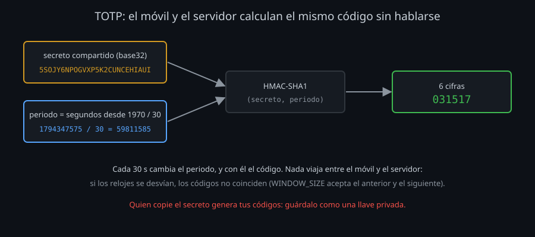
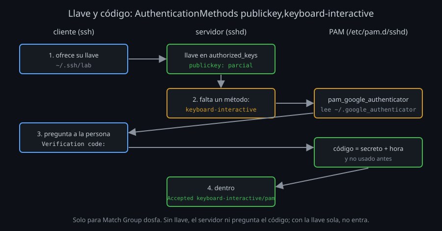

# El segundo factor: llave y código

## Qué es un factor

Un factor es una **forma distinta** de demostrar quién eres:

| Factor | Ejemplo en SSH |
|---|---|
| Algo que **tienes** | Tu llave privada, una llave FIDO2, el móvil con la app de códigos |
| Algo que **sabes** | La frase de la llave, una contraseña |
| Algo que **eres** | La huella dactilar que desbloquea una llave FIDO2 |

Dos factores son dos cosas que un atacante tiene que conseguir **por caminos distintos**. Una llave robada de un portátil no trae el móvil; un código visto por encima del hombro no trae la llave. Dos contraseñas no son dos factores: se roban igual.

Ya conoces uno de dos factores: una llave con frase (algo que tienes y algo que sabes). Pero la frase la comprueba **tu equipo**, no el servidor: el servidor no puede saber si tu llave tenía frase. Las llaves FIDO2 con `verify-required` ([semana 04](../../week-04-ssh_agent_y_llaves_fido2/1-teoria/03-llaves-fido2-sk.md)) sí se lo demuestran. El código TOTP es la otra forma: lo comprueba el servidor y solo necesita un móvil.

## TOTP: un código que cambia cada 30 segundos

TOTP (*Time-based One-Time Password*, RFC 6238) es lo que hacen Google Authenticator, Aegis, FreeOTP o 1Password:



1. Al darte de alta, el servidor y tu móvil comparten un **secreto**: 16-32 caracteres en base32 (`5SOJY6NPOGVXP5K2CUNCEHIAUI`), normalmente dentro de un código QR.
2. Cada uno calcula, por su cuenta, el número de periodos de 30 s desde 1970: `date +%s` dividido entre 30.
3. Con el secreto y ese número, un HMAC-SHA1 da 20 bytes; de ahí salen 6 cifras.

No viaja nada entre el móvil y el servidor: los dos llegan al mismo código porque tienen el mismo secreto y la misma hora. Por eso:

- **La hora importa.** Si el reloj del servidor o del móvil se desvía, los códigos no coinciden. La *ventana* (`WINDOW_SIZE 3`) acepta el código anterior y el siguiente.
- **El secreto es tan valioso como una llave privada.** Quien lo copie genera tus códigos. Vive en `~/.google_authenticator` (modo 400) y en tu móvil, y en ningún sitio más.
- **Cada código vale una vez** si el servidor lo apunta (`DISALLOW_REUSE`): quien lo vea al teclearlo llega tarde.
- **Códigos de emergencia**: 8 cifras, cada uno vale una sola vez, para cuando pierdes el móvil. Se guardan fuera del servidor y del móvil.

`oathtool --totp -b SECRETO` calcula el código en una terminal: en el laboratorio sustituye al móvil (**solo en el laboratorio**: en un equipo de verdad, el secreto en un script es otra llave sin frase).

## Cómo pregunta sshd: PAM y keyboard-interactive

`sshd` no sabe nada de TOTP. Lo delega en **PAM** (*Pluggable Authentication Modules*), la pieza de Linux que decide cómo se autentica cada servicio, con un archivo por servicio en `/etc/pam.d/`:

```
# /etc/pam.d/sshd en Ubuntu, parte "auth"
@include common-auth          ← la contraseña de Unix (pam_unix)
```

`libpam-google-authenticator` añade el módulo `pam_google_authenticator.so`, que lee `~/.google_authenticator` y pide `Verification code:`. Para pedirlo, `sshd` usa el método **keyboard-interactive**: el servidor manda preguntas y el cliente se las enseña a la persona.



Tres piezas, en dos archivos:

| Pieza | Dónde | Qué hace |
|---|---|---|
| `KbdInteractiveAuthentication yes` | `sshd_config` | Permite el método keyboard-interactive (tu `10-acceso.conf` lo deja en `no` para todos) |
| `AuthenticationMethods publickey,keyboard-interactive` | `sshd_config` | Exige los dos métodos, **en ese orden**: con la llave sola, el servidor contesta «falta el código» |
| `auth required pam_google_authenticator.so` | `/etc/pam.d/sshd` | Lo que se pregunta en keyboard-interactive: el código, **no** la contraseña |

El cambio de PAM tiene trampa: si dejas `@include common-auth` y añades el código, PAM pide **contraseña y código** después de la llave: tres factores, uno de ellos la contraseña que querías dejar de usar. Por eso se comenta. Y con `PasswordAuthentication yes`, PAM recibiría la contraseña como si fuera el código: tu `10-acceso.conf` lo deja en `no`.

## Solo para quien esté listo: Match Group

Si activas el segundo factor para todos de golpe, quien aún no tenga secreto se queda fuera. `Match Group dosfa` lo aplica persona a persona:

```
Match Group dosfa
    KbdInteractiveAuthentication yes
    AuthenticationMethods publickey,keyboard-interactive
```

El orden del alta es siempre el mismo: la persona crea su secreto **y después** entra en el grupo. `nullok` en PAM dejaría pasar a quien no tiene secreto: cómodo durante una migración, pero convierte el segundo factor en opcional sin que nadie lo note. El kit no lo usa: el grupo es la lista de quién ya tiene secreto.

## Lo que cambia para ti

- **Hace falta una terminal.** `BatchMode`, `cron`, `rsync` desde un script o Ansible no pueden escribir el código: las cuentas de `dosfa` son para personas. Las tareas automáticas usan una cuenta propia con una llave restringida ([semana 03](../../week-03-autenticacion_con_llaves_ssh/README.md)) o un certificado corto.
- **El multiplexing pide el código una vez.** Un master abierto ya está autenticado: las conexiones que van por él no vuelven a preguntar. Es cómodo, y es la misma razón por la que hay que cerrarlo al cambiar llaves.
- **Los certificados también pasan.** `publickey` incluye los certificados de la [semana 10](../../week-10-certificados_ssh_ca_principals_krl_y_rotacion/README.md): certificado y código.

<!-- nav -->
---

## 🔗 Navegación

| Anterior | Siguiente |
|---|---|
| ← [Teoría — Auditar los algoritmos de un servidor](01-auditar-algoritmos.md) | [Teoría — fail2ban y el log de sshd](03-fail2ban-y-registros.md) → |

[↑ Semana 11](../README.md)
