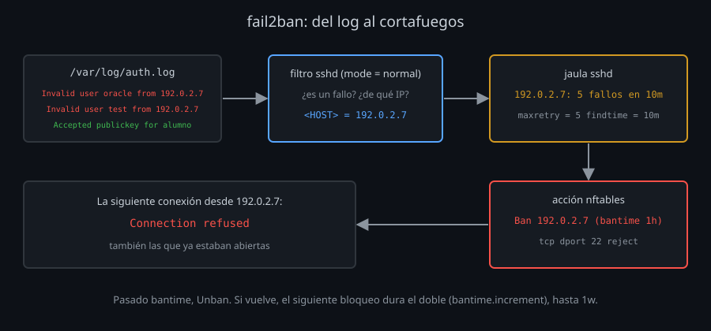

# fail2ban y el log de sshd

## El ruido de Internet

Un servidor con el puerto 22 abierto recibe intentos de entrar a los pocos minutos de encenderse: robots que prueban `root`, `admin`, `test`, `oracle`, `ubuntu`… con contraseñas de diccionario. Con solo llaves (`10-acceso.conf`) no van a entrar, pero:

- llenan el log y esconden lo que sí importa;
- gastan CPU en cada intercambio de llaves y huecos de `MaxStartups`;
- y si algún día una cuenta acaba con contraseña por error, la encuentran.

**fail2ban** lee el log, cuenta fallos por IP y, al pasar un límite, bloquea esa IP en el cortafuegos durante un tiempo. No sustituye a las llaves ni al segundo factor: quita ruido y frena a quien prueba.

## Cómo funciona

| Pieza | Dónde | Qué hace |
|---|---|---|
| **Filtro** | `/etc/fail2ban/filter.d/sshd.conf` | Expresiones regulares que reconocen un fallo y sacan la IP (`<HOST>`) de cada línea |
| **Acción** | `/etc/fail2ban/action.d/nftables.conf` | Qué hacer al bloquear y al desbloquear: añadir y quitar la IP de un conjunto de nftables |
| **Jaula** | `/etc/fail2ban/jail.d/*.local` | Une un log, un filtro y una acción, con los límites |

Los límites de la jaula:

| Opción | Kit | Significado |
|---|---|---|
| `maxretry` | `5` | Fallos que provocan el bloqueo |
| `findtime` | `10m` | Ventana en la que se cuentan esos fallos |
| `bantime` | `1h` | Cuánto dura el bloqueo |
| `bantime.increment` | `true` | Cada nuevo bloqueo de la misma IP dura más (el doble), hasta `bantime.maxtime` (`1w`) |
| `ignoreip` | `127.0.0.1/8 ::1` | IP que nunca se bloquean |

Los archivos `.conf` son del paquete y se pisan al actualizar; lo tuyo va en `.local`, que se lee después y gana. En Ubuntu, `jail.d/defaults-debian.conf` ya activa la jaula `sshd` con `backend = systemd` (el journal); en el laboratorio no hay systemd, y tu jaula dice `backend = auto` y `logpath = /var/log/auth.log`.

El bloqueo es una regla de nftables que **rechaza todo** lo que llega de esa IP al puerto 22: la siguiente conexión recibe `Connection refused` sin llegar a ver el banner. Y también las conexiones que ya estaban abiertas, incluido tu master de multiplexing.

## El modo del filtro

El filtro `sshd` tiene modos. Cuenta como fallo:

| Modo | Además |
|---|---|
| `normal` | Usuario que no existe (`Invalid user`), contraseña o código equivocados (`Failed password`, `PAM: Authentication failure`), usuario fuera de `AllowGroups` |
| `aggressive` | Cualquier conexión que se cierra **sin llegar a autenticarse** (`Connection closed by ... [preauth]`), negociaciones fallidas |

`aggressive` parece mejor con contraseñas desactivadas, pero cuenta como ataque lo que hacen tus propias herramientas: `ssh-copy-id` al probar llaves, `ssh-audit` (unas 40 conexiones), un escáner de inventario o un cliente con una llave que el servidor no conoce. Te bloquearías a ti mismo, y el bloqueo corta también tus sesiones abiertas. El kit usa `normal`.

`fail2ban-regex LOG sshd` aplica el filtro a un log y dice cuántas líneas casan con cada expresión: es la forma de probar una jaula **antes** de que bloquee a nadie.

## El log de sshd

`sshd` escribe una línea por cada cosa que pasa. En un Ubuntu con rsyslog van a `/var/log/auth.log`; con systemd, al journal (`journalctl -u ssh`). En el laboratorio, `start-sshd` escribe cada línea en la salida del contenedor (`docker compose logs server`) y, con fecha, en `/var/log/auth.log`.

| Línea | Qué te dice |
|---|---|
| `Accepted publickey for alumno from 172.20.0.4 port 47578 ssh2: ED25519 SHA256:Bld…` | Quién entró, desde dónde y **con qué llave** (su huella) |
| `Accepted keyboard-interactive/pam for alumno from …` | Segundo factor aceptado |
| `Invalid user oracle from 172.20.0.4 port 50262` | Alguien probó un usuario que no existe |
| `Failed password for alumno from …` | Contraseña equivocada (solo si las permites) |
| `PAM: Authentication failure for alumno from …` | Código TOTP equivocado |
| `User salto from … not allowed because none of user's groups are listed in AllowGroups` | Usuario real fuera de los grupos permitidos |
| `Connection closed by authenticating user alumno … [preauth]` | Se fue sin terminar de entrar: llave rechazada, código no escrito o una auditoría |

La huella de `Accepted publickey` se cruza con `ssh-keygen -lf ~/.ssh/authorized_keys` (o con `emitidos.log` de tu CA, [semana 10](../../week-10-certificados_ssh_ca_principals_krl_y_rotacion/README.md)): así sabes **qué llave** se usó, no solo qué cuenta. Con `LogLevel VERBOSE` (tu `20-sesion.conf`) también salen las llaves rechazadas.

Tres preguntas que el log responde con `grep`, `sort` y `uniq -c` ([lab 07](../2-practicas/lab-07-leer-el-log/README.md)):

1. ¿Quién entró hoy, desde dónde y con qué llave?
2. ¿Qué IP fallan más, y probando qué usuarios?
3. ¿Hubo un acceso aceptado desde una IP que antes solo fallaba?

Y una cuarta que no responde el log sino `sshd -T`: ¿la configuración que corre es la que crees? Guarda `sudo sshd -T` después de cada despliegue y compáralo con `diff` la próxima vez.

## Capas

| Amenaza | Defensa | Semana |
|---|---|---|
| Robots que prueban contraseñas | Solo llaves; fail2ban quita el ruido | 07, 11 |
| Algoritmos débiles anunciados | `15-algoritmos.conf`, comprobado con `ssh-audit` | 11 |
| Una llave robada | Segundo factor; certificados cortos | 11, 10 |
| Llave y código robados | Revocar (KRL); el log dice qué llave fue | 10, 11 |

<!-- nav -->
---

## 🔗 Navegación

| Anterior | Siguiente |
|---|---|
| ← [Teoría — El segundo factor: llave y código](02-segundo-factor.md) | [Índice de labs](../2-practicas/README.md) → |

[↑ Semana 11](../README.md)
