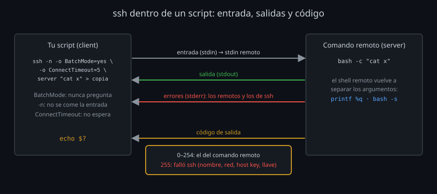

# SSH dentro de un script

Hasta ahora, delante de cada `ssh` había una persona: alguien que escribe la frase, contesta `yes` a una host key nueva o pulsa Ctrl+C si algo se cuelga. En un script no hay nadie. Todo lo que `ssh` podría preguntar se convierte en un script que se queda esperando para siempre, o que sigue adelante sin enterarse de que algo falló.

## Lo que entra y lo que sale



`ssh HOST COMANDO` se comporta como un comando local más, con tres canales y un código:

| Canal | Qué lleva |
|---|---|
| Entrada (`stdin`) | Lo que tu script le pase: un archivo, una tubería, un `heredoc`. `ssh` lo reenvía al comando remoto |
| Salida (`stdout`) | Lo que escribe el comando remoto. Se redirige igual que en local: `ssh server cat x > copia` |
| Errores (`stderr`) | Los del comando remoto **y** los del propio `ssh` (`Permission denied`, `Could not resolve hostname`) |
| Código de salida | El del comando remoto (0-254), o **255** si falló `ssh` |

El código es lo que tu script tiene que mirar. `ssh server false` sale con 1 porque `false` sale con 1. Un 255 casi siempre es `ssh`: no resuelve el nombre, no conecta, la host key no coincide o no aceptan la llave. Un comando remoto que sale con 255 de verdad se confunde con eso: evítalo.

## Que no pregunte nada: BatchMode

| Opción | Qué hace en un script |
|---|---|
| `BatchMode yes` | `ssh` no pregunta nunca: ni contraseñas, ni frases, ni `yes/no` de host keys. Si necesitaría preguntar, falla con 255 |
| `ConnectTimeout 5` | Un servidor que no responde falla en 5 s, no en los ~2 minutos del sistema |
| `ServerAliveInterval 15` | Una conexión que se corta a mitad se detecta (15 s × `ServerAliveCountMax`) en lugar de quedarse colgada |
| `StrictHostKeyChecking yes` | Una host key desconocida o cambiada es un error, no una pregunta. Con `BatchMode`, aunque no lo pongas, `ask` se comporta igual |

Sin `BatchMode`, un script que llega a un servidor sin tu llave se queda esperando una contraseña que nadie va a escribir. Con `BatchMode`, falla, y el siguiente servidor sigue.

## La entrada: el bucle que se come la lista

```bash
while read -r h; do ssh "$h" hostname; done < hosts
```

Parece que recorre todos los hosts, pero se para en el primero: `ssh` lee su entrada (la del bucle) y se la reenvía al comando remoto, que no la usa. El resto de la lista desaparece. Dentro de un bucle que lee de la entrada, `ssh -n` (entrada vacía) o `ssh ... < /dev/null`.

## Las comillas: el comando se interpreta dos veces

`ssh` junta sus argumentos con espacios y el shell **remoto** los vuelve a separar:

```bash
d="mi carpeta"
ssh server mkdir -p "$d"         # el remoto recibe: mkdir -p mi carpeta  → dos carpetas
ssh server mkdir -p "$(printf %q "$d")"   # recibe: mkdir -p mi\ carpeta  → una
```

- Tu shell expande `$VAR` antes de enviar; el remoto expande lo que vaya entre comillas simples o escapado (`'echo $HOME'`, `"echo \$HOME"`).
- `printf %q` escapa un valor para que llegue entero al otro lado.
- Para más de una línea, envía el script por la entrada: `ssh server bash -s <<'FIN' ... FIN`. Las comillas de `'FIN'` impiden que tu shell toque los `$`; `bash -s -- ARG` le pasa argumentos (escapados con `%q`).

## Muchos servidores

- **En serie**: un bucle con `ssh -n`, `BatchMode` y `ConnectTimeout`, que apunta los que fallan y sale con 1 al final si alguno falló. Un servidor caído no para a los demás.
- **En paralelo**: `xargs -P N` lanza N `ssh` a la vez; el tiempo total es el del más lento, no la suma. Pero las salidas llegan en cualquier orden (pon el nombre del host delante de cada línea) y `xargs` **se para** si un comando sale con 255: envuelve el `ssh` en `sh -c '... || echo "$1: FALLO"'`.
- **Multiplexing** ([semana 05](../../week-05-configuracion_avanzada_cliente_ssh/1-teoria/03-multiplexing.md)): diez conexiones al mismo servidor pagan un solo intercambio de llaves. En el laboratorio, diez `ssh server true` pasan de ~1,8 s a ~0,07 s.

Cuando el bucle crece (reintentos, solo lo que cambió, grupos de servidores, `sudo`), estás escribiendo Ansible: ver [03-ansible.md](03-ansible.md).

## Resumen

- Mira el código de salida: 255 es `ssh`, lo demás es el comando remoto.
- `BatchMode yes` y `ConnectTimeout` en todo `ssh` sin persona delante.
- `ssh -n` dentro de un `while read`.
- `printf %q` o `bash -s` con `'FIN'` para no pelearte con las comillas.
- En paralelo, `xargs -P` con el host en cada línea y sin dejar que un 255 lo pare todo.

<!-- nav -->
---

## 🔗 Navegación

| Anterior | Siguiente |
|---|---|
| ← [Semana 12 — Automatización: scripting, CI/CD y Ansible](../README.md) | [Teoría — Desplegar desde un CI](02-despliegue-desde-ci.md) → |

[↑ Semana 12](../README.md)
