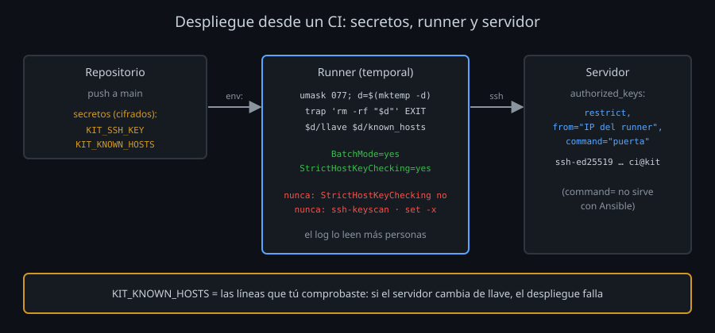

# Desplegar desde un CI

Un CI (*integración continua*: GitHub Actions, GitLab CI, Jenkins) ejecuta tareas en una máquina temporal, el **runner**, cada vez que pasa algo en el repositorio: un push, una etiqueta, un botón. Desplegar desde ahí significa que el runner entra por SSH en tus servidores. Es un usuario más, con tres diferencias: no hay nadie delante, la máquina es de otro (y se borra al terminar) y lo que hace queda escrito en un log que leen más personas.



## La llave del CI

| Decisión | Por qué |
|---|---|
| Una llave **solo** para el CI, nunca la tuya | Se revoca sin tocar tu acceso, y el log del servidor dice qué hizo el CI |
| Sin frase | Nadie la escribiría. Lo que la protege es dónde vive (el almacén de secretos del CI) y lo que puede hacer |
| Restringida en `authorized_keys` | Si se filtra, que sirva para lo mínimo |
| Sus propias líneas en el registro | `restrict,from=...` y un comentario (`ci@ssh-infra-kit`) que la identifique en los logs ([semana 11](../../week-11-2fa_fail2ban_y_auditoria/2-practicas/lab-07-leer-el-log/README.md)) |

Las opciones de `authorized_keys` las conoces de la [semana 03](../../week-03-autenticacion_con_llaves_ssh/1-teoria/03-authorized_keys-y-opciones.md):

```
restrict,command="/home/alumno/bin/puerta",from="203.0.113.0/24" ssh-ed25519 AAAA... ci@despliegue
```

- `restrict`: sin terminal, sin reenvíos de puertos, sin agente ni X11.
- `command="..."`: **comando forzado**. Pida lo que pida el cliente, se ejecuta este; lo pedido llega en `$SSH_ORIGINAL_COMMAND`. Un script corto con un `case` decide qué se permite (`estado`, `publicar`) y rechaza lo demás.
- `from="..."`: solo desde esas direcciones. En un CI con runners de IP fija; con IP variable, no sirve.

Con comando forzado, la llave del CI no da un shell aunque se filtre. Pero no todo cabe en un `case`: Ansible ejecuta Python arbitrario en el servidor, y con `command=` no funciona. Para esa llave quedan `restrict`, `from=`, una cuenta propia y `sudo` limitado a lo que despliega.

## Los secretos

El CI guarda valores cifrados (*secrets*) y los entrega al job como variables de entorno. El job los escribe donde `ssh` los necesita:

1. Una carpeta temporal con `umask 077`: llave y `known_hosts` solo legibles por el job.
2. `trap 'rm -rf "$d"' EXIT`: se borran al salir, también si el script falla a mitad.
3. Nunca en la salida: ni `echo`, ni `set -x` (imprime cada comando con sus valores), ni `cat` de la llave. GitHub tapa en el log los valores exactos de los secretos, pero no lo que se derive de ellos (un trozo, una versión en base64).

Un `ssh-agent` es la alternativa a escribir la llave: `ssh-add - <<< "$KEY"` la carga sin tocar el disco. Con un archivo en una carpeta 700 que se borra al salir, en un runner que se destruye después, el riesgo es el mismo y hay menos piezas.

## known_hosts: el secreto que se olvida

En tu equipo, la primera conexión a un servidor te enseña su huella y la compruebas ([semana 02](../../week-02-protocolo_kex_y_known_hosts/1-teoria/03-host-keys-y-known_hosts.md)). En un runner nuevo, `known_hosts` está vacío **en cada ejecución**. Las salidas fáciles son malas:

| Lo que se ve en muchos CI | Qué hace de verdad |
|---|---|
| `StrictHostKeyChecking no` | Acepta cualquier llave: quien se ponga en medio (un DNS envenenado, una IP reasignada) recibe tu despliegue, y con él lo que lleve |
| `ssh-keyscan server >> known_hosts` | Lo mismo con un paso más: lee la llave por la misma red en la que no confías |
| `StrictHostKeyChecking accept-new` | Acepta la primera que vea; en un runner vacío, siempre es la primera |

La buena: las líneas de `known_hosts` que **tú** comprobaste van en un segundo secreto (`KIT_KNOWN_HOSTS`), y el job usa `StrictHostKeyChecking yes`. Si un servidor cambia de host key, el despliegue falla: es lo que tiene que pasar, y lo arreglas actualizando el secreto después de comprobar la llave nueva. Con certificados de host ([semana 10](../../week-10-certificados_ssh_ca_principals_krl_y_rotacion/README.md)), el secreto es una sola línea `@cert-authority` que no cambia al rotar llaves.

## Un workflow de GitHub Actions

```yaml
on:
  push:
    branches: [main]
permissions:
  contents: read            # el token del job no puede escribir en el repositorio
concurrency: despliegue     # un despliegue a la vez
jobs:
  servidores:
    runs-on: ubuntu-24.04
    steps:
      - uses: actions/checkout@v4
      - run: bin/ci-deploy
        env:
          KIT_SSH_KEY: ${{ secrets.KIT_SSH_KEY }}
          KIT_KNOWN_HOSTS: ${{ secrets.KIT_KNOWN_HOSTS }}
```

- Los secretos solo entran en el paso que los necesita (`env:` del paso, no del job).
- `permissions` y `concurrency`: lo que puede hacer un job comprometido, y que dos pushes seguidos no desplieguen a la vez.
- Los secretos no llegan a los *pull requests* que vienen de forks: alguien de fuera no puede escribir un workflow que imprima tu llave.

## Resumen

- Una llave por CI, sin frase, restringida (`restrict`, `command=` si cabe, `from=` si la IP es fija).
- Secretos a una carpeta 700 que se borra con `trap`; nunca a la salida.
- `known_hosts` comprobado a mano, como secreto, y `StrictHostKeyChecking yes`. Nunca `no`, `accept-new` ni `ssh-keyscan` en el runner.
- Permisos mínimos y un despliegue a la vez.

<!-- nav -->
---

## 🔗 Navegación

| Anterior | Siguiente |
|---|---|
| ← [Teoría — SSH dentro de un script](01-ssh-en-scripts.md) | [Teoría — Ansible: muchos servidores, el mismo estado](03-ansible.md) → |

[↑ Semana 12](../README.md)
