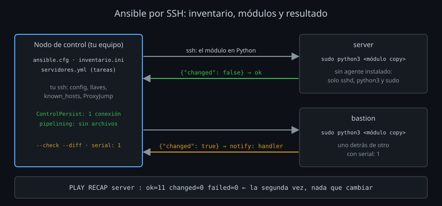

# Ansible: muchos servidores, el mismo estado

Ansible es la evolución natural del bucle de [01-ssh-en-scripts.md](01-ssh-en-scripts.md): recorre una lista de servidores por SSH y deja en cada uno el estado que describes. No instala nada en los servidores (es *agentless*): solo necesita `ssh`, `python3` y, para cambiar el sistema, `sudo`.



## Las piezas

| Pieza | Qué es | Ejemplo |
|---|---|---|
| Nodo de control | Tu equipo (o el runner del CI), donde está instalado Ansible | `uv tool install ansible-core` |
| Inventario | Los servidores, en grupos | `[lab]` con `server` y `bastion` |
| Módulo | Un programa en Python que hace una cosa y dice si cambió algo | `ping`, `command`, `copy`, `group`, `user` |
| Tarea | Un módulo con sus argumentos | «copia este archivo aquí con permisos 0644» |
| Playbook | Un archivo YAML con tareas para un grupo, en orden | `servidores.yml` |
| Handler | Una tarea que solo se ejecuta si otra avisa (`notify`) de que cambió algo | «recargar sshd» |
| `ansible.cfg` | La configuración de Ansible, leída de la carpeta donde lo ejecutas | `inventory`, `ssh_args`, `pipelining` |

## Cómo usa SSH

Por cada tarea y servidor, Ansible:

1. Abre (o reutiliza) una conexión `ssh` al servidor. Usa **tu** `ssh`: lee `~/.ssh/config`, `known_hosts`, tus llaves y tu agente. Un `ProxyJump` en tu configuración vale para Ansible sin cambiar nada.
2. Envía el módulo en Python y lo ejecuta con `python3` (con `become: true`, a través de `sudo`).
3. Lee la respuesta en JSON: `ok`, `changed` o `failed`.

Por eso todo lo que sabes de SSH se aplica: si `ssh server` no entra sin preguntar, Ansible tampoco. `ansible -vvv` enseña el `ssh` exacto que ejecuta:

```
SSH: EXEC ssh -C -o ControlMaster=auto -o ControlPersist=60s ... -o 'ControlPath="/home/alumno/.ansible/cp/f9e6445ae9"' server '/bin/sh -c ...'
```

Lo que más pesa en el tiempo:

| Ajuste | Qué ahorra | En el laboratorio, 10 tareas |
|---|---|---|
| Sin multiplexing | Nada: una conexión entera por paso | ~13,7 s |
| `ControlPersist` (por defecto) | El intercambio de llaves y la autenticación de cada paso | ~3,3 s |
| `+ pipelining = True` | Copiar el módulo a un archivo antes de ejecutarlo: va por la entrada de `ssh` | ~2,2 s |

`pipelining` choca con un `sudo` que exige terminal (`Defaults requiretty`); en Ubuntu no está activado.

## Idempotencia: describir el estado, no los pasos

Un módulo como `copy` no «copia un archivo»: deja el archivo **como dices**. Si ya está así, no hace nada y responde `ok`; si no, lo cambia y responde `changed`. Ejecutar el mismo playbook dos veces da el mismo servidor, y la segunda vez el resumen dice `changed=0`.

Eso da tres herramientas que un script no tiene:

- `--check --diff`: qué cambiaría, línea a línea, sin tocar nada.
- Handlers: recargar `sshd` solo si su configuración cambió, una vez al final aunque cambien cinco archivos.
- `changed_when: false` en una tarea que solo consulta (como `sshd -t`), para que no cuente como cambio.

`command` y `shell` no son idempotentes por sí solos: ejecutan siempre, y siempre dicen `changed`. Úsalos para comprobar, y los módulos (`copy`, `file`, `group`, `user`) para cambiar.

## Cambiar sshd sin quedarte fuera

Ansible no tiene la vuelta atrás de `bin/sshd-deploy` ([semana 07](../../week-07-servidor_sshd_config_y_hardening/README.md)): si una configuración nueva te deja fuera, se queda. Lo que hace el playbook del kit en su lugar:

| Medida | Cómo |
|---|---|
| Validar antes de instalar | `validate: /usr/sbin/sshd -t -f %s` en un archivo suelto, o `sshd -t` sobre una copia de la configuración completa |
| De uno en uno | `serial: 1`: si el primero falla, el playbook se para antes del segundo |
| Recargar, no reiniciar | `kill -HUP`: las conexiones abiertas siguen vivas |
| Comprobar al final | `meta: flush_handlers`, `meta: reset_connection` y un `ping` con una conexión nueva |
| Probar antes | `--check --diff` y una sesión abierta en otra terminal |

`copy` de una carpeta añade y sustituye, pero **no borra**: un `.conf` viejo en `sshd_config.d` seguiría mandando. El playbook del kit busca lo que sobra (`find`) y lo borra (`file: state=absent`).

## Resumen

- Ansible usa tu `ssh`: misma configuración, llaves y `known_hosts`. Si `ssh -o BatchMode=yes HOST` no entra, Ansible tampoco.
- Multiplexing y `pipelining` son la diferencia entre segundos y minutos.
- Los módulos describen estados: `changed=0` en la segunda ejecución, `--check --diff` antes de la primera.
- Para `sshd`: validar, de uno en uno, recargar y comprobar con una conexión nueva.

<!-- nav -->
---

## 🔗 Navegación

| Anterior | Siguiente |
|---|---|
| ← [Teoría — Desplegar desde un CI](02-despliegue-desde-ci.md) | [Índice de labs](../2-practicas/README.md) → |

[↑ Semana 12](../README.md)
