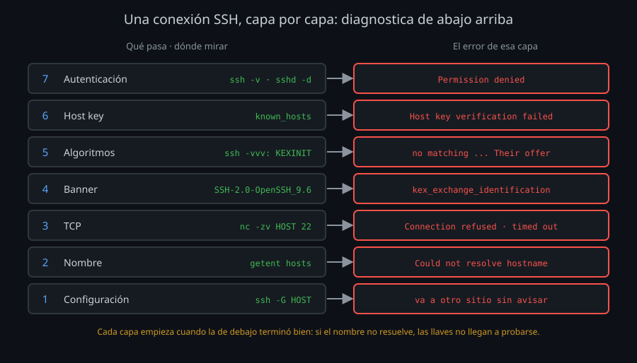

# Diagnóstico por capas

"No conecta" no es un diagnóstico. Entre que escribes `ssh server` y que aparece el prompt pasan siete cosas, una detrás de otra, y cada una falla con su propio mensaje. Saber en cuál estás es la mitad del arreglo: un `Connection refused` no se arregla tocando llaves, y un `Permission denied` no se arregla abriendo puertos.

## Una conexión por capas

| # | Capa | Qué pasa | Si falla | Dónde mirar |
|---|---|---|---|---|
| 1 | Configuración | `ssh` decide usuario, nombre, puerto, llaves y opciones | Va a otro sitio sin decir nada | `ssh -G HOST` |
| 2 | Nombre | El nombre se convierte en una IP | `Could not resolve hostname` | `getent hosts NOMBRE` |
| 3 | TCP | Se abre la conexión al puerto | `Connection refused` (nadie escucha), `Connection timed out` (nadie responde: apagado, cortafuegos, una IP bloqueada por fail2ban) | `nc -zv HOST 22`, `bin/lab-check` |
| 4 | Banner | Cada lado dice su versión (`SSH-2.0-OpenSSH_9.6p1`) | `kex_exchange_identification: Connection closed by remote host` | Log del servidor (`MaxStartups` lleno), o al otro lado no hay un SSH (`bin/lab-check`) |
| 5 | Algoritmos | Se negocian intercambio de llaves, host key, cifrado y MAC | `no matching ... found. Their offer: ...` | `ssh -vvv` (las dos listas), [teoría 02](02-algoritmos-y-postcuantico.md) |
| 6 | Host key | El cliente compara la llave del servidor con `known_hosts` | `Host key verification failed`, `REMOTE HOST IDENTIFICATION HAS CHANGED` | `ssh-keygen -F HOST`, la huella real en el servidor |
| 7 | Autenticación | Llave, certificado, código | `Permission denied (publickey,...)`, `Too many authentication failures` | `ssh -v` (qué llaves se ofrecen) y el log del servidor (por qué no) |

Y después, la sesión: el comando remoto sale con su código (y `ssh` con él), o algo la corta (`Connection reset`, `Broken pipe`: la red, o `ClientAliveInterval`).

La regla práctica: **de abajo arriba**. Si el nombre no resuelve, no tiene sentido leer qué llaves se ofrecieron. Es lo que hace `bin/lab-check` del kit (semana 01) para las capas 2 a 4, y lo que hace `bin/doctor` esta semana para todas.

## Lo que dice el cliente: `ssh -v`

`-v` escribe en `stderr` cada paso de la conexión (`-vv` y `-vvv` añaden más detalle). Lo que buscas en él:

| Línea | Qué te dice |
|---|---|
| `Reading configuration data ...` | Qué archivos de configuración leyó (y en qué línea aplica cada `Host`) |
| `Connecting to server [172.20.0.2] port 22` | A qué IP y puerto va de verdad |
| `Remote protocol version 2.0, remote software version OpenSSH_9.6p1` | Qué servidor hay al otro lado |
| `kex: algorithm: ...`, `kex: host key algorithm: ...`, `kex: client->server cipher: ...` | Lo negociado |
| `Server host key: ssh-ed25519 SHA256:...` | La huella que presentó el servidor |
| `Offering public key: ...` y `Server accepts key: ...` | Qué llave se probó y cuál valió |
| `Authenticated to server ... using "publickey"` | Con qué entró |

Tres opciones que acompañan a `-v` cuando diagnosticas:

| Opción | Para qué |
|---|---|
| `-E archivo` | Los mensajes van a un archivo y no ensucian la terminal |
| `-o BatchMode=yes` | Que no pregunte nada: si necesitaría una contraseña, falla y lo ves |
| `-o ControlPath=none` | Una conexión nueva de verdad: un master abierto (semana 05) no negocia ni se autentica, y su `-v` no enseña nada de eso |

## El servidor sabe la razón

Un `Permission denied` es igual para una llave que no está en `authorized_keys`, para un `~/.ssh` con permisos malos, para un usuario fuera de `AllowGroups` o para una llave RSA demasiado corta. Es a propósito: a quien prueba llaves ajenas, `sshd` no le dice qué falló. La razón queda en el log del servidor.

| Herramienta | Qué hace | Cuándo |
|---|---|---|
| `/var/log/auth.log` o `journalctl -u ssh` | El log de siempre; con `LogLevel VERBOSE`, también las llaves rechazadas | Primero |
| `sudo /usr/sbin/sshd -d -p 2222` | Un `sshd` de depuración: otro puerto, en primer plano, todo a `stderr`, una sola conexión | Cuando el log no basta |
| `sudo sshd -T -C user=U,host=H,addr=IP` | La configuración que se aplicaría a esa conexión, con los `Match` evaluados | Antes de recargar, o para saber qué le toca a alguien |
| `sudo sshd -t` | Valida toda la configuración sin tocar el `sshd` que corre | Antes de **cada** recarga |

`sshd -d` es la herramienta más fuerte: no toca el `sshd` del puerto 22 (tu sesión sigue), cuenta cada decisión y desaparece al terminar. Para conectar a él, `ssh -p 2222 -o HostKeyAlias=NOMBRE`: las host keys son las mismas, pero `known_hosts` las guarda como `NOMBRE`, no como `[NOMBRE]:2222`.

Las razones más frecuentes, de un vistazo:

| `sshd` dice | Causa |
|---|---|
| `Authentication refused: bad ownership or modes for directory /home/U/.ssh` | El home, `~/.ssh` o `authorized_keys` escribibles por otros (`StrictModes`) |
| `User U from IP not allowed because none of user's groups are listed in AllowGroups` | Falta el grupo: `usermod -aG` |
| `refusing RSA key: Invalid key length` | RSA más corta que `RequiredRSASize` |
| `Failed publickey for U ...` sin nada antes | La llave no está en `authorized_keys` (o en otro archivo del que dice `AuthorizedKeysFile`) |
| `Connection closed by invalid user U` | El usuario no existe o no puede entrar |
| `error: Bad SSH2 KexAlgorithms` (al arrancar) | Un algoritmo que esta versión no conoce |

## Resumen

- Siete capas: configuración, nombre, TCP, banner, algoritmos, host key y autenticación. Diagnostica de abajo arriba.
- `ssh -G` antes de conectar; `ssh -v` (con `ControlPath=none` y `BatchMode`) para ver cada paso.
- El cliente no sabe por qué no entra: el servidor sí. Log, `sshd -d` en otro puerto, `sshd -T -C`.
- `sshd -t` antes de cada recarga, siempre.

<!-- nav -->
---

## 🔗 Navegación

| Anterior | Siguiente |
|---|---|
| ← [Semana 13 — Operación y troubleshooting: algoritmos post-cuánticos, rendimiento y migraciones](../README.md) | [Teoría — Algoritmos y postcuántico](02-algoritmos-y-postcuantico.md) → |

[↑ Semana 13](../README.md)
