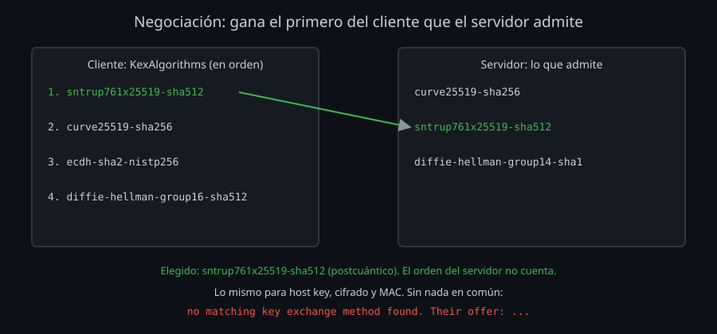

# Algoritmos y postcuántico

En la [semana 11](../../week-11-2fa_fail2ban_y_auditoria/1-teoria/01-auditar-algoritmos.md) quitaste del servidor lo que `ssh-audit` marcaba como débil. Esta semana miras la otra cara: qué pasa cuando cliente y servidor no se ponen de acuerdo, cómo entrar en un equipo viejo sin bajar la guardia en los demás, y por qué el intercambio de llaves ya tiene que ser postcuántico aunque los ordenadores cuánticos todavía no existan.

## Cuatro listas, una regla



Nada más conectar, cada lado manda su mensaje `KEXINIT` con sus listas, en orden de preferencia:

| Lista | Opción | Qué decide |
|---|---|---|
| Intercambio de llaves | `KexAlgorithms` | Cómo se acuerda la clave de la sesión sin enviarla |
| Host key | `HostKeyAlgorithms` | Con qué llave firma el servidor para demostrar quién es |
| Cifrado | `Ciphers` | Cómo se cifran los datos (una vez por sentido) |
| MAC | `MACs` | Cómo se detecta un paquete alterado (los cifrados AEAD, como `chacha20-poly1305` y `aes-gcm`, ya lo incluyen) |

La regla es la misma para las cuatro: **gana el primero de la lista del cliente que también esté en la del servidor**. El orden del servidor solo dice qué admite. Si una lista no tiene nada en común, la conexión acaba ahí.

Una quinta lista va aparte: `PubkeyAcceptedAlgorithms`, las firmas que se aceptan para las llaves de **usuario**. El servidor anuncia las suyas en `server-sig-algs` (lo ves con `ssh -v`) y el cliente salta las llaves que no casan (`Skipping ssh-dss key ... not in PubkeyAcceptedAlgorithms`).

Para cambiar una lista sin escribirla entera, en `ssh_config` y en `sshd_config`:

| Forma | Ejemplo | Efecto |
|---|---|---|
| `lista` | `KexAlgorithms curve25519-sha256` | Sustituye la lista entera |
| `+lista` | `HostKeyAlgorithms +ssh-rsa` | Añade al **final** de la lista por defecto |
| `-lista` | `MACs -*-sha1*` | Quita de la lista por defecto (admite comodines) |
| `^lista` | `KexAlgorithms ^sntrup761x25519-sha512@openssh.com` | Pone al **principio** de la lista por defecto |

Para saber qué hay: `ssh -Q kex` (y `cipher`, `mac`, `key`) dice lo que tu `ssh` **sabe** hacer; `ssh -G HOST` dice lo que **ofrece** a ese host; `sudo sshd -T` lo que ofrece el servidor.

## Cuando no hay nada en común

```
Unable to negotiate with 172.20.0.2 port 2223: no matching key exchange method found. Their offer: diffie-hellman-group14-sha1,ext-info-s,kex-strict-s-v00@openssh.com
```

El mensaje lo dice todo: qué lista falló (`key exchange method`; o `host key type`, `cipher`, `MAC`) y qué admite el otro lado (`Their offer`). `ext-info-s` y `kex-strict-s-v00@openssh.com` no son algoritmos, sino avisos de que el servidor admite extensiones y la defensa contra Terrapin.

Casi siempre es una de dos cosas:

- **Un equipo viejo** (un switch, una cámara, un servidor sin actualizar) que solo habla lo que OpenSSH fue retirando. Tu cliente lo **sabe** hablar (`ssh -Q`), pero no lo **ofrece**.
- **Una configuración demasiado estricta** en uno de los dos lados: una lista escrita a mano que alguien no actualizó.

OpenSSH retira en dos pasos: primero lo quita de la lista por defecto (sigue disponible con `+`), años después lo quita del programa.

| Versión | Año | Cambio |
|---|---|---|
| 7.0 | 2015 | Fuera de la lista: `ssh-dss` (DSA) y `diffie-hellman-group1-sha1` |
| 8.8 | 2021 | Fuera de la lista: `ssh-rsa` (RSA firmando con SHA-1). Las llaves RSA siguen valiendo con `rsa-sha2-256/512` |
| 9.0 | 2022 | `sntrup761x25519-sha512` por defecto: intercambio postcuántico |
| 9.1 | 2022 | `RequiredRSASize`: longitud mínima de las llaves RSA |
| 9.9 | 2024 | `mlkem768x25519-sha256` disponible |
| 10.0 | 2025 | `mlkem768x25519-sha256` por defecto; **DSA eliminado** del programa; `sshd` deja de ofrecer los `diffie-hellman-group*` por defecto |
| 10.1 | 2025 | El cliente avisa si el intercambio no es postcuántico (`WarnWeakCrypto`) |
| 10.6 | 2026 | `sshd` también lo registra; firma híbrida postcuántica `ssh-mldsa44-ed25519` activada |

El orden para arreglarlo:

1. **Actualiza el equipo.** Es el único arreglo de verdad.
2. Si no se puede, **un alias para él** con `+`: `Host switch1` y `KexAlgorithms +diffie-hellman-group14-sha1`. Solo ese host acepta lo viejo, y con `+` lo moderno sigue delante: si el equipo se actualiza, el alias negocia lo mejor sin tocar nada. Tu kit lo hace para todos los `legado-*` (`conf.d/90-legado.conf`).
3. **Nunca en `Host *`**. Con `+` no cambiaría lo que negocias con servidores modernos, pero cualquier servidor que solo ofrezca SHA-1 entraría sin aviso, y nadie se acordaría de quitar la línea cuando desaparezca el último equipo viejo.

Una trampa más, del lado del servidor: un nombre que **tu versión** no conoce rompe la configuración. Con OpenSSH 9.6, `KexAlgorithms mlkem768x25519-sha256,...` o `+mlkem768x25519-sha256` hacen fallar `sshd -t` (`Bad SSH2 KexAlgorithms`), y un `kill -HUP` sin validar deja el `sshd` sin escuchar. Quitar con `-` algo que no existe no molesta: por eso `15-algoritmos.conf` del kit **quita** en lugar de listar.

## Postcuántico: guardar hoy, descifrar mañana

Un ordenador cuántico suficientemente grande rompería RSA, ECDSA, Ed25519 y los intercambios Diffie-Hellman y X25519: todos se apoyan en problemas (factorizar, el logaritmo discreto) que el algoritmo de Shor resuelve. Ese ordenador no existe hoy. El problema es que no hace falta que exista **hoy**:

- **Guardar ahora, descifrar después** (*store now, decrypt later*): alguien graba hoy tu sesión cifrada (una copia de seguridad, una sesión con contraseñas de bases de datos) y la descifra cuando tenga el ordenador. Lo que viaja hoy con un intercambio clásico tiene fecha de caducidad.
- Contra eso protege el **intercambio de llaves** postcuántico: la clave de la sesión se acuerda de una forma que un ordenador cuántico no puede deshacer después.

Los dos de OpenSSH son **híbridos**: combinan un algoritmo postcuántico con X25519, y la clave de la sesión sale de los dos. Para descifrar hay que romper **ambos**. Si mañana se descubre un fallo en el algoritmo nuevo (son jóvenes), la sesión sigue tan protegida como con X25519 sola.

| Algoritmo | Desde | Parte postcuántica |
|---|---|---|
| `sntrup761x25519-sha512@openssh.com` | 9.0 (por defecto) | Streamlined NTRU Prime |
| `mlkem768x25519-sha256` | 9.9 (por defecto desde 10.0) | ML-KEM-768, el estándar del NIST (FIPS 203) |

Cuesta poco: en el laboratorio, unos 50 ms y 2 KB más por conexión, una vez, al conectar ([lab 04](../2-practicas/lab-04-postcuantico/README.md)). Con multiplexing, una vez por master.

**¿Y las host keys y las llaves de usuario?** Siguen siendo Ed25519 o RSA. Es menos urgente, porque una firma se comprueba **en el momento**: romperla dentro de diez años no le sirve a nadie para entrar en una sesión de hoy. Hará falta cambiarlas antes de que exista el ordenador, no antes de que alguien pueda grabar. OpenSSH ya tiene una firma híbrida (`ssh-mldsa44-ed25519`, experimental en 10.4 y activada en 10.6); cuando tus servidores y clientes la tengan, cambiarla será una migración como la del [lab 07](../2-practicas/lab-07-rotar-host-keys/README.md).

Qué hacer hoy:

1. Comprueba que tus conexiones son postcuánticas: `ssh -v HOST true 2>&1 | grep 'kex: algorithm'`, o `bin/doctor HOST` del kit.
2. Si no lo son, el problema suele estar en el servidor: una versión anterior a 9.0, o un `KexAlgorithms` que quita los híbridos. Actualiza, o revisa la configuración.
3. No silencies el aviso de OpenSSH 10.1+ para todos (`WarnWeakCrypto`): si un host concreto no se puede actualizar, apágalo solo para él y déjalo escrito.

## Resumen

- Cuatro listas negociadas (intercambio, host key, cifrado, MAC): gana el primero del cliente que admita el servidor. `+` añade, `-` quita, `^` pone delante.
- `no matching ... Their offer` dice qué lista falla y qué acepta el otro lado. Arreglo: actualizar; si no, un alias con `+`; nunca `Host *`.
- Un nombre que tu versión no conoce rompe `sshd`: valida con `sshd -t` y prefiere `-`.
- El intercambio de llaves postcuántico (híbrido) protege lo que grabas hoy de lo que se descifre mañana. OpenSSH lo usa por defecto desde 9.0: compruébalo.

<!-- nav -->
---

## 🔗 Navegación

| Anterior | Siguiente |
|---|---|
| ← [Teoría — Diagnóstico por capas](01-diagnostico-por-capas.md) | [Teoría — Rendimiento y migraciones](03-rendimiento-y-migraciones.md) → |

[↑ Semana 13](../README.md)
