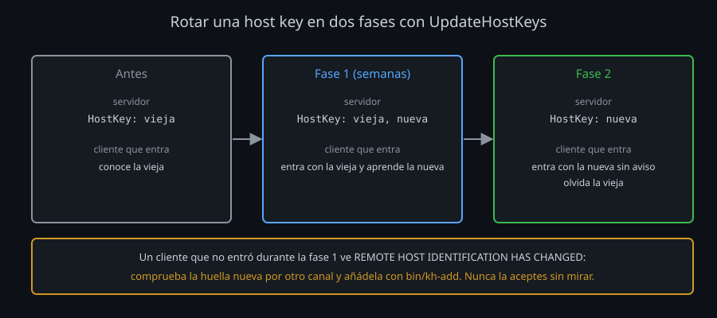

# Rendimiento y migraciones

Dos tareas de operación que llegan tarde o temprano: "SSH va lento" y "hay que cambiar esto en todos los servidores sin que nadie se quede fuera". Las dos se resuelven igual: medir antes de tocar, y cambiar en un orden que no rompa a nadie.

## Dónde se va el tiempo

Una conexión SSH tarda por tres razones distintas, y cada una tiene su arreglo:

| Lo que cuesta | Cuándo pesa | Cómo se nota | Arreglo |
|---|---|---|---|
| **Idas y vueltas** (*RTT*) | Servidor lejos (latencia alta) | Abrir conexión es lento; una vez dentro, va bien | Multiplexing: un master, y las demás conexiones dentro |
| **CPU** | Mucho volumen, o equipos pequeños | Copiar gigas va más lento que la red | Un cifrado rápido para esa CPU |
| **Ancho de banda** | Enlace lento, datos que se comprimen | Copiar texto o logs es lento | Compresión (`-C`), solo ahí |

**Idas y vueltas.** Antes de ejecutar nada, cliente y servidor se esperan uno a otro unas once veces: TCP, versiones, `KEXINIT`, el intercambio, `NEWKEYS`, pedir el servicio, probar la llave, firmar, abrir el canal, el comando y el cierre. Con 50 ms de latencia, eso es más de medio segundo por conexión, se use el cifrado que se use ([lab 05](../2-practicas/lab-05-medir-el-rendimiento/README.md)). El multiplexing ([semana 05](../../week-05-configuracion_avanzada_cliente_ssh/README.md)) deja solo las del canal: en el laboratorio, diez conexiones pasan de 7,8 s a 1,1 s.

**CPU.** Con AES en la CPU (AES-NI en Intel y AMD, también en los ARM modernos), `aes128-gcm` mueve unas tres veces más datos por segundo que `chacha20-poly1305`. Sin esas instrucciones (un router, una placa pequeña), ChaCha20 gana: por eso OpenSSH lo pone primero, porque va bien en todas partes. Solo cambia el orden si mueves mucho volumen y lo has medido: `Ciphers ^aes128-gcm@openssh.com` en el alias de las copias.

**Ancho de banda.** `-C` comprime con zlib antes de cifrar. En un enlace lento, un archivo de texto llega varias veces antes; uno ya comprimido (`.gz`, vídeo, fotos), igual que sin `-C`. En una red rápida, comprimir **retrasa**: cuesta más CPU de lo que ahorra. Por eso `Compression` es `no` por defecto.

Otras lentitudes con su firma propia:

| Síntoma | Causa probable | Comprueba |
|---|---|---|
| Unos segundos de espera antes de pedir la llave | El servidor busca tu IP en un DNS que no responde (`UseDNS yes`) | `sshd -T \| grep usedns`; por defecto es `no` |
| Espera tras `Authentications that can continue: ...gssapi...` | El cliente prueba Kerberos (`GSSAPIAuthentication yes`) sin servidor Kerberos | `ssh -v`: dónde se para |
| Cada conexión tarda lo mismo aunque haya master | El master no se está usando (otro `ControlPath`, o `ControlMaster no`) | `ssh -O check HOST` |
| La sesión se congela a ratos | Red con pérdidas, o un cortafuegos que corta conexiones inactivas | `ServerAliveInterval` (semana 08) |

La regla: **mide antes de cambiar** (`time`, `ssh -v`, `ping`). Un cambio de cifrado no arregla una latencia, y un master no arregla un enlace lento.

## Migrar sin dejar a nadie fuera

Cambiar algo de lo que dependen otros (algoritmos, llaves, host keys) se hace siempre en el mismo orden:

1. **Inventario**: qué hay y de quién es.
2. **Añadir** lo nuevo **sin quitar** lo viejo.
3. **Esperar y comprobar** que todos usan lo nuevo (el log lo dice).
4. **Quitar** lo viejo.
5. **Exigir**, para que lo viejo no vuelva.

El error clásico es empezar por el paso 5: el servidor exige y alguien se queda fuera sin entender por qué, porque el cliente solo ve `Permission denied`.

### Migrar llaves de usuario

Se migran a Ed25519 (o a una llave `-sk`, [semana 04](../../week-04-ssh_agent_y_llaves_fido2/README.md)):

| Llave | Por qué | Prisa |
|---|---|---|
| DSA | OpenSSH 10.0 la eliminó; desde 7.0 el cliente ni la ofrece | Ninguna: ya no funciona. Borra la línea |
| RSA < 3072 bits | 2048 bits son unos 112 bits de seguridad, menos que el resto | Alta: funciona, y nadie se queja |
| ECDSA | Curvas NIST: el kit las quita de las host keys (semana 11) | Baja: no está rota |
| RSA ≥ 3072, Ed25519, `-sk` | Bien | — |

1. Inventario: `ssh-keygen -lf .ssh/authorized_keys` en cada cuenta (bits, huella, comentario, tipo); tu kit lo filtra con `bin/key-audit`.
2. Cada persona crea su llave nueva, en su equipo, y te da la pública. Añádela sin quitar la vieja; que pruebe con una conexión nueva.
3. En el log, la huella con la que entra cada uno (`Accepted publickey ... SHA256:...`, [semana 11](../../week-11-2fa_fail2ban_y_auditoria/2-practicas/lab-07-leer-el-log/README.md)). Cuando nadie use la vieja, quítala **por su contenido** (el segundo campo del `.pub`), no por el comentario.
4. Exige: `RequiredRSASize 3072` (OpenSSH 9.1+). Una RSA más corta recibe `Permission denied`, y el servidor registra `refusing RSA key: Invalid key length`.

### Rotar las host keys

Una host key se cambia si el servidor se reinstaló o se clonó de una imagen (todas las copias comparten llave), si la llave pudo copiarse, o para retirar un tipo (RSA, ECDSA). El problema: cada cliente tiene la vieja en `known_hosts`, y para él una llave distinta es un posible impostor.

`UpdateHostKeys` lo resuelve. Cuando un cliente entra con una host key que ya conoce, el servidor le manda **todas** las suyas (`hostkeys-00@openssh.com`) y demuestra que tiene la privada de cada una. El cliente añade las nuevas a `known_hosts` y quita las que el servidor ya no tiene. Está activo por defecto mientras no cambies `UserKnownHostsFile`; tu kit lo deja escrito en `config`.

Con eso, la rotación va en dos fases:

1. **Fase 1**: en el servidor, la nueva **junto a** la vieja (dos líneas `HostKey`, la vieja primero: la primera de cada tipo es la que firma). Los clientes que entran aprenden la nueva sin ver nada. Dura semanas.
2. **Fase 2**: solo la nueva. Los clientes que ya la aprendieron entran sin aviso y olvidan la vieja.

Lo que `UpdateHostKeys` no cubre:

- Un cliente que no entró en la fase 1 verá el aviso de llave cambiada. Es correcto: comprueba la huella nueva por otro canal y añádela (`bin/kh-add`).
- Los `known_hosts` que no son de una persona: el secreto `KIT_KNOWN_HOSTS` del CI ([semana 12](../../week-12-automatizacion_scripting_ci_cd_y_ansible/README.md)), los de otros equipos. Actualízalos en la fase 1.
- Con certificados de host ([semana 10](../../week-10-certificados_ssh_ca_principals_krl_y_rotacion/README.md)), el cliente confía en la CA: firmas la llave nueva y nadie ve nada, haya entrado o no. Es la forma de rotar a escala.

### Migrar algoritmos

Mismo orden, en los servidores: `ssh-audit` como inventario ([semana 11](../../week-11-2fa_fail2ban_y_auditoria/README.md)); el `LogLevel DEBUG1` de una cuenta para ver qué negocian los clientes reales; quitar con `-` lo que ningún cliente usa; actualizar la política de `bin/audit`. Para el postcuántico no hay que añadir nada: viene por defecto. Lo que hay que hacer es **no quitarlo** y actualizar los servidores que no lo tienen ([teoría 02](02-algoritmos-y-postcuantico.md)).

## Resumen

- Tres costes: idas y vueltas (multiplexing), CPU (cifrado según la CPU) y ancho de banda (compresión, solo en enlaces lentos). Mide antes de tocar.
- Migrar: inventario, añadir, comprobar, quitar, exigir. Nunca exigir primero.
- Llaves de usuario: DSA fuera, RSA corta a Ed25519, después `RequiredRSASize 3072`.
- Host keys: dos fases con `UpdateHostKeys`; el cliente que no entró a tiempo comprueba la huella; a escala, certificados de host.

<!-- nav -->
---

## 🔗 Navegación

| Anterior | Siguiente |
|---|---|
| ← [Teoría — Algoritmos y postcuántico](02-algoritmos-y-postcuantico.md) | [Índice de labs](../2-practicas/README.md) → |

[↑ Semana 13](../README.md)
