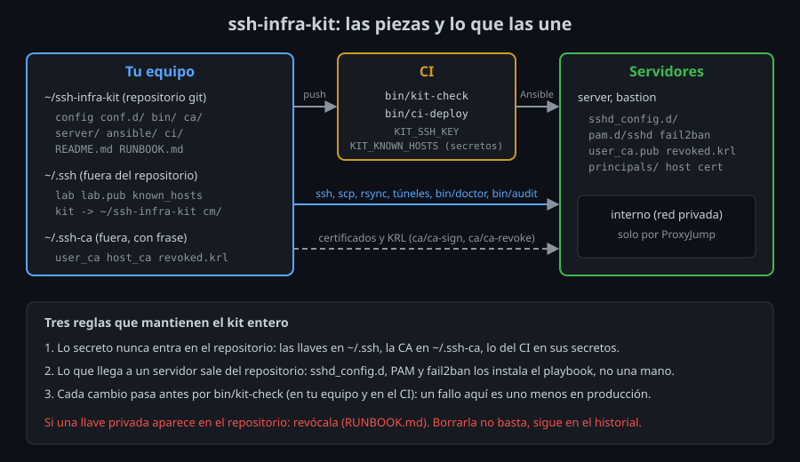

# El kit como sistema

## Trece piezas, un sistema

Durante trece semanas añadiste piezas a `ssh-infra-kit`, y cada una se probó sola: `bin/kh-add` en la semana 02, la CA en la 10, `bin/doctor` en la 13. Esta semana toca usarlas **juntas**, como lo hará quien herede tu kit: un equipo nuevo, un servidor nuevo, una persona que entra, una llave que se pierde.

Juntas fallan de formas que ninguna prueba aislada encuentra. En los labs de esta semana aparecen dos casos reales:

- `bin/kh-add` (semana 02) se niega a añadir la host key de un servidor porque `known_hosts` ya tiene "otra llave" para él. Esa otra llave es la línea `@cert-authority` de la CA de hosts, que llegó en la semana 10. `kh-add` se escribió antes de que existiera.
- `bin/doctor` (semana 13) deja vacío el campo `host key:` cuando el servidor presenta un **certificado** de host. `ssh -v` escribe entonces `Server host certificate:`, no `Server host key:`, y `doctor` solo busca la segunda.

Ninguno es un error de la semana en que se escribió el script. Son errores **de integración**: dos piezas correctas que no se conocían. Se encuentran usando el sistema entero, de punta a punta, y se evitan que vuelvan con una comprobación automática que mira el kit entero: `bin/kit-check`, el incremento del proyecto.

## El mapa



El kit vive en tres sitios, y cada uno guarda cosas distintas:

| Sitio | Qué guarda | Qué **no** guarda nunca |
|---|---|---|
| El repositorio (`~/ssh-infra-kit`) | Configuración de cliente y servidor, scripts, playbook, documentación | Llaves privadas, la CA, contraseñas |
| Tu `~/.ssh` y tu `~/.ssh-ca` | Tus llaves, `known_hosts`, la CA con su frase | Nada que tenga que llegar a un servidor |
| Los secretos del CI | La llave de despliegue y las host keys comprobadas | Nada más: el CI lee el resto del repositorio |

**Qué:** el repositorio es público para tu equipo, lo secreto vive fuera. **Para qué:** que puedas compartir, revisar y copiar el kit sin repartir acceso. **Impacto:** si una llave privada entra en el repositorio, queda en el historial de git y en cada copia; borrarla no la protege. Hay que revocarla (RUNBOOK, "Perdí una llave o un equipo").

## Las dependencias entre piezas

El orden de las semanas no fue casual: cada pieza da algo por hecho de las anteriores. Conviene saber cuáles, porque es por donde se rompe:

| Pieza | Da por hecho | Si falta |
|---|---|---|
| `config` y `conf.d/` | `~/.ssh/kit` apunta al kit (`bin/kit-link`) | El `Include` no encuentra nada, **sin avisar**, y los alias no resuelven |
| `StrictHostKeyChecking yes` | Cada host key entró con `bin/kh-add` | `No ED25519 host key is known` |
| `IdentitiesOnly yes`, `MaxAuthTries 3` | Cada alias nombra su `IdentityFile` | `Too many authentication failures` si se acumulan llaves |
| `bin/doctor`, el CI, Ansible | `BatchMode`: nadie escribe la frase | `Permission denied` con una llave con frase que no está en el agente |
| `10-acceso.conf` (`AllowGroups`) | La cuenta está en `ssh-users` (el playbook) | `not allowed because none of user's groups are listed` |
| `50-ca.conf` | `user_ca.pub`, `revoked.krl` y el certificado de host en `/etc/ssh` | Sin KRL, `sshd` rechaza todas las llaves; sin certificado, un aviso en cada recarga |
| El playbook | `sudo` sin contraseña y `python3` en el servidor | El primer `TASK` falla |

La tabla se lee en las dos direcciones. Si cambias una pieza de la izquierda, mira qué das por hecho a la derecha. Y cuando algo falla con el error de la derecha, ya sabes qué pieza mirar.

## Probar el sistema: de punta a punta

Una prueba de punta a punta hace lo que hará una persona real, desde cero, con el kit y nada más. En esta semana son cinco recorridos, uno por lab:

1. **Un equipo nuevo** (lab 01): copiar el kit, `bin/kit-link`, una llave, las host keys comprobadas, entrar. Aquí aparece la primera trampa: `ssh-copy-id` con la configuración del kit deja abierto un **master autenticado con contraseña**, y las conexiones siguientes entran por él sin probar la llave.
2. **Un servidor nuevo** (lab 02): la host key, el alias, la llave del administrador y el playbook. La segunda ejecución del playbook no cambia nada (`changed=0`): es la prueba de que el servidor quedó como dice el repositorio.
3. **Una persona nueva** (lab 03): CA, certificado de host, certificado de usuario, `principals/`. Ana entra sin `authorized_keys`.
4. **Una llave perdida** (lab 04): revocar, ver que el master abierto **sigue entrando** y cortarlo.
5. **Un servidor reconstruido** (lab 06): la host key cambió, y el RUNBOOK lo arregla paso a paso. O no lo arregla, porque `kh-add` falla: es el segundo error de integración.

**Qué:** cada recorrido empieza de cero (contenedores recreados) y usa solo el kit. **Para qué:** encontrar lo que una prueba aislada no ve: el orden, las piezas que no se conocen, lo que das por hecho. **Impacto:** cuesta tiempo, pero es el tiempo que perdería otra persona el día que lo necesite con prisa.

## Comprobar el kit sin conectar: `bin/kit-check`

Los recorridos necesitan servidores. Muchos fallos no: un script que perdió el permiso de ejecución, una opción mal escrita en `conf.d/`, un `sshd_config.d` que `sshd -t` rechaza, una llave privada copiada por error. `bin/kit-check` los busca en segundos, sin red, y cabe en el CI antes del despliegue:

```
ok      secretos
ok      permisos
fallo   documentado  bin/nuevo no aparece en README.md
ok      pendientes
ok      config
ok      sshd
ok      shellcheck
```

| Comprobación | Qué mira | Por qué importa |
|---|---|---|
| `secretos` | Cabeceras `PRIVATE KEY` y `PuTTY-User-Key-File` en cualquier archivo | Una llave en git no se borra nunca de verdad |
| `permisos` | `bin/*` y `ca/*` ejecutables | Un `git clone` en otro sistema, o un `cp` sin `-a`, los pierde |
| `documentado` | Cada script aparece en el README | Lo que no está documentado no lo usa nadie más que tú |
| `pendientes` | Ningún `TODO` | Un `TODO` es una decisión aplazada que alguien hereda sin saberlo |
| `config` | `ssh -G` de cada alias de `conf.d/` | Una opción desconocida rompe **todos** los alias, no solo el suyo |
| `sshd` | `sshd -t` de `server/sshd_config.d/` | Lo mismo que hace el playbook, antes del commit |
| `shellcheck` | Los scripts de `bin/` y `ca/` | Comillas, variables sin definir, `cd` sin comprobar |

`kit-check` no sustituye a los recorridos: no sabe si el `AllowGroups` deja entrar a quien debe. Los complementa. Lo barato se comprueba en cada cambio y lo caro, cuando cambia algo grande.

## Lo que te llevas

- Un kit es un sistema: sus fallos más caros están **entre** las piezas.
- El repositorio guarda la configuración; lo secreto vive fuera, siempre.
- Prueba de punta a punta desde cero, como lo hará otra persona.
- Lo que se pueda comprobar sin red, compruébalo en cada cambio (`bin/kit-check`).

<!-- nav -->
---

## 🔗 Navegación

| Anterior | Siguiente |
|---|---|
| ← [Semana 14 — Proyecto integrador `ssh-infra-kit`](../README.md) | [Teoría — Documentar para operar](02-documentar-para-operar.md) → |

[↑ Semana 14](../README.md)
