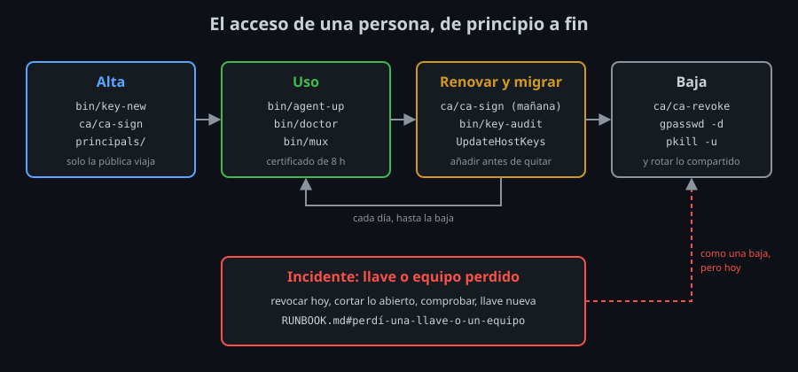

# Documentar para operar

## Para quién escribes

La documentación de un kit de acceso tiene tres lectores, y cada uno llega con una pregunta distinta:

| Lector | Llega con | Necesita | Dónde |
|---|---|---|---|
| Quien lo instala por primera vez | "¿Por dónde empiezo?" | Requisitos y pasos en orden, con lo que debe salir | README: "Instalar el kit en un equipo" |
| Quien tiene un problema **ahora** | "No entro / se perdió una llave" | Pasos cortos, sin teoría, y cómo saber que acabó | `RUNBOOK.md` |
| Quien revisa o hereda el kit | "¿Por qué está así? ¿Qué cubre?" | Las decisiones y sus razones, lo que protege y lo que no | Comentarios Qué / Para qué / Impacto; README: "Qué protege el kit y qué no" |

Mezclarlos es el error más común. Un runbook con párrafos de teoría no se lee con prisa, y un README que solo da pasos no explica nada a quien lo revisa. Por eso el kit separa los tres: el README es el **punto de entrada** y enlaza a los otros dos en sus primeras líneas.

## El README como punto de entrada

Las primeras líneas del README tienen que contestar, sin desplazarse por la página: qué es esto, por dónde empiezo, qué hago si algo falla. Después vienen la referencia (la tabla de `Contenido`, una fila por archivo) y la historia (la `Bitácora`).

**Qué:** cuatro enlaces al principio (instalar, RUNBOOK, qué protege, `kit-check`). **Para qué:** quien abre el repositorio con un problema no tiene que leer 300 líneas para encontrar el runbook. **Impacto:** cada sección nueva del README tiene que caber en uno de esos cuatro caminos, o sobra.

La tabla de `Contenido` tiene una regla que `bin/kit-check` comprueba: **cada script aparece**. Un script sin documentar es un script que solo sabe usar quien lo escribió.

## El runbook: síntoma, pasos, comprobación

Un runbook es un procedimiento para un incidente concreto, escrito para seguirlo con prisa. Cada uno tiene la misma forma:

```markdown
## La host key cambió

**Síntoma:** `REMOTE HOST IDENTIFICATION HAS CHANGED` ...

1. No borres la línea a ciegas. ...
2. Consigue la huella nueva por otro camino: ...
3. ...

**Comprobación:** `bin/doctor HOST` sale con 0 y su `host key:` es la huella del paso 2.
```

- **Síntoma**: lo que ve la persona, con el texto exacto del error. Así encuentra el procedimiento buscando el mensaje que tiene en la pantalla.
- **Pasos**: numerados, en el orden en que se hacen, cada uno con su comando. Los porqués van en el README; aquí, como mucho, media frase.
- **Comprobación**: cómo sabes que terminaste. Sin ella, un incidente se cierra cuando la persona se cansa, no cuando está resuelto.

Los siete procedimientos del kit cubren el ciclo de vida de un acceso y sus incidentes:



| Procedimiento | Lo dispara | El comando que lo resuelve |
|---|---|---|
| No puedo entrar | Cualquier fallo de conexión | `bin/doctor` |
| La host key cambió | `REMOTE HOST IDENTIFICATION HAS CHANGED` | `bin/kh-add`, tras comprobar la huella |
| Perdí una llave o un equipo | Un robo, una copia indebida, `kit-check` con `fallo secretos` | `ca/ca-revoke` |
| Alta de una persona | Alguien nuevo | `ca/ca-sign` (o `bin/ak-line`) |
| Baja de una persona | Alguien se va | `ca/ca-revoke` y sacarla de los grupos |
| Un servidor nuevo | Una máquina más que gestionar | `bin/kh-add`, `conf.d/`, el playbook |
| La CA queda expuesta | Su llave privada salió de `~/.ssh-ca` | `ca/ca-init` de una CA nueva |

### La prueba del extraño

Un runbook está bien escrito cuando lo puede seguir alguien que no lo escribió, sin preguntarte nada. La única forma de saberlo es probarlo: otra persona (o tú, dentro de un mes) lo sigue **al pie de la letra** en un laboratorio recién creado. Cada vez que tiene que adivinar algo, falta un paso o un comando.

En el lab 06 lo haces con "La host key cambió": recreas `server` y sigues el procedimiento. Descubres que el paso de `bin/kh-add` falla con el kit tal como está. Eso no es un fallo del runbook: es un fallo del kit que solo el runbook probado podía encontrar.

## Qué protege y qué no: el modelo de amenazas

Un modelo de amenazas responde a dos preguntas: **contra qué** te protege el kit, y contra qué **no**. La segunda es la importante: es la que evita una falsa sensación de seguridad.

Se escribe como una tabla: amenaza, lo que la para, dónde está en el kit. La del README del kit tiene nueve filas: contraseñas probadas a fuerza, un servidor falso, una llave robada, root de un salto usando tu agente, algoritmos débiles... Cada fila nombra un archivo o un script: si no puedes señalar dónde está el control, no está.

Y después, la lista de lo que **no** cubre, con lo que haces al respecto:

- **Tu propio equipo comprometido.** Quien controla tu sesión usa tu agente y tus masters como tú. Las llaves `-sk` y la caducidad del agente acotan el daño; no lo evitan.
- **La llave de la CA robada.** Firma certificados para cualquier cuenta: es el procedimiento más grave del runbook.
- **Lo que pasa dentro del servidor.** El kit controla quién entra y cómo, no lo que hace una vez dentro.

**Qué:** escribir lo que no se cubre. **Para qué:** que quien revisa el kit sepa dónde poner el siguiente control, y que nadie crea que el kit hace lo que no hace. **Impacto:** en la defensa (teoría 03) te van a preguntar justo por esa lista.

En el lab 05 compruebas la tabla atacando tu propio servidor: cada fila de "protege contra" es una prueba que debe fallar para el atacante, con la línea del log que lo demuestra.

## Las decisiones: Qué / Para qué / Impacto

Durante el bootcamp cada opción del kit lleva un comentario con tres partes:

```
# Qué: ssh nunca acepta por su cuenta una host key desconocida o cambiada.
# Para qué: que las llaves entren en known_hosts solo verificadas, con
#   bin/kh-add, y no con un "yes" escrito de memoria.
# Impacto: el primer ssh a un host nuevo falla con "No ED25519 host key
#   is known" hasta que lo añades; un cambio de llave corta siempre.
StrictHostKeyChecking yes
```

Es un **registro de decisiones** al lado de la decisión. El **Impacto** es la parte que más se olvida y la que más se agradece: dice qué se rompe, qué cuesta, qué tendrás que hacer distinto. Quien quiera cambiar la opción sabe qué pierde.

Una regla para mantenerlos útiles: **se explica una vez y se enlaza**. Si `ControlMaster` está explicado en `config`, el README dice "multiplexing (`config`)" y no lo repite. Dos explicaciones de lo mismo acaban diciendo cosas distintas.

## Mantener la documentación viva

La documentación se queda vieja en cuanto cambia el kit. Tres hábitos lo evitan:

1. **El mismo commit.** Un cambio en el kit y su documentación (README, runbook, comentario) van juntos. `bin/kit-check` obliga a una parte: un script nuevo sin su fila en el README no pasa.
2. **La bitácora.** Una fila por cambio importante, con la fecha o la semana. Dice cuándo entró algo y ayuda a saber qué versión del kit tiene cada uno.
3. **Probar los runbooks.** Cada pocos meses, o después de un cambio grande, un procedimiento al azar en un laboratorio limpio.

## Lo que te llevas

- Tres lectores, tres documentos: README (entrada), RUNBOOK (incidentes), comentarios (decisiones).
- Cada procedimiento: síntoma, pasos, comprobación.
- Un runbook no está terminado hasta que lo sigue otra persona.
- El modelo de amenazas dice también lo que **no** cubres.

<!-- nav -->
---

## 🔗 Navegación

| Anterior | Siguiente |
|---|---|
| ← [Teoría — El kit como sistema](01-el-kit-como-sistema.md) | [Teoría — La defensa](03-la-defensa.md) → |

[↑ Semana 14](../README.md)
